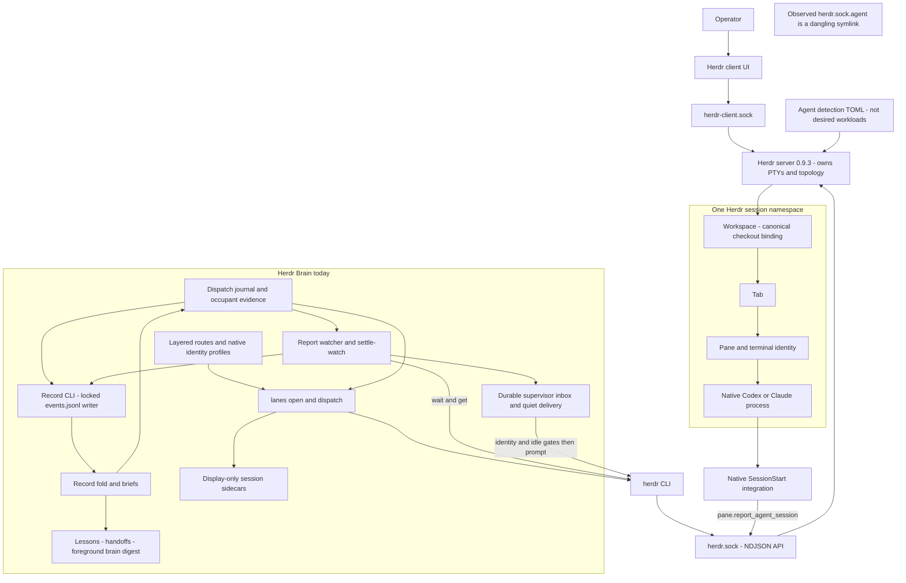
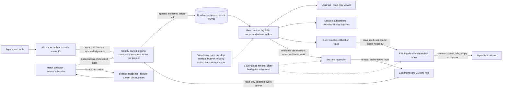
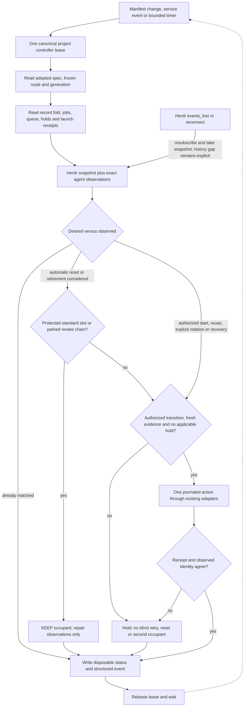

# A standard session platform for Herdr Brain

Research run **R-421**, item **RES-3**, 2026-10-15. Proposal only, based on lane source at `2c488614b16bb9a28f22530853208f274952c26c` and the installed Herdr **0.9.3**. The operator's corrections take precedence over the older run acceptance text: structured logging is a **service**, the logs tab is a **viewer**, and worker sessions survive review and correction rounds. No wallet architecture comparison is included.

**Recommendation [P]:** use a small, model-free session controller above existing route, dispatch, watch and retirement code. A Markdown manifest describes desired work and context; the record, handoffs and memory retain durable knowledge. Preserve the same live worker from initial dispatch through review and corrections. Reconstruct a session only after a confirmed failure or an explicit fresh-cycle decision. Adopt three protected tab slots—chat, supervisor and logs—per enrolled workspace. Keep logging independent of every tab and every model session.

The closest Kubernetes analogy is **a controller-owned pod retained until its work item's review chain ends**, with a Job-like completion condition outside the process. A reported result or an idle prompt is not workload completion. Kubernetes itself is not a proposed dependency or deployment requirement.

Evidence notation applies to each tagged paragraph or table row: **[M]** observed with read-only commands/files during this run; **[D]** documented in inspected local or upstream source, not exercised here; **[I]** inference with its limits stated; **[P]** proposed behavior, not implemented. All of sections 3–4 and proposed diagrams are [P] except explicitly tagged observations. Local source links are relative to this checkout. Upstream code links pin v0.9.3's commit, `7b116c05bfda646af39d2524c54e70c751f57ee8`; a matching version string does not prove a reproducible match between that source and the installed binary.

## 1. How Herdr works today, measured

### Processes, endpoints and access

| Finding | Evidence and meaning |
| --- | --- |
| [M] Installed CLI and active server agree | `command -v herdr` → `/Users/rewt/.local/bin/herdr`; `herdr --version` → `herdr 0.9.3`; `herdr status` → client/server `0.9.3`, channel `stable`, protocol/private protocol `22`, endpoint generation `1`, compatible `yes`, `restart_needed: no`, `server_binary_stale: no`. |
| [M+D] Server owns terminals; client is a UI | Server log records separate API and client-protocol listeners. The [concepts documentation](https://herdr.dev/docs/concepts/) describes server-owned PTYs and UI attachment. A client exit is different from terminating the server or a pane. |
| [M] Default API socket | `lstat` of `~/.config/herdr/herdr.sock` → Unix socket, mode `0600`; config directory mode `0755`. A newline-terminated `ping` request succeeded. |
| [M+D] UI transport is separate | `~/.config/herdr/herdr-client.sock` → Unix socket, mode `0600`. The [socket path implementation](https://github.com/herdrdev/herdr/blob/7b116c05bfda646af39d2524c54e70c751f57ee8/src/server/socket_paths.rs) derives this client endpoint; it is not the public NDJSON API. |
| [M] The supposed `.agent` socket is not active here | `lstat ~/.config/herdr/herdr.sock.agent` → **symlink**, target `/Users/rewt/.config/herdr/herdr.sock.unavailable`; the target does not exist. No connection was attempted. Its origin and former purpose are unverified. Treating it as today's notification service would be wrong. |
| [M+D] Named namespaces have separate endpoints | `herdr session list --json` showed `default` running at the default directory and `work` not running at `~/.config/herdr/sessions/work`. A stale socket path in a stopped namespace is not proof of a live server. [Socket API documentation](https://herdr.dev/docs/socket-api/). |
| [M+D] Access is controlled at the OS boundary, not by API roles | The measured socket mode is owner-only. Inspected [API connection handling](https://github.com/herdrdev/herdr/blob/7b116c05bfda646af39d2524c54e70c751f57ee8/src/api/server.rs) has no application login, per-method principal or read-only/control credential split. “No authentication or authorization at all” overstates this: filesystem ownership and native sandbox policy still matter. This was source inspection, not a security audit. |
| [M+D] Capabilities describe compatibility | `ping` returned `live_handoff`, `detached_server_daemon`, `surface_interest`, `health_check`, `ssh_agent_registration`, plus endpoint generation `1`. These are not permission grants. The inspected request handler does not use them to confer authority. |

[M] Selected `ping` exchange, one request on one socket connection:

```json
{"id":"r421:ping","method":"ping","params":{}}
```

```text
type=pong version=0.9.3 protocol=22
capabilities: live_handoff=true detached_server_daemon=true
endpoint_protocol_generation=1 surface_interest=true
health_check=true ssh_agent_registration=true
```

[D] The API accepts newline-delimited JSON. The inspected normal connection handler reads one request; streaming waits/subscriptions are special cases. Clients should use a fresh connection for independent ordinary requests. [API server source](https://github.com/herdrdev/herdr/blob/7b116c05bfda646af39d2524c54e70c751f57ee8/src/api/server.rs). [M] Attempting a second ordinary request on the ping connection produced `BrokenPipeError: [Errno 32] Broken pipe`; a new connection to read manifests succeeded. This was a transport error, not an access refusal.

### CLI, configuration and installed integrations

[M] Inspected `herdr --help`, `herdr agent`, `herdr pane`, `herdr session`, `herdr api`, and the JSON API schema. The installed CLI exposes agent start/get/list/prompt/wait/rename, pane read/send-text/send-keys/run/clear and integration-report methods, plus tab/workspace/session operations. There is **no `pane send` command** in the inspected help; use the exact operation name when discussing delivery. `agent.start` has required `name`, `kind`, `pane_id`, and optional `args` and readiness timeout. It does not take a workload manifest, personality, context sources, or desired replica count.

[M] `~/.config/herdr/config.toml` has `agent`, `keys`, `onboarding`, `theme`, `ui` sections, with no explicit `session` or `server` override. Persona detection is enabled, checks `AI_PERSONA` then `HERMES_PROFILE`, and maps values to UI persona labels. That observation demonstrates detection configuration, not what instructions any current agent received. `plugins.json` lists enabled `herdr-file-viewer` 1.17.0, `herdr.markdown-viewer` 0.1.0 and `persiyanov.reviewr` 0.36.2; the latter hooks worktree creation/opening. No Brain plugin entry was present.

[M] `herdr integration status` reports Claude integration v10/current at `~/.claude-personal/hooks/herdr-agent-state.sh`, and Codex v8/current at `~/.codex/herdr-agent-state.sh`. Their file hashes match the v0.9.3 upstream assets. Native settings contain the corresponding SessionStart hooks; this is Herdr's native session reporting, separate from a Brain-installed wrapper.

[M+D] `server.agent_manifests` returned an `agent_manifest_status` result with 22 detection entries. Both Codex and Claude selected remote version `2026.10.11.1`, with no local override shadowing it, from `~/.local/state/herdr/agent-detection/remote/*.toml`. These manifests describe **agent detection/presentation/integration behavior**, not desired workspaces or sessions. Updates can change detection independently of the binary. Extend Brain's route and dispatch layer for desired workloads; use native `agent.start` and the detection infrastructure underneath. Do not repurpose or overwrite these upstream manifests. [Agents documentation](https://herdr.dev/docs/agents/), [agent API source](https://github.com/herdrdev/herdr/blob/7b116c05bfda646af39d2524c54e70c751f57ee8/src/app/api/agents.rs).

### Workspace, tab, pane and four different identities

[D] A Herdr *session* is a server namespace containing workspaces; a workspace contains tabs, and tabs contain panes. A pane hosts a terminal/process. A native Codex/Claude conversation ID is another kind of session identity. An agent name is a discoverable handle, not durable proof that the same process or conversation occupies the pane. [Concepts](https://herdr.dev/docs/concepts/), [terminal identity implementation](https://github.com/herdrdev/herdr/blob/7b116c05bfda646af39d2524c54e70c751f57ee8/src/terminal/state.rs).

| [M] R-421 evidence | Value | Interpretation |
| --- | --- | --- |
| Agent name | `lane-session-archi-fa46bc-9f5414` | Managed Herdr handle, constrained to at most 32 characters. |
| Topology | workspace `w3AP`, tab `w3AP:t1`, pane `w3AP:p1` | Live placement, scoped to this Herdr server. |
| Terminal ID | `term_65de4ccccfc7f1ab` | Additional occupant evidence, distinct from the pane label. |
| Native session | `herdr:codex`, agent `codex`, kind `id`, value `01a140b7-8925-7ee1-8ba2-63bb40a7acac` | Reported native conversation reference. |
| Registry `session_id` | `79454403-3f69-445d-8ed5-74c9f1ef421d` | Brain-generated random UUID for a display record; **not** the native conversation ID. |
| Registry launch metadata | route `research-astra-max`, harness `codex`, model `gpt-6-astra`, effort `max`, terminal ID above | Declared launch metadata, not proof of actual model-side execution. Native ID was absent from this sidecar when read. |
| Registry report hint | `docs/reports/session-architecture.md` | Display hint; the actual run report required by the brief is `.org/runs/R-421/report.md`. It must not drive authority. |

[M] The R-421 workspace binds to the canonical Herdr Brain Git common directory and this linked worktree. Its single tab was labeled `agent:session-architecture` and contained the worker pane plus a `reviewr` pane. This is evidence that the requested standard three-tab layout is not already a universal default. The main project workspace had five tabs; BCH's workspace had eleven at the sampled time. Counts are point-in-time observations, not desired state.

### Launch, naming and session-ID reporting

[D] Native `agent.start` validates the requested name, targets a pane with an eligible shell, builds the detected executable and arguments, and begins a managed agent. The CLI additionally waits for readiness. It does not create Brain runs or persist a project intent. [Server `start_agent`](https://github.com/herdrdev/herdr/blob/7b116c05bfda646af39d2524c54e70c751f57ee8/src/app/agents.rs), [CLI `agent_start`](https://github.com/herdrdev/herdr/blob/7b116c05bfda646af39d2524c54e70c751f57ee8/src/cli/agent.rs). [D-local] Brain's [`newAgentName()`](../../../lanes/lane.mjs) combines a shortened topic, repository/root/topic digest and random suffix, then checks the actual launch occupant; names alone are not adoption evidence.

[D] SessionStart integrations submit `pane.report_agent_session` with a native ID/transcript reference, source, agent kind, sequence and start reason. The Codex hook rejects a reported session that conflicts with inherited `CODEX_THREAD_ID`; the Claude hook filters subagent events. Both are bounded, best-effort hook reports. Explicit resume arguments are another source of stored native references. The per-terminal setter checks report source/order and allowed replacement reasons; it does not establish a global uniqueness invariant across all live panes. [Codex hook](https://github.com/herdrdev/herdr/blob/7b116c05bfda646af39d2524c54e70c751f57ee8/src/integration/assets/codex/herdr-agent-state.sh), [Claude hook](https://github.com/herdrdev/herdr/blob/7b116c05bfda646af39d2524c54e70c751f57ee8/src/integration/assets/claude/herdr-agent-state.sh), [session-reference logic](https://github.com/herdrdev/herdr/blob/7b116c05bfda646af39d2524c54e70c751f57ee8/src/terminal/state.rs), [resume argument handling](https://github.com/herdrdev/herdr/blob/7b116c05bfda646af39d2524c54e70c751f57ee8/src/agent_resume.rs).

**[M] The reported 2026-10-14 duplicate-ID incident remains unexplained.** No retained observation showing the alleged two panes was found. This is not a finding that it did not happen:

| Search/sample | Result and limitation |
| --- | --- |
| `herdr agent list --json`, 2026-10-15 `18:00:48.499105Z` | 34 agents; zero duplicated nonempty native IDs in that snapshot. Later selected `agent get` confirmed R-421's tuple above. It does not reconstruct yesterday. |
| Canonical Herdr Brain `.lane/sessions.json.d` | 1,356 JSON files including completion markers; 236 unique nonempty native session IDs; no duplicate native-ID groups in the parsed sidecars. Many records lack native IDs. Display UUIDs were not counted as native IDs. |
| BCH `.lane/sessions.json.d` | Two JSON files, neither with a native ID. Little historical coverage. |
| `/Users/rewt/development/rewt/.org/events.jsonl` and `/Users/rewt/development/bastian/.org/events.jsonl` | Searched October 14–15 text for duplicate/same-session/two-pane evidence, then grouped direct event metadata containing native ID and pane. Only 2 and 17 distinct native-ID groups respectively; none bound to more than one pane. Sparse metadata and current records cannot disprove an earlier transient incident. |
| Referenced reports and server/client log excerpts | No preserved two-pane native-ID pair or correlated hook payload found. The incident is described in the research ask, not proven by an attached capture. |

[I] Mechanisms worth testing include a forwarded/stale SessionStart report with the wrong pane environment, two clients attaching to the same native conversation, or a stale binding displayed alongside a current one. `~/bin/ai` can use a shared Codex app-server, but it is not proven to have launched either alleged pane. None of these is an established cause. [D] Restore-time deduplication reserves a native resume key before spawning and falls back to a shell on a repeated key; that guard does not retrospectively prove uniqueness in the live reporting path. [Restore implementation](https://github.com/herdrdev/herdr/blob/7b116c05bfda646af39d2524c54e70c751f57ee8/src/persist/restore.rs).

[P] On recurrence, capture a timestamped list, both `agent get` results, pane/terminal/workspace tuples, source/sequence/start reason, and relevant registry/run metadata before any repair. Compare `(server namespace, provider/source, native ID)` and preserve the tuple history. Stop automatic reuse/retirement of both ambiguous occupants; do not “fix” it by deleting an ID or assuming the newer pane owns it. A duplicate detector should create a diagnostic, not authorize a close.

### Prompt delivery and notifications

[D] `agent prompt` queues text for a named, eligible foreground agent. The inspected implementation encodes bracketed paste when the terminal mode supports it, then submits Enter after a short delay (300 ms in v0.9.3). That is terminal delivery, not a transaction acknowledged by the model. `pane send-text` sends text; `pane send-keys` sends key events; `pane run` combines command text with submission. These lower-level operations do not inherit Brain's occupant and delivery journal checks. [Prompt handler](https://github.com/herdrdev/herdr/blob/7b116c05bfda646af39d2524c54e70c751f57ee8/src/app/api/agents.rs), [text encoder](https://github.com/herdrdev/herdr/blob/7b116c05bfda646af39d2524c54e70c751f57ee8/src/app/api_helpers.rs), [pane input](https://github.com/herdrdev/herdr/blob/7b116c05bfda646af39d2524c54e70c751f57ee8/src/server/pane_input.rs).

[M+D] No prompt, text, key or clear command was sent during this research. Native SessionStart hooks use `herdr.sock`, not the dangling `.agent` link. Herdr events/notifications expose runtime observations and UI notices; Brain's `watch/` and durable supervisor inbox are separate. A desktop notification, a hook report and a model-readable correction brief must not be treated as equivalent delivery receipts. [Integration contract](https://herdr.dev/docs/add-herdr-support/), [`watch/watch.mjs`](../../../watch/watch.mjs), [`supervisor/prompt-supervisor.mjs`](../../../supervisor/prompt-supervisor.mjs).

### Lifecycle boundaries

| Operation | What the evidence supports | Limit here |
| --- | --- | --- |
| Native `/clear` | [D] Supported SessionStart replacement reasons can change the native session reference. `reconcile_agent_name_owner()` preserves a managed same-kind agent name; a name attached to a different non-managed session owner may be cleared. A rename after every clear is therefore not universally required. [Terminal state source](https://github.com/herdrdev/herdr/blob/7b116c05bfda646af39d2524c54e70c751f57ee8/src/terminal/state.rs). | [M] Not exercised. Installed native harness command support and behavior are not established by Herdr source. |
| `pane clear` | [D] Clears terminal display/scrollback through the pane surface, not a promise to reset model context. [Pane API](https://github.com/herdrdev/herdr/blob/7b116c05bfda646af39d2524c54e70c751f57ee8/src/app/api/panes.rs). | Never use screen clearing as session reset evidence. |
| Agent rename or release | [D] Rename changes the handle. Native `pane.release_agent` can clear a binding; switching native sessions should report the new reference according to integration ownership rules. [Integration documentation](https://herdr.dev/docs/add-herdr-support/). | A reused handle does not prove occupant continuity. Neither was invoked. |
| Native `/exit` or `/quit` | [I] These are harness commands whose support and effects depend on the installed harness. Process exit and a valid report are distinct events. | No universal exit string is asserted; neither was tried. |
| Tab/workspace close | [D] These are control operations that remove terminal topology; Brain must gate them with safe retirement. CLI help and [`lib/retire.mjs`](../../../lib/retire.mjs). | No close was attempted; process signal details were not measured. |
| Client detach/reattach | [D] Server-owned live PTYs can continue; reconnecting a UI is not a fresh conversation. [Session state documentation](https://herdr.dev/docs/session-state/). | No detach experiment performed. |
| Server stop/start and restore | [D] Old processes do not survive an ordinary restart. Layout and eligible native resume references can restore; unusable or duplicate references fall back to shells, and resume may wait for client sizing/theme. Native resume does not itself prove the complete prior route/personality was re-applied. [Resume plans](https://github.com/herdrdev/herdr/blob/7b116c05bfda646af39d2524c54e70c751f57ee8/src/agent_resume.rs), [restore](https://github.com/herdrdev/herdr/blob/7b116c05bfda646af39d2524c54e70c751f57ee8/src/persist/restore.rs). | Logs show a past restore, not a restart experiment in this run. Live handoff is a separate best-effort mode, not a durability guarantee. |

### Logs and measurement caveats

[M] Selected log evidence, paths `~/.config/herdr/herdr-server.log` and `herdr-client.log`, both mode `0644` when inspected (approximately 2.26 MB and 54 KB):

```text
server 2026-10-13T17:12:43.605235Z  API server listening: herdr.sock
server 2026-10-13T17:12:44.140942Z  persist.restore ok workspaces=37
server 2026-10-13T17:12:44.206687Z  client protocol socket listening: herdr-client.sock
server 2026-10-13T17:12:44.206996Z  server started; both endpoints recorded
client 2026-10-13T17:12:44.239336Z  handshake endpoint generation=1 server_version=0.9.3
```

[M+D] Restore warnings also report unavailable saved directories while preserving panes. Generic API request logs expose method/outcome, not a durable business event log or proof that a model consumed a prompt. The proposed service must not copy arbitrary terminal buffers or credentials into these logs.

[M] One mistaken command during help discovery was **not read-only**: bare `herdr server` attempts a headless server start. It exited 1 with exactly:

```text
error: herdr server is already running
api socket: /Users/rewt/.config/herdr/herdr.sock
```

It was not retried. No new server or topology change from that rejected invocation was observed. This exception is disclosed rather than describing the whole command history as read-only. No live creation, close, rename, focus, key/prompt delivery or restart was performed. No harness permission refusal was bypassed. No credentials, full environment, native transcripts or memory contents were read. A README for the mistakenly included wallet comparison had been read before the operator correction arrived; it was excluded from the deliverables and no further reading of that component occurred.

## 2. How Herdr Brain sits on top today

All rows below are **[D-local]** source findings unless explicitly marked [M]. They describe present code, not a new session-platform implementation.

| Layer | Files and functions | Present responsibility and boundary |
| --- | --- | --- |
| Route selection | [`lanes/routes.mjs`](../../../lanes/routes.mjs): `loadDiscoveredRoutes`, `mergeRoutesConfig`, `resolveRoute`, `resolveLaunchRoute`, `selectRoute`; [`lanes/preset.mjs`](../../../lanes/preset.mjs) | Discovers fleet/ancestor/canonical project layers, validates routes, resolves task-class policy. Named routes own harness/model/effort; conflicting launch overrides and reserved extra args are rejected. Environment lists concatenate; route entries and argument choices are not arbitrary recursive merges. A selected explicit config bypasses normal discovery. |
| Checkout and native launch | [`lanes/lane.mjs`](../../../lanes/lane.mjs): `open`, `ensureHerdrWorkspace`, `newAgentName`, `dispatch` | Canonical common-directory identity owns a lane. Native workspace evidence must match repository/checkout/link status. A newly created compatible initial pane can be reused; otherwise create a tab. Launch waits for cwd/readiness, checks the actual occupant, sends the brief, and records display metadata. Ambiguous prompt delivery is not replayed blindly. |
| Durable dispatch | [`dispatch/dispatch.mjs`](../../../dispatch/dispatch.mjs): `main`, journal stages and `liveWorker`; [`dispatch/record-worker.mjs`](../../../dispatch/record-worker.mjs) | Freezes routing, opens the run and brief, starts/binds a worker, registers a watcher before prompting, and records progress in a dispatch journal. STOP gates launch. `record-worker` reads live evidence through `agent get`; it does not promote a display sidecar to authority. |
| Warm correction rounds | [`dispatch/dispatch.mjs`](../../../dispatch/dispatch.mjs), `--reuse` branches | Prior run must be reported/abandoned, and item, lane, route and declared harness/model/effort must match. Terminal or native-ID evidence is required; name, placement/cwd and live occupant are checked; worker must be idle/done. A new run/report path is created for the **same session**. This is the foundation to preserve, not replace. |
| Session registry | [`lanes/board/registry.mjs`](../../../lanes/board/registry.mjs): `newSessionId`, `writeSessionRecord`, `loadRegistry`, `markTopicSessionsDone` | Random display UUIDs and atomic immutable sidecars, plus separate completion markers and legacy compatibility. Registry values never authorize retry, dispatch, validation, promotion, retirement or deletion. |
| Identity launcher | [`~/bin/ai`](/Users/rewt/bin/ai), inspected but never executed | Selects personal/work/business native homes and identity settings. Personal interactive Codex can attach to a shared native app-server via `--remote`; this is a second client/server layer, independent of Herdr. Claude gets identity settings; `.identity-root` helps native Codex root selection. Native Herdr `agent.start` constructs executable argv; it does **not** intrinsically invoke `ai`. Shell indirection for every live process was not measured. |
| Identity desks and chat | [`supervisor/request.mjs`](../../../supervisor/request.mjs): `request`; [`supervisor/chats.mjs`](../../../supervisor/chats.mjs): `openProjectChat`, `entryPolicy` | Identity requests use that identity's desk and native policy. Project chats currently use a separate fleet chat workspace and identity-keyed receipts, with native appended/developer instructions. This is not yet a chat/supervisor/logs trio in every workspace. No desk request was sent here. |
| Cold start and handoffs | [`supervisor/context.mjs`](../../../supervisor/context.mjs): `coldStart`, `renderColdStart`; [`supervisor/protocol.mjs`](../../../supervisor/protocol.mjs): `supervisorPolicy`; [`supervisor/entry.mjs`](../../../supervisor/entry.mjs): `enterSupervisor`; [`lib/render.mjs`](../../../lib/render.mjs): briefs | Cold start reads folded record, decisions, routes, lessons, queue and receipts. Entry has bounded recovery and STOP/torn-state handling. Handoff documents such as `docs/handoffs/2026-10-03-supervisor-handoff.md` are durable context, not live authority. Workers must not invoke supervisor cycle mutations. |
| Report watch | [`watch/watch.mjs`](../../../watch/watch.mjs): `reportState`, `waitForSignal`, `observeProcessEnd`, `deliver`; [`watch/notice.mjs`](../../../watch/notice.mjs) | Combines filesystem observation, timers and `agent wait`. Valid report plus idle/done/gone is distinct from unknown/working/blocked. Checks reports and records permitted observations through the CLI, then sends a structured notice. It does not directly append the core log or independently ingest every report. |
| Supervisor notice transport | [`supervisor/prompt-supervisor.mjs`](../../../supervisor/prompt-supervisor.mjs): `inboxPath`, `readInbox`, `drainInbox` | Locked/fsynced append journal at `.org/supervisor/inbox.log`; stable notice IDs, retry/sending/sent states, quiet/identity/composer checks before prompting. Busy/gone supervisors leave durable work pending. Read-to-send races remain; transport cannot promise exactly-once model consumption. |
| Routine notice handling | [`supervisor/autopilot.mjs`](../../../supervisor/autopilot.mjs), [`supervisor/supervisor.mjs`](../../../supervisor/supervisor.mjs) `handle` command | Deterministic policy can handle routine notices through existing workflow. Exceptions requiring judgment reach the supervisor. The supervisor is not a log aggregator (lesson L-8). |
| Settlement and promotion glue | [`contrib/settle-watch.mjs`](../../../contrib/settle-watch.mjs): `launchSettings`, `reportReady`, retirement helpers; [`supervisor/reconcile.mjs`](../../../supervisor/reconcile.mjs): `reconcile` | Settle-watch waits model-free and launches bounded settlement/executive sessions when needed, with explicit model/effort and optional memory launch args. The existing `reconcile.mjs` reconciles promotion completion; it is **not** the proposed session reconciler and must retain its interface. |
| Safe retirement | [`lib/retire.mjs`](../../../lib/retire.mjs): `matchingRun`, `occupantReason`, `planRetirement`, `executeRetirement`; [`lib/retire-runtime.mjs`](../../../lib/retire-runtime.mjs): `createRetirement`; [`lib/retire-hold.mjs`](../../../lib/retire-hold.mjs): `retirementHold` | Holds, focus, canonical repository, exact occupant/process state, references, report/review chain, Git integration/cleanliness and fresh execution rechecks govern closing. Unknown evidence retains. Successful report or idle state alone is insufficient. |
| Core record | [`bin/org.mjs`](../../../bin/org.mjs), [`lib/store.mjs`](../../../lib/store.mjs), [`lib/state.mjs`](../../../lib/state.mjs), [`lib/report.mjs`](../../../lib/report.mjs) | CLI is the authorized write path; store owns the event-log lock; status is folded from events, and unknown event types are ignored by older folds. A second different report for a run is refused. Core remains dependency-free, foreground, model-free and provider-agnostic. |

### Effective route and native identity observations

[M] `/Users/rewt/development/rewt/.lane.json` declares `engineer` → Codex `gpt-6.1-sol`/`high`, `engineer-xhigh`/`xhigh`, `engineer-max`/`max`, `research-astra-max` → Codex `gpt-6-astra`/`max`, `executive` and `research` → Claude `opus`/`high`, `writer` → Claude `sonnet`/`medium`, and `review` → Claude `opus`/`high`. The canonical project `.lane.json` is `{}`. Relevant inspected routes had no added environment or argument payloads. These are declarations, not a provider availability or effective-token-budget measurement.

[M] The identity root marker exists. Project `.codex/config.toml` selects `gpt-6.1-sol`, `xhigh`, `workspace-write`; native user config selects `gpt-6.1-sol`, `high`, `personality = "pragmatic"`, `workspace-write`, `approval_policy = "on-request"`, and `project_root_markers = [".identity-root"]`. Explicit route arguments can supersede defaults. Credential files were excluded. [D] Current [Codex configuration reference](https://developers.openai.com/codex/config-reference/) treats `personality` as a deprecated compatibility setting rather than a reliable style selector. A proposed personality must resolve to explicit native instructions, not assume that a `pragmatic` string is applied by every version.

[M+D-local] Native Claude identity settings contain sandbox/permission scopes. These remain owned by the native harness; the manifest must not synthesize widened privileges. The repository also has an existing `.claude/settings.json` SessionStart entry for [`herdr/canary-env.sh`](../../../herdr/canary-env.sh), which adjusts the canary PATH when present. This is not evidence for installing a new launch wrapper or security hook. The proposal adds neither; Herdr integration hooks, native identity settings and this repository-specific canary hook are separate concerns.

### Three kinds of durable context

| Context | Current mechanism and limits |
| --- | --- |
| [D-local] Record lessons and briefs | [`lib/lessons.mjs`](../../../lib/lessons.mjs) selects active scoped lessons (`lessonsForItem`, `lessonsJson`); brief rendering includes relevant record evidence. Approved lessons remain in the record. Reading selected lessons is not authority to alter another identity's memory. |
| [D-local] Foreground digest | [`brain/README.md`](../../../brain/README.md), [`brain/lib/signals.mjs`](../../../brain/lib/signals.mjs): `recordDigest`, `buildDigest`, `renderDigest`. Model-free digest uses its own cursor/pending state under `~/.local/state/herdr-brain/distill/…` and never writes `events.jsonl`. Even a digest preview can update its own pending state, so it was not executed in this read-only investigation. No removed capture/steward service is proposed. |
| [D-local] Optional claude-mem | `/Users/rewt/development/claude-mem/bin/cmem-domain`: `cmd_launch_args` resolves a domain, requires preflight/bound native adapter, then supplies Claude `--plugin-dir` or Codex `-p claude-mem-<domain>`. It explicitly refuses memory binding for remote sessions because hooks run in the shared app-server. `contrib/settle-watch.mjs::launchSettings` uses this path. No memory service health, account data or stored memory was read. A route with no memory args does not prove an active integration. |

[P] Preserve these distinct owners: record facts/lessons, bounded handoff files, and an optional identity-scoped memory adapter. A manifest should name context sources and required/optional behavior; it must not silently promise that all three exist, or copy entire historical conversations into every model call.

## 3. Proposed Markdown session manifests and reconciliation

### Kubernetes concept map

This is an analogy and a contract sketch, not Kubernetes API compatibility. Kubernetes distinguishes desired `spec` from observed `status`, and controllers repeatedly reconcile the two. That separation is useful here. [Objects](https://kubernetes.io/docs/concepts/overview/working-with-objects/), [controllers](https://kubernetes.io/docs/concepts/architecture/controller/).

| Kubernetes concept | Herdr / Brain equivalent proposed | Where the analogy stops |
| --- | --- | --- |
| Cluster | A selected Herdr server namespace plus its explicitly enrolled Brain projects | A local PTY host has neither a Kubernetes scheduler nor a cross-host resource-control boundary. |
| Namespace | Identity-owned project partition, keyed by canonical Git common directory and selected server endpoint | Workspace names and repository basenames are not isolation. Native permissions still enforce access. |
| Pod | One manifest incarnation: an exact native conversation/process in a proven pane | Warm conversational context is significant state. Idle does not mean finished; restarting may be expensive and lossy. |
| Container | Native harness executable/argv, or a log-viewer process | A terminal process is not a container sandbox. The manifest cannot grant broader filesystem/socket permissions. |
| Deployment / ReplicaSet | A workspace controller maintaining exactly one occupant per adopted standard slot | No rolling overlap for a supervisor: two concurrent queue writers are unsafe. Replacement requires handoff, no active references and a fresh identity bind. |
| Job | A work item with completion determined by its record/review/integration chain | Process success/report submission is only a step. A Kubernetes Job's normal completion is too early for a warm review loop. |
| StatefulSet | Stable logical slot identity and external context sources | Stable names/storage do not preserve live conversation or PTY state; ordinal replicas are unnecessary here. |
| ConfigMap / Secret | Versioned personality/context/route files, and opaque references to native credential/permission profiles | Credentials are never embedded in manifests, reports, log events or generated prompt bundles. Referencing a profile does not authorize modifying it. |
| Readiness/liveness probes | Exact occupant, cwd, native ID, terminal ID, interactive readiness, quiet/composer checks | `idle` alone does not prove safety. A model refusal is a decision boundary, not a failed health probe to restart through. |
| Events / logs | Herdr's transient observations versus the proposed durable structured event service | Runtime observations are incomplete history. Logs inform decisions; record events and existing journals retain authority. |
| Controller / operator | Model-free session reconciler plus existing workflow adapters; supervisor handles exceptions | No model in the core, no independent write path to the record or promotion queue, no auto-retry of refused actions. |

**Choose a retained pod-like worker, with a custom work-item completion condition.** A worker is ephemeral across work items, not across turns or correction runs. Keep it alive in `ParkedAwaitingReview`. A fresh worker is appropriate only after landing/disposition or a separately authorized recovery. A plain Job is insufficient because completed task semantics do not include the warm review conversation; suspending a Job can terminate active pods. A StatefulSet offers stable identity, not conversational continuity. [Jobs](https://kubernetes.io/docs/concepts/workloads/controllers/job/), [StatefulSets](https://kubernetes.io/docs/concepts/workloads/controllers/statefulset/).

Prompt delivery has no Kubernetes-style exactly-once “apply.” A lost terminal-delivery acknowledgement can leave a model working. Reconciliation must observe and hold ambiguity, not resend. Cost also differs: every new context or supervisor wake can incur another model call. Surface budgets and context size as advisory observations; never refuse otherwise valid work solely because an advisory budget is exhausted. Model/harness refusal must hold the action for its existing authority path, never trigger a provider/model switch to evade it.

### File format and ownership

Use one Markdown document per desired object, with human explanation and **exactly one `json` fenced block under `## Manifest`**. JSON supplies a small, dependency-free parser; the document is still Markdown and its object shape follows `apiVersion`, `kind`, `metadata`, `spec`. No YAML runtime, arbitrary template evaluation, embedded executable commands or new npm dependency is needed. The four examples below show the contents of that block; each belongs in its own file if adopted. All example paths/UIDs are proposed declarations, not installed configuration.

The accepted object is `kind: Session` or `kind: LogViewer`. `metadata.uid` is allocated once at adoption, stable through restarts; `generation` changes when accepted desired configuration changes. `metadata.name` is human-facing, not a native handle. A workspace enrollment receipt resolves `workspaceRef` to the selected server socket, canonical common directory, checkout path and live workspace binding. It must be issued through existing lane/workspace ownership checks, never inferred from a label. An enrollment can propose a not-yet-created lane; existing `open()` must establish it before launch.

Example workspace resolutions:

| Reference | Proposed canonical resolution |
| --- | --- |
| `herdr-brain/main` | Default server; common `/Users/rewt/development/rewt/herdr-brain/.git`; checkout `/Users/rewt/development/rewt/herdr-brain`. |
| `herdr-brain/lane/docs-install-guidance` | Same common directory and server; lane `docs-install-guidance`; checkout resolved from canonical `git worktree list`/lane-open receipt, not guessed from its basename. |

`spec.route` references existing layered route configuration. `spec.launch` makes harness/model/effort visible as **assertions on the resolved route**, not a second source of overrides. Any mismatch is a validation error. Freeze the resolved route with the dispatch journal; a later edit to a route does not mutate an existing warm session. A proposed optional `sessions` extension in `.lane.json` would select manifest templates/default slot policy using the same layer discovery. It must receive an explicitly versioned validator change before use; today's validator is not claimed to accept it. Keep `.lane.json` authoritative for routing and selection policy.

`personality` refers to a reviewed profile and an explicit instruction string. Materialization uses existing native appended/developer-instruction paths. `context` declares source types, bounded selections and whether missing data blocks launch or is reported as optional. Briefs, relevant lessons, cold start and the latest handoff are assembled with hashes/record sequence receipts. Memory settings describe intent and adapter selection, not proof that memory is running. A required adapter failure holds the launch; an optional one produces a visible disabled condition. Do not expose credential values or inspect native transcripts to reconstruct context by default.

### Four concrete example objects

The main-workspace examples share a proposed service reference `rewt/logs/herdr-brain`. `identity-default` denotes the existing native identity profile; it does not install or broaden one. The engineer example uses the existing item ENG-232 as an illustration, not an instruction to dispatch it.

**Workspace chat — `chat.md`, explanatory purpose: the operator's project conversation.**

```json
{
  "apiVersion": "brain.herdr.dev/v1alpha1",
  "kind": "Session",
  "metadata": {
    "name": "workspace-chat",
    "uid": "example-main-chat",
    "namespace": "rewt/herdr-brain",
    "generation": 1
  },
  "spec": {
    "workspaceRef": "herdr-brain/main",
    "role": "chat",
    "standardSlot": "chat",
    "route": "executive",
    "launch": { "harness": "claude", "model": "opus", "effort": "high" },
    "personality": {
      "profile": "project-conversation",
      "instructions": "Discuss project choices clearly; turn authorized work into the existing intake path."
    },
    "intent": { "kind": "conversation", "purpose": "Operator conversation for this workspace" },
    "context": [
      { "source": "identity-instructions", "required": true },
      { "source": "project-cold-start", "required": true, "limit": 6 },
      { "source": "latest-chat-handoff", "required": false }
    ],
    "memory": { "recordLessons": true, "claudeMem": { "mode": "off" }, "handoff": "on-explicit-rotation" },
    "permissions": { "owner": "native", "profileRef": "identity-default" },
    "logs": { "serviceRef": "rewt/logs/herdr-brain", "subscribe": ["operator-requested-summary"] },
    "lifecycle": {
      "scope": "operator-conversation",
      "automaticRetirement": "never",
      "clear": "explicit-safe-boundary-only",
      "restartPolicy": "on-confirmed-exit-with-context-evidence",
      "recovery": { "knownNativeSession": "resume", "freshContext": "declared-safe-boundary-with-handoff", "missingEvidence": "hold" },
      "onRefusal": "hold"
    }
  }
}
```

**Workspace supervisor — `supervisor.md`, purpose: judgment and bounded coordination.**

```json
{
  "apiVersion": "brain.herdr.dev/v1alpha1",
  "kind": "Session",
  "metadata": {
    "name": "workspace-supervisor",
    "uid": "example-main-supervisor",
    "namespace": "rewt/herdr-brain",
    "generation": 1
  },
  "spec": {
    "workspaceRef": "herdr-brain/main",
    "role": "supervisor",
    "standardSlot": "supervisor",
    "route": "executive",
    "launch": { "harness": "claude", "model": "opus", "effort": "high" },
    "personality": {
      "profile": "project-supervisor",
      "instructions": "Apply decision routing, handle exceptions, and keep routine aggregation model-free."
    },
    "intent": { "kind": "coordination", "purpose": "Project supervision", "authorityRef": "canonical-project-supervisor" },
    "context": [
      { "source": "identity-instructions", "required": true },
      { "source": "supervisor-protocol", "required": true },
      { "source": "project-cold-start", "required": true, "limit": 6 },
      { "source": "latest-supervisor-handoff", "required": false }
    ],
    "memory": { "recordLessons": true, "claudeMem": { "mode": "off" }, "handoff": "before-replacement" },
    "permissions": { "owner": "native", "profileRef": "identity-default" },
    "logs": { "serviceRef": "rewt/logs/herdr-brain", "subscribe": ["exception", "review-ready"], "delivery": "durable-inbox-when-quiet" },
    "lifecycle": {
      "scope": "supervisor-decision-cycle",
      "automaticRetirement": "never",
      "clear": "explicit-safe-boundary-only",
      "restartPolicy": "on-confirmed-exit-with-context-evidence",
      "recovery": { "knownNativeSession": "resume", "freshContext": "declared-safe-boundary-with-handoff", "missingEvidence": "hold" },
      "onRefusal": "hold",
      "replicas": 1
    }
  }
}
```

Creating the same supervisor slot in a lane workspace does **not** create another project scheduler. Its enrollment resolves `authorityRef` to a workspace observer/delegate, with project mutations forwarded through the existing canonical supervisor path when authorized. The manifest's requested role cannot grant itself authority. Only the designated canonical project supervisor owns project-wide cycles, queue draining and housekeeping; that role does not follow a tab label.

**Engineer — `engineer.md`, purpose: one item through all review rounds.**

```json
{
  "apiVersion": "brain.herdr.dev/v1alpha1",
  "kind": "Session",
  "metadata": {
    "name": "worker-docs-install-guidance",
    "uid": "example-eng-232-worker",
    "namespace": "rewt/herdr-brain",
    "generation": 1
  },
  "spec": {
    "workspaceRef": "herdr-brain/lane/docs-install-guidance",
    "role": "engineer",
    "route": "engineer",
    "launch": { "harness": "codex", "model": "gpt-6.1-sol", "effort": "high" },
    "personality": {
      "profile": "lane-engineer",
      "instructions": "Complete the authorized item, preserve evidence, and keep this session available for correction rounds."
    },
    "intent": { "kind": "work-item", "item": "ENG-232", "purpose": "Correct the stale dependency-install guidance" },
    "context": [
      { "source": "identity-instructions", "required": true },
      { "source": "run-brief", "required": true },
      { "source": "item-lessons", "required": true },
      { "source": "latest-review", "required": false },
      { "source": "item-handoff", "required": false }
    ],
    "memory": { "recordLessons": true, "claudeMem": { "mode": "off" }, "handoff": "before-context-loss" },
    "permissions": { "owner": "native", "profileRef": "identity-default" },
    "logs": { "serviceRef": "rewt/logs/herdr-brain", "subscribe": ["authorized-correction-ready"], "delivery": "existing-dispatch-only" },
    "lifecycle": {
      "scope": "work-item",
      "afterReport": "park-awaiting-review",
      "corrections": "reuse-same-session",
      "retainUntil": "landed-or-explicit-disposition",
      "clearWhileParked": false,
      "automaticRetirement": "safe-planner-after-disposition",
      "restartPolicy": "on-confirmed-exit-resume-known-session",
      "recovery": { "freshContextWhileItemOpen": "explicit-recovery-disposition-only", "missingEvidence": "hold" },
      "clear": "explicit-safe-boundary-only",
      "onRefusal": "hold"
    }
  }
}
```

**Logs — `logs.md`, purpose: view service-owned events.**

```json
{
  "apiVersion": "brain.herdr.dev/v1alpha1",
  "kind": "LogViewer",
  "metadata": {
    "name": "workspace-logs",
    "uid": "example-main-logs",
    "namespace": "rewt/herdr-brain",
    "generation": 1
  },
  "spec": {
    "workspaceRef": "herdr-brain/main",
    "role": "logs",
    "standardSlot": "logs",
    "viewer": "brain-structured-events",
    "intent": { "kind": "view", "purpose": "Inspect this workspace and its project event stream" },
    "context": [{ "source": "workspace-event-filter", "required": true }],
    "memory": { "mode": "none" },
    "permissions": { "owner": "native", "profileRef": "identity-default", "serviceAccess": "read" },
    "logs": { "serviceRef": "rewt/logs/herdr-brain", "start": "saved-cursor-or-recent", "scope": "workspace" },
    "lifecycle": {
      "scope": "workspace-slot",
      "automaticRetirement": "never",
      "restartPolicy": "on-confirmed-exit-with-backoff",
      "onRefusal": "hold"
    }
  }
}
```

`LogViewer` deliberately has no harness/model/effort/personality: these fields would be invalid for that kind. Its `viewer` is a product-owned adapter identifier, not an arbitrary shell command from a file. Recreating a viewer does not restart the service, reset another subscriber's cursor, or call a model. Setting `serviceAccess: read` expresses a required capability; a future service must actually implement the scoped read endpoint/token, not mistake the field for enforcement.

### Reconciler-owned status without stored business status

Desired Markdown is versioned with the project. Keep generated status in ignored runtime storage, for example canonical `.lane/session-runtime/<uid>/status.json`, exposed alongside the spec by an inspection command as `{apiVersion, kind, metadata, spec, status}`. Only the reconciler writes the `status` projection; it never rewrites the tracked spec to persist observations. Do not let a worker edit authoritative desired state by changing its own status. The status portion below is illustrative, not an extra writable work-status field in the record:

```json
{
  "status": {
    "observedGeneration": 1,
    "specDigest": "sha256:<resolved-spec-digest>",
    "phase": "ParkedAwaitingReview",
    "phaseEvidence": { "recordSeq": 12345, "run": "R-example", "reason": "report present; review chain remains open" },
    "incarnation": "incarnation-1",
    "binding": { "server": "default", "workspace": "w-example", "tab": "w-example:t1", "pane": "w-example:p1", "agentName": "lane-example-abc123-def456", "terminalId": "term-example", "nativeSessionId": "native-example" },
    "conditions": [{ "type": "RetainForReview", "value": true }, { "type": "ReadyForCorrection", "value": true }],
    "lastObservedAt": "2026-10-15T18:30:00Z"
  }
}
```

Every field above is disposable and recomputable from canonical spec, live evidence, record fold and existing operation receipts. `phase`, readiness and `ReadyForCorrection` are observations, not permission. A correction requires a new authorized dispatch and fresh occupant checks. A new operation journal may retain launch/reset intent and acknowledgement uncertainty, as dispatch journals already do; that is delivery/ownership evidence, not stored item status. Losing the cache triggers observation, never a second launch. Losing ownership receipts leaves an unknown occupant to keep pending adoption, not an invitation to infer ownership from labels or sidecars.

### Materialization, reuse, clear and restart

1. **Resolve and validate.** Select canonical project/identity/server; parse one object; resolve workspace enrollment and route through existing layers; freeze hashes and bounded context references. Acquire a canonical per-project controller lock. The core record remains foreground; an optional external supervisor-owned loop invokes this controller, never the core itself.
2. **Observe before acting.** Read STOP/close hold, record/review chain, dispatch/watch receipts and queue references; take a Herdr snapshot and `agent get` evidence. Compare canonical checkout, pane, terminal, native ID and name. Unknown, duplicate or mismatched ownership is `Hold`. Existing unmanaged tabs are not adopted or closed merely because their labels match.
3. **Make at most one missing occupant.** Journal intent before invoking existing `open`/dispatch or chat/supervisor adapters. Let existing code own native argv, launch readiness, record-worker evidence and watcher-before-prompt ordering. A lost create acknowledgement cannot be solved by another `agent.start`: re-observe exact receipt evidence; if still ambiguous, hold. Herdr does not supply an end-to-end manifest operation idempotency key.
4. **Converge without repeatedly prompting.** A matching live incarnation is a no-op even if idle. An unchanged spec must not replay its brief on each reconcile. A manifest edit while work/review is open becomes a pending generation, not a clear, model change or replacement. Freeze native route and personality across the warm chain.
5. **Park after reports.** As soon as a report is available and the worker is quiet, retain it through ingestion and review. Ingestion delay, failed review, needs-human outcome, open correction or queued integration is a keep condition. Derive `ParkedAwaitingReview` from report/run/chain evidence; even a malformed report with unclear ownership must retain, not count as completion. A correction uses `dispatch --reuse R-prev`, a new run and new report, and the same live native session/terminal. Reuse failure holds; it does not silently substitute a fresh worker.
6. **Retire after final disposition.** Worker eligibility requires landed or explicit disposition evidence plus all existing safe-retirement gates. The new controller should require explicit work-item disposition, rather than using the existing confirmed-successor escape hatch to silently replace a parked worker. Standard slots remain outside automatic retirement. Closing their enclosing workspace requires an explicit withdrawal procedure described below.
7. **Clear only at an explicit safe boundary.** Persist the handoff and record references, prove no active review/work or old delivery callbacks remain, record reset intent, then use a native clear operation only if its installed-harness contract is known. Observe the resulting native ID before starting another run. If the name survives, keep it; if lost, rebind/rename only the already-proven pane, with no name collision. Missing hooks/new-ID evidence hold the reset. Screen clearing is not context clearing. Never rewrite the prior run's historical binding.
8. **Recover rather than pretend a crash preserved warmth.** Detect confirmed process loss separately from transient disconnect/unknown readiness. First determine whether Herdr's native restore is already pending or has resumed the known reference. Exactly one layer owns the spawn. The adopted manifest preauthorizes the reconciler to resume a known native session after confirmed exit, subject to ownership, route/context evidence, STOP and backoff; it does not require a new permission question for each routine restart. A successful native resume gets a new process/incarnation receipt and rechecked model/context claims, while retaining the parked intent if review is pending. Missing references, repeated failures or any refusal hold the transition. Fresh reconstruction from manifest, brief, report and handoff is explicitly labeled context loss: for an open work item it requires explicit recovery disposition, and for a standard session it requires its declared safe boundary and completed handoff. Never claim reconstruction preserved the same warm process. The viewer may restart with backoff without native context evidence.

For a chat/supervisor slot, the work unit is an operator conversation or decision cycle. Keep that session until a declared handoff boundary; it need not be discarded after each response. Once that boundary is satisfied and the current process is quiescent, the reconciler starts the next fresh incarnation from the same manifest and saved handoff. An authorized next-item dispatch gets a new workload UID using the same worker template. A new incarnation of an existing workload is a restart, not a different item or overwrite of old evidence. Thus the platform actually restores desired sessions; observation alone or a report arriving never licenses context loss.

### Parser and semantic validation

Reject zero/multiple manifest blocks, duplicate JSON keys, unknown schema/kind/fields, malformed IDs, escaping paths and inconsistent scope/role combinations. `JSON.parse` alone does not detect duplicate keys; a small restricted scanner must check them before parsing. Never evaluate prose, interpolate shell text, expand environment secrets or execute a `command` key. Resolve symlinks and existing native identity roots before reading context. Required missing context yields a clear diagnostic; optional context is recorded as absent. Content hashing and size bounds must not turn context data into executable instructions from an untrusted source.

Validate route assertions against `resolveLaunchRoute`, reserved args, item existence and same-item reuse, unique slot/UID within canonical namespace, approved context source types, memory adapter/domain scope, service subscription allowlist, and lifecycle invariants. A work-item session must retain review context; a standard slot cannot opt into automatic retirement; a log viewer cannot declare a model; a user-supplied `status` cannot grant ownership. Native permissions remain unchanged. Adoption and spec mutation must follow the existing decision-routing policy; merely reading an edited Markdown file does not authorize a fresh worker, a model switch, or a promotion.

## 4. Standard tabs and the logging service

### Three stable slots in every enrolled workspace

The target is exactly one **chat**, **supervisor** and **logs** slot in every enrolled workspace, including lane workspaces. The three desired objects share its canonical enrollment identity. Their current occupants may be replaced at a safe boundary; the slots themselves persist. Keep existing independent worker/reviewer tabs. Enrollment is staged across the fleet, not an unsolicited rewrite of other identities' live workspaces.

Chat retains the operator conversation. Supervisor receives bounded exceptions and authorized coordination work. Logs renders the service stream and has no model. Default filters are workspace-specific; an authorized operator can widen a viewer to project scope without widening its writer capabilities. Labels make the slots discoverable, but immutable enrollment and launch receipts establish ownership. No-focus creation should be retained in the existing adapters. Ordinary reconciliation must not move panes or steal focus to make the screen resemble a template.

**[D-local] Current retirement is conservative, but it does not yet guarantee protection for all three new slots.** `planRetirement()` keeps non-linked/persistent/operator/lab workspaces, focus/self, unknown shells, ambiguous processes and open chains. In a lane workspace, there is no general `chat|supervisor|logs` slot rule. A viewer may currently survive as an unknown shell; that is not a durable product guarantee. Inspection of [`lib/retire.mjs`](../../../lib/retire.mjs) and [`lib/retire-runtime.mjs`](../../../lib/retire-runtime.mjs) found no standard-slot enrollment input. The planner was not run and no live close was attempted.

**Prerequisite to adopting defaults:** extend the planner/observation contract with canonical adopted-slot receipts that can only add `KEEP`, and reject automatic cleanup of their tabs and enclosing workspace. Add an explicit warm-chain keep rule before any successor-based release: `ParkedAwaitingReview` remains protected until landing/explicit disposition. Source facts must come from the record and actual ownership receipts, not `.lane/sessions.json.d`, user-editable phase strings or tab names. Recheck both protections immediately before executing retirement. Unknown or unreadable protection evidence must keep. This is a required future change, not a claim that the current implementation already meets the requirement.

To remove a completed lane workspace, the authorized supervisor first withdraws that workspace's desired standard slots and pauses their recreation, persists needed chat/supervisor handoffs, drains or disposes outstanding references, and records the explicit disposition. Only then can the existing retirement path assess exact occupants and Git state. This prevents both immortal finished lanes and a controller that resurrects tabs during explicit cleanup. A close hold still vetoes this procedure; withdrawing a manifest is not a bypass.

### Service boundary and durable event schema

Run one explicitly installed **identity-owned logging service**, with isolated project partitions and exactly one append writer/lock per partition. It is outside the dependency-free record core and outside model sessions. A built-in Node filesystem/socket implementation is sufficient to explore; no datastore/framework dependency is justified yet. The service owns its own journal, not `.org/events.jsonl`. A model-free collector mirrors selected authoritative record events read-only and observes Herdr; emitters use bounded structured messages. Storage survives closing every logs tab. This follows the useful Kubernetes separation of workload and log backend without adopting its container runtime. [Cluster logging](https://kubernetes.io/docs/concepts/cluster-administration/logging/).

Suggested storage: `~/.local/state/herdr-brain/logs/<identity>/<canonical-project-hash>/`, directory `0700`, journal/socket files `0600`, with sequenced segments, service epoch/retention metadata and subscriber cursors. Canonical identity mapping belongs to the service's approved enrollment. Do not merge another identity's files or give a cross-identity viewer write access. A separately scoped read interface is a proposed service feature; Herdr's present API itself does not provide a read-only role.

Illustrative stored event, with service-assigned fields distinguished below:

```json
{
  "schema": "brain.log/v1",
  "eventId": "dispatch-adapter:epoch-7:42",
  "producer": { "id": "dispatch-adapter", "epoch": "epoch-7", "sequence": 42 },
  "stream": "rewt/herdr-brain",
  "cursor": { "epoch": "journal-1", "sequence": 9012 },
  "occurredAt": "2026-10-15T18:30:00Z",
  "receivedAt": "2026-10-15T18:30:00.120Z",
  "type": "run.report.available",
  "level": "info",
  "identity": "rewt",
  "project": { "commonDir": "/Users/rewt/development/rewt/herdr-brain/.git" },
  "workspaceUid": "enrolled-workspace-1",
  "sessionUid": "example-eng-232-worker",
  "incarnation": "incarnation-1",
  "run": "R-example",
  "item": "ENG-232",
  "correlationId": "work-item-eng-232",
  "causationId": "dispatch-adapter:epoch-7:41",
  "source": { "kind": "dispatch-journal", "ref": "dispatch/<job>.json" },
  "payload": { "reportRef": "runs/R-example/report.md", "reportDigest": "sha256:<digest>" }
}
```

The schema requires a version, stable producer/event key, recognized type, level, canonical scope and bounded typed payload. Session/run/item/correlation fields are optional for events such as service health, but required for run-specific event types. The server validates authenticated/local authorized producer scope rather than trusting claimed identity. It assigns stream cursor, received time and validated identity/project mapping; producer time is informational, not ordering. Paths are references, not instructions to read arbitrary files. Unknown future fields may be retained as inert data within bounds; unknown event types never trigger actions.

Use event types such as `session.started`, `session.parked`, `session.recovered`, `dispatch.delivery.uncertain`, `run.report.available`, `review.corrections.requested`, `retirement.kept`, `service.source.gap`, `service.events.coalesced`, and `service.health`. A logged correction request is merely a hint to re-read the authorized record/dispatch path. It cannot directly prompt a worker. Native session IDs are correlation evidence; their presence does not make the payload trusted. Redact before transport, cap strings/payloads, and exclude prompts, terminal buffers, transcripts, secret values and full environment dumps by default.

### Append-once persistence, replay and loss

Give each producer an outbox and stable `(producer ID, epoch, sequence)` / event ID before sending. A single writer validates, appends and fsyncs before acknowledging. Resending the same key and same payload returns the stored cursor; the same key with a different payload is an error. Rebuild the deduplication index from durable journal/checkpoint state after restart, rather than treating a separate non-atomic index write as committed. Retain deduplication keys at least for the supported outbox replay horizon; a producer older than that horizon must receive an explicit reconciliation-required response, not silently append a duplicate.

This gives **one persisted event per accepted producer key** under the stated recovery contract. It does not give exactly-once semantic actions or model consumption. A disk-full/unwritable/fsync failure is not acknowledged; the producer keeps the outbox and reports the service problem locally. Recovery must detect a partial trailing record, retain corruption evidence and use an explicit repair/rotation procedure. Never skip a corrupt middle segment and pretend the stream is complete. `.org/events.jsonl` remains untouched by this service.

Subscriber cursors are `(stream epoch, sequence)`, persisted by subscriber ID. A read returns events, next cursor and retention floor. Acknowledgements advance only that subscriber's cursor. Disconnection/busy/gone agents do not hold the writer lock or block other consumers. Reconnect replays within retention. A too-old cursor receives an explicit gap plus current floor and instructions to rebuild its view from authoritative sources. A snapshot can repair current state; it cannot invent missing history.

Initial policy values to evaluate, **not measured capacities**: cap one event at 16 KiB, cap each delivery batch at 100 events/64 KiB, coalesce routine progress per session over five seconds, and retain by both a byte ceiling and age (for example 256 MiB or seven days per project, whichever is reached first). Record truncation/coalescing counts and sequence ranges in visible control events. Critical run/approval/hold signals remain in their original durable record/outbox until acknowledged; a bounded local outbox reaching capacity must visibly stop accepting new critical events, not claim success. Existing work/report writing must continue through its original authoritative path even if observability is impaired. Never tie continued work authorization to a logging budget.

Measure bytes/day, maximum burst, producer spool size, subscriber lag, retry count, fsync latency and gaps before choosing production limits. A busy session gets a bounded summary and source references, not a replay of every progress line into its model context. Advisory model budgets belong in observations and summaries; they are not a new refusal condition.

### Herdr subscriptions and deterministic notifications

**[D] Herdr's event feed is not a durable journal.** The v0.9.3 [event hub](https://github.com/herdrdev/herdr/blob/7b116c05bfda646af39d2524c54e70c751f57ee8/src/api/event_hub.rs) uses an in-memory bounded ring (512 events); [subscriptions](https://github.com/herdrdev/herdr/blob/7b116c05bfda646af39d2524c54e70c751f57ee8/src/api/subscriptions.rs) can emit `events_lost` and close. There is no durable replay guarantee across server restart. [Socket API documentation](https://herdr.dev/docs/socket-api/). [M] No overflow was induced and no long-lived subscription was started in this investigation.

The collector subscribes, waits for subscription readiness, continuously reads events, and obtains a `session.snapshot` on a separate connection. Treat events as invalidations and re-read affected state if they race the snapshot: there is no demonstrated shared snapshot/event transaction cursor to rely on. On loss/disconnect/restart, record a source-gap event, resubscribe and reconcile a fresh snapshot. Do not present the new snapshot as recovered historical events or resume blindly from an old server sequence. Preserve the gap in the durable service even after current topology converges.

Notification rules are deterministic, scoped, debounced and idempotent by source event plus rule/subscriber ID. Routine progress feeds the viewer and model-free summaries. Ready-for-review events go through the existing watcher/report-validation route; exceptions needing judgment enter the existing durable supervisor inbox with stable notice IDs. A missing, working, blocked or nonempty-composer target remains queued. Delivery rechecks the exact name/pane/terminal/native identity and quiet state immediately before `agent prompt`. A changed occupant requires re-resolution; do not send a stale notice to a newly reused name. Supervisor wake count must remain observable.

**[D-local] Two delivery contracts must remain distinct:** `dispatch/dispatch.mjs` holds an uncertain work prompt until an explicit inspected `--accept-delivered`/`--resend` decision. `prompt-supervisor.mjs::drainInbox` can retry an unacknowledged notice automatically with the same `notice-id`, after repeating its quiet/occupant gates. The latter is at-least-once notice delivery, not exactly-once action execution. **[P]** Preserve those semantics when adding service notifications; consumers must deduplicate action receipts and re-read record state. A repeated informational notice cannot authorize a repeated dispatch or a workaround for a harness refusal.

### Fit with existing watches, STOP and close holds

| Existing surface | Proposed treatment |
| --- | --- |
| `watch/watch.mjs` report readiness and process observation | Initially unchanged. Add an event-emitting adapter while retaining it as the sole report-ready transport owner for that run. A later service subscriber may replace polling only after reproducing report validation, identity, process-end and uncertain-delivery behavior. Cut over ownership explicitly; never run two independent ingesters/prompters. |
| `contrib/settle-watch.mjs` | Keep installed path, flags and behavior. Emit/mirror structured events first. Do not launch additional model sessions just to summarize logs. Any future compatibility adapter must preserve `--model`/`--effort`, holds and launch settings. |
| `supervisor/prompt-supervisor.mjs` inbox | Reuse its durable notice and quiet-delivery path; do not introduce a second direct prompt channel. Existing at-least-once transport limits remain visible. |
| Native hooks and `.agent` | Preserve native Herdr hooks for session identity. The measured `.agent` link is not a logging backend or notification contract. No new Brain SessionStart hook or wrapper is needed. |
| `.org/STOP` | Controller may observe, log and render diagnostics, but it must not start/reuse/clear/restart/retire sessions or deliver action-triggering prompts while stopped. Respect the existing canonical STOP resolution. No restarting through STOP; no loss of queued events merely because execution is held. |
| `.lane/supervisor/HOLD-WORKER-TAB-CLOSE` | Canonical hold presence, or inability to determine it safely, prevents retirement and teardown. Do not clear/reset a parked worker as a substitute for closing it. It is not permission to stop durable logging. Keep STOP and close-hold semantics distinct. |
| `ParkedAwaitingReview` | Always keep while the work-item chain is open; correction dispatch is the intended legal transition. Log retention, restart timeouts, advisory budget or an idle threshold never override this guard. |

**[M]** Read-only existence checks during this run found no STOP and no close-hold in the canonical Herdr Brain scope, and no STOP but a present canonical close-hold in BCH's scope. No hold contents were read, and point-in-time absence does not authorize later actions. **[D-local]** `retirementHold()` treats unreadable/uncertain hold evidence conservatively. Existing callers and the proposed controller must recheck before action.

## 5. Visual map

The first two diagrams describe inspected current code [D], with measured topology/endpoint facts [M]. The remaining diagrams are the proposal [P]. The same Mermaid sources live in [`diagrams/`](diagrams/) and the pinned-version [`viewer`](diagrams.html). Review loops are explicit in both creation sequences and the lifecycle state machine. No diagram implies that an idle worker is eligible for clearing or retirement.

<!-- DIAGRAMS_START -->

### Today: components and boundaries

Measured endpoints and inspected source. Herdr owns terminal processes; Brain owns the work record and orchestration.

Source: [`01-current-components.mmd`](diagrams/01-current-components.mmd).



### Today: dispatch and warm review rounds

A correction gets a new run and report but returns to the same native worker session.

Source: [`02-current-dispatch-review.mmd`](diagrams/02-current-dispatch-review.mmd).

```mermaid
sequenceDiagram
  actor S as Project supervisor
  participant D as dispatch/dispatch.mjs
  participant R as Record and dispatch journal
  participant L as lanes/lane.mjs
  participant H as Herdr server and native worker
  participant W as Report watcher and inbox
  S->>D: Item, lane, route, brief
  D->>R: Freeze route, open run, render brief
  D->>L: Open checkout and dispatch
  L->>H: Reuse proven empty initial pane or create tab
  L->>H: agent.start with native model and effort args
  H-->>L: Ready plus pane, terminal and session evidence
  L-->>D: Verified occupant and display sidecar
  D->>R: Bind worker evidence
  D->>W: Register report watcher and wait for readiness
  D->>H: agent.prompt brief
  Note over D,H: Ambiguous delivery is not replayed automatically
  H->>R: Write a run report file
  H-->>H: Idle, keeping conversational context
  W->>R: Check report and observe process end
  W->>S: Durable notice, delivered when supervisor is quiet
  S->>R: Ingest and arrange review through existing workflow
  loop Corrections while the same item remains open
    S->>D: dispatch --reuse R-prev with correction brief
    D->>R: Check prior run, same item, lane and frozen route
    D->>H: Verify same name, pane, terminal or native ID; require idle
    D->>R: Open a new run with a separate report path
    D->>W: Arm watcher for the new run
    D->>H: Prompt the SAME live session
    H->>R: Write correction report
    H-->>H: Idle awaiting another review
    W->>S: Report notice through inbox
  end
  S->>R: Land or explicitly dispose of the review chain
  Note over S,H: Retirement still requires fresh identity, references, Git and hold checks
```

### Proposal: manifest to session

Convergence reuses a matching occupant. An ambiguous launch or prompt is held for inspection.

Source: [`03-proposed-materialization.mmd`](diagrams/03-proposed-materialization.mmd).

```mermaid
sequenceDiagram
  actor O as Operator or authorized project supervisor
  participant M as Markdown manifest and route layers
  participant C as Session reconciler
  participant R as Record, operation receipts and cold start
  participant D as Existing dispatch and lane adapters
  participant H as Herdr and native session
  participant E as Structured log service
  O->>M: Adopt desired workspace and workload generation
  C->>M: Parse and validate; freeze route and context hashes
  C->>R: Acquire project lease; inspect STOP and existing ownership
  C->>H: Snapshot and observe exact occupant identity
  alt Desired occupant already matches
    C->>R: Refresh disposable observed status; no prompt
  else No occupant and no ambiguous prior launch
    C->>R: Journal launch intent
    C->>D: Materialize through existing route and dispatch path
    D->>H: Start native harness and verify readiness and identity
    D->>R: Bind run, terminal and native session evidence
    D->>H: Send initial brief once under delivery journal
  else Occupant or prior delivery is ambiguous
    C->>R: Hold for inspection; do not create a duplicate
  end
  H->>E: Structured progress and report-available event
  C->>R: Re-read validated report and record facts
  C->>R: Derive ParkedAwaitingReview; KEEP occupant
  loop Review requests corrections on the same item
    O->>R: Authorized correction request and brief
    C->>D: dispatch --reuse R-prev
    D->>H: Check unchanged occupant, route and quiet state
    D->>R: New run, same session, new report path
    D->>H: Correction prompt without clear or restart
    H->>E: Correction report available
    C->>R: Derive ParkedAwaitingReview again
  end
  O->>R: Landing or explicit disposition evidence
  C->>R: Recheck review chain, references, holds and Git state
  alt Worker workload complete
    C->>H: Retire worker only through safe retirement
  else Explicit fresh-cycle request for a retained standard session
    C->>R: Persist handoff and reset intent; quiesce callbacks
    C->>H: Approved native clear or restart operation
    H-->>C: Observe new native ID and terminal binding
    C->>D: Reapply manifest context; restore name only if lost
    C->>R: New incarnation receipt; retain old run evidence
  end
  Note over C,H: Standard tab slots remain protected until explicit workspace withdrawal
```

### Proposal: durable logging service

The logs tab is a viewer. Producers, subscribers and deterministic notifications share a service-owned journal.

Source: [`04-proposed-logging.mmd`](diagrams/04-proposed-logging.mmd).



### Proposal: work-item session lifecycle

Parked workers keep their context through review. Standard slots stay protected until explicit withdrawal.

Source: [`05-proposed-lifecycle.mmd`](diagrams/05-proposed-lifecycle.mmd).

```mermaid
stateDiagram-v2
  [*] --> Created: Adopt manifest generation
  Created --> Starting: Valid route, ownership, no STOP
  Starting --> Running: Ready and occupant bound; initial prompt recorded
  Starting --> Hold: Ambiguous launch or prompt, refusal or identity mismatch
  Running --> ParkedAwaitingReview: Report available and worker quiet
  ParkedAwaitingReview --> Running: Corrections via dispatch --reuse; same native session
  ParkedAwaitingReview --> ParkedAwaitingReview: Reviewer active, delayed, or asks another review
  ParkedAwaitingReview --> Eligible: Work landed or explicit disposition verified
  Running --> Eligible: Explicit disposition and quiescence verified
  Eligible --> Retired: Worker only; fresh safe-retirement checks and no hold
  Eligible --> Cleared: Explicit fresh-cycle intent, saved handoff, supported native clear
  Cleared --> Starting: Same pane if safe; observe new ID and rebind name
  Running --> RecoveryRequired: Confirmed process loss
  ParkedAwaitingReview --> RecoveryRequired: Crash; keep parked intent, never auto-clear
  RecoveryRequired --> Restarted: Manifest-authorized native resume or explicitly dispositioned reconstruction
  Restarted --> Running: Active work recovered
  Restarted --> ParkedAwaitingReview: Review hold recovered; do not redispatch work
  RecoveryRequired --> Hold: Missing resume evidence or any refusal
  Eligible --> Restarted: Explicit fresh-cycle restart with manifest and handoff
  Hold --> Starting: Authorized initial-launch resolution and fresh checks
  Hold --> ParkedAwaitingReview: Evidence resolved; retain parked occupant
  Hold --> Running: Delivery resolved; same active occupant
  Retired --> [*]
  note right of ParkedAwaitingReview
    Context stays warm across turns and runs.
    Reconciler and retirement planner must KEEP.
    Route changes wait for disposition.
  end note
  note right of Eligible
    Standard chat, supervisor and logs slots are
    excluded from automatic retirement.
    Withdrawing a workspace is an explicit action.
  end note
```

### Proposal: the reconcile loop

Read authoritative evidence, compare desired and observed state, then perform at most one authorized action.

Source: [`06-proposed-reconcile-loop.mmd`](diagrams/06-proposed-reconcile-loop.mmd).



<!-- DIAGRAMS_END -->

## 6. Standardization across the herd

### Product contract versus project decisions

| Centralize in the product [P] | Keep with each identity/project [P] |
| --- | --- |
| Dependency-free Markdown object parser, schema, default-slot templates, inspect/render tooling | Adoption decision, project enrollment, native permissions/identity files, approved personality text and context sources |
| Existing route resolution plus manifest assertions; one dispatch/reuse integration | Model/effort routes, task-class selection and advisory cost preferences |
| Canonical ownership receipts, reconciliation lock, operation journal and explicit uncertain-state behavior | Item priorities, authorized correction decisions, landing/disposition and permitted fresh-context boundaries |
| Warm review retention and standard-slot keep checks, integrated with the existing planner | Retention holds, operator/lab protections and workspace withdrawal decisions |
| Event schema, append writer, bounded replay, filtering and notification/inbox adapter | Log retention/volume choices, subscription policy and optional memory domain |
| Read-only current-state collector and surfaced source gaps | Which cross-workspace summaries the operator requests; no unsolicited cross-identity collection |

The controller belongs above the existing CLI/modules; the core stays model-free, foreground and provider-agnostic. Harness-specific launch adaptation already exists at the edge and remains there. Model and session metadata stay opaque to the record core. A service or loop is explicitly installed/owned outside the core by the canonical supervisor, not started as a side effect of reading a manifest or by a lane worker.

### Risks and required invariants

| Risk | Required treatment before implementation |
| --- | --- |
| Two writers corrupt a record or queue | Logging never appends `.org/events.jsonl`; actions go through the record CLI/store lock. Reuse existing promote-queue locking/ownership; a workspace supervisor does not become another queue drain owner. Controller locks do not substitute for existing record/queue locks. |
| Cached phase becomes authority | Keep manifest status disposable. Fold business state from events. Delivery and ownership receipts record operations, not mutable item status. Older folds must ignore unknown event types. Prefer no new core events until a concrete need is reviewed. |
| Idle/reported mistaken for finished | Retain from initial dispatch through every review/correction round. A new run is not a new native session. No idle timeout, model budget threshold or stale manifest refresh may clear `ParkedAwaitingReview`. |
| Desired-state replacement destroys warm context | Defer spec/route/personality updates during open work. Native process loss follows the adopted evidence-gated recovery policy; missing context requires disposition. A fresh prompt bundle is not the same warm conversation. Bind each incarnation and preserve previous run evidence. |
| Prompt retry duplicates work | Preserve journal stages and uncertain delivery. Service event delivery may be at least once; authorized action execution must recheck receipts/record. No exactly-once model-consumption claim. |
| Names, sidecars or stale IDs authorize a close | Use canonical repository identity plus fresh full occupant/process evidence. Duplicated native IDs cause hold. Standard-slot receipts may add keep protection only; neither role labels nor registry metadata authorize dispatch/cleanup. |
| Lifecycle reset bypasses a hold | STOP blocks action; canonical close hold vetoes teardown; parked review guards context. Manifest deletion and service restart are not bypasses. Unknown evidence produces keep/hold, never a delete decision. |
| Authority leaks between identities | Follow [`supervisor/DECISION-ROUTING.md`](../../../supervisor/DECISION-ROUTING.md) and identity desks. Do not edit another identity's configuration or forward a harness-refused action to another model, tool or desk. Native profile references cannot widen permissions. |
| A second “supervisor” schedules work | Distinguish a per-workspace conversation slot from canonical project authority. One project controller/queue owner; delegation requires the existing authorized path. |
| Log data injects commands or exposes secrets | Validate bounded typed payloads and scope, treat messages as untrusted data, use references/hashes, redact at producers, keep credentials/transcripts out by default. No action solely because an event asks for it. |
| Service overload loses key state | Keep authoritative work/report paths independent. Explicit gaps, retained critical outboxes, visible storage failures and bounded replay. Do not call transient Herdr observations a complete historical log. |
| Adoption revives removed infrastructure | No console/MCP dependency module, capture/steward, permission wrapper or product-installed SessionStart hook. Optional generic service/controller is a new reviewed edge component, not a resurrected hidden authority layer. |

**Stable BCH surfaces [D-local requirement, P preservation]:** leave installed `~/.local/share/herdr-monitor/current/contrib/settle-watch.mjs`, its `--model`/`--effort` behavior, and checkout `supervisor/reconcile.mjs` on every promotion intact. Keep shipping `contrib/` and `lib/cli-help.mjs`. Continue honoring BCH's canonical `HOLD-WORKER-TAB-CLOSE` in retirement and lane cleanup. These are the compatibility obligations in [`AGENTS.md`](../../../AGENTS.md), not permission to migrate that project or change its record. No such change was made.

### Staged recommendation

Estimates are rough engineering effort for one implementer with existing modules available, excluding review, host-slot waiting and release time. They are planning estimates, not measured performance. Each stage is separately adoptable and reversible; none is implemented by this research run.

| Stage | Size | Acceptance evidence in a future authorized implementation | Reverse it |
| --- | --- | --- | --- |
| 1. Agree contract and add an offline inspector | Small, 1–2 days | Parse four fixtures; reject duplicate keys/route mismatch/unsafe context refs; resolve actual route layers without launches; explain pending desired generation and absent context. | Remove opt-in inspector/template references; leave record and routes intact. |
| 2. Integrate warm-chain and default-slot protections | Medium, 2–4 days | Focused offline planner/reuse fixtures: unreviewed report, failed review, corrections, delayed ingestion, successor, needs-human, STOP, unreadable hold, ID mismatch, standard slots in linked lane and unknown process all keep appropriately. Terminal chain plus explicit disposition can proceed through existing checks. | Disable defaults adoption; preserve canonical keep receipts until explicit withdrawal. Do not remove protections while adopted slots or open chains remain. |
| 3. Foreground manifest reconciliation and inspect-only rollout | Medium, 3–5 days | Fake Herdr/record adapters prove idempotent no-op, lost-start acknowledgement, changed occupant, no blind prompt replay, pending spec edit, and repeated review→reuse→park. Human approves one isolated disposable workspace experiment only after review. | Stop invoking reconciler. Existing sessions and records continue; preserve journals for uncertain operations. No automatic teardown. |
| 4. Explicit reset/recovery and context handoff | Medium, 2–4 days | Native-version-specific experiment records `/clear`, name retention/rebind, resumed native IDs, process/terminal changes and parked crash recovery. Reproduce refusal/unknown-reference holds offline; confirm no second spawn during Herdr restore. | Disable reset/recovery adapter; use current manually supervised dispatch/resume. Preserve handoffs and incarnation evidence. |
| 5. Structured log service and viewer | Medium/large, 4–6 days | Focused storage/adapter checks: fsync-before-ack, duplicate-key conflict, crash/torn-tail handling, disk-full, replay horizon, retention gap, source overflow, busy/gone subscribers and viewer-only restart. Measure volume without model calls. | Stop emit/mirror adapters and optional service; retain/export service journal, keep existing watchers/inbox operating. Viewer closure never deletes logs. |
| 6. Standard tabs and optional reconcile loop | Medium, 2–3 days | Start in one explicitly enrolled identity/project; ensure exactly three protected slots per workspace, no duplicate supervisor authority, no focus stealing, explicit lane withdrawal, no parked clear. Supervisor alone opts into bounded event/timer reconciliation. | Disable loop/enrollment expansion, keep protected live tabs; withdraw explicitly with handoff and normal retirement checks. |
| 7. Watch transport consolidation and fleet adoption | Medium, 2–4 days plus project-specific review | Compare old/new event/report semantics; one owner per run; busy-supervisor delivery, uncertain prompt recovery, holds and BCH stable CLI paths remain equivalent. Adopt each identity via its own desk/record. | Revert subscriber ownership to existing watches; replay cursors without duplicate actions. Keep compatibility entrypoints. |

Future focused checks above must use the repository's lane/promotion/release rules and host test-slot policy. This proposal does not schedule them or claim they pass. Separate decisions should adopt the contract and sequence before any implementation task changes live behavior.

### Exact future experiments requiring supervisor authorization

These steps are **not executed**. Use an isolated disposable test workspace and a throwaway native conversation, never this worker or an open review chain. Record version/route/identity tuple before and after every step; preserve timestamps and source receipts.

1. **Clear/name contract:** start through the existing authorized lane adapter; capture `herdr agent get NAME --json` and pane topology; send one harmless native prompt through `herdr agent prompt`; wait for a report/quiet state; explicitly authorize the fresh boundary; invoke the installed harness's supported `/clear`; capture new native ID, terminal ID, managed name and hook source/sequence. If name is absent, first prove pane/terminal ownership and no collision, then test the documented rename operation. Do not assume a Codex and Claude clear behave alike.
2. **Warm review contract:** complete a fixture item, leave the worker idle, submit review corrections through `dispatch/dispatch.mjs ITEM --org ORG --lane TOPIC --route ROUTE --brief CORRECTION --reuse R-prev`; capture that the new run/report is distinct but native ID/name/pane/terminal remain the same. Repeat one correction; inspect the planner's keep reason before landing. Only after explicit fixture landing/disposition inspect retirement eligibility. Do not create an unrelated successor to evade retention.
3. **Exit/recovery contract:** determine the installed harness's supported exit command from its own help; exit only the fixture. Observe process/agent evidence without retrying work. Resume the known native reference through one designated adapter, then inspect pending parked intent and new process binding. A failed resume should hold, not start a fresh context implicitly.
4. **Duplicate report isolation:** first reproduce offline against a disposable server fixture if upstream permits it; otherwise obtain separate authorization for two throwaway panes in a separate named server. Capture both `pane.report_agent_session` inputs and outputs with the same synthetic reference, then list/get/restore observations. Do not inject a fabricated reference into any current pane. This tests acceptance behavior, not the historical incident's cause.
5. **Server restore/stream gap:** use only a separate disposable named server. Capture snapshot, subscribe and continuously drain; restart that server using its documented command, observe restoration and a source-gap event, and reconcile a fresh snapshot. Induce ring overflow only in a fixture. Never run an unqualified server restart against the default namespace.

### Explicit non-claims and completed artifact checks

The architecture is a proposal. No session controller, manifest loader, logging service, slot protection or new native adapter has been installed. No product source, configuration or test was changed. No suite, build, promotion, release, `verify` command or housekeeping ran. Current retirement conclusions come from source reading; the requested future protection is not falsely reported as already present.

The 2026-10-14 duplicate-ID incident remains unproven and unexplained by retained evidence. No native clear/exit/restart/rename, prompt consumption, server handoff, restoration of model/effort/personality, memory-service operation, subscriber overflow, durable-service throughput or native sandbox enforcement was tested. No live model selection/availability was verified beyond declared route and process metadata. Upstream documentation is current web documentation and may evolve; pinned source evidence is the v0.9.3 code, not a guarantee about every installed binary path. The rejected bare `herdr server` invocation is disclosed in section 1.

The only committed changes for this run belong under `docs/research/session-architecture/`. Artifact inspection and the run-report parser result are recorded in the separate R-421 run report. The viewer embeds the exact standalone Mermaid sources, loads only the requested Mermaid 11.4.1 CDN script, defines light/dark color tokens and provides fit/readable-size controls for narrow screens. It is self-contained apart from that explicitly required CDN dependency; its source text remains readable if the CDN is unavailable.

**[M] Rendered appearance remains unverified.** Browser preview of this local `diagrams.html` was refused: `Browser Use rejected this action due to browser security policy. Reason: The browser URL policy blocks this action. Browser use cannot visit the requested page because its URL is blocked by the Browser use URL policy.` The tool also forbade alternate surfaces or indirect workarounds. The preview action stopped, its unused tab was closed, and no alternate browser, localhost proxy or renderer was used to evade the refusal. Static artifact inspection is separate from rendered Mermaid, phone-width and dark-mode verification; those visual checks remain for the supervisor's permitted viewer.
