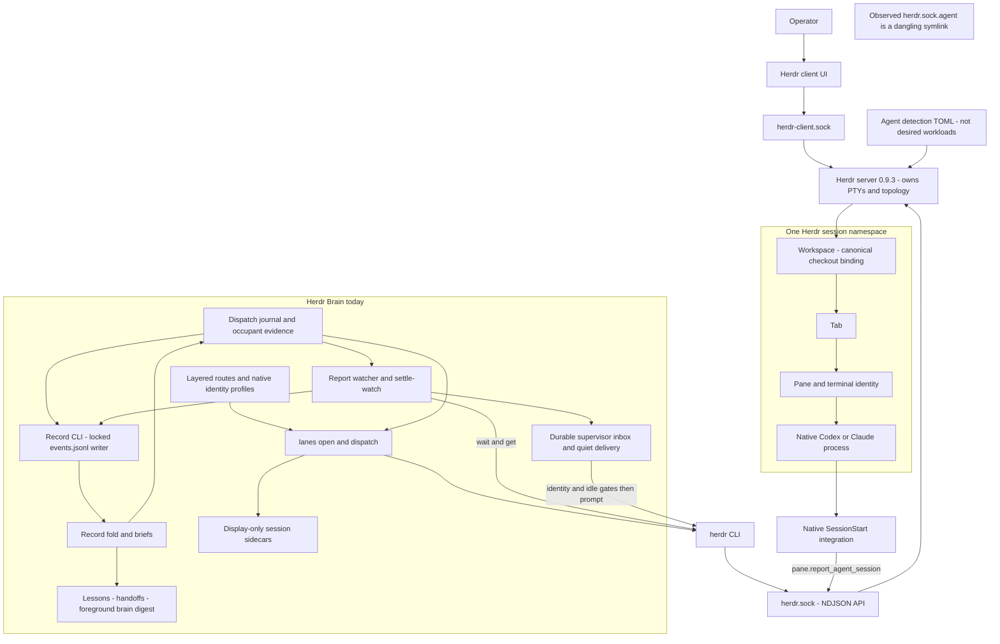
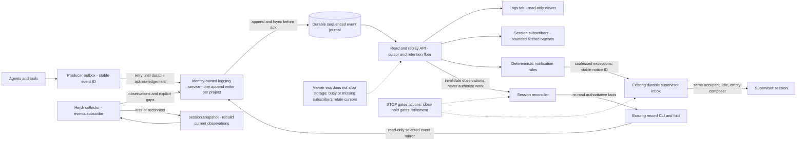
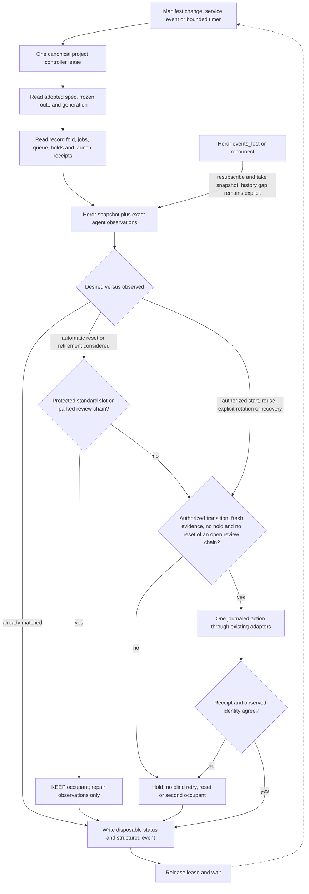

# A standard session platform for Herdr Brain

Research **R-421**, extended by **R-422**, item **RES-3**, 2026-10-15. Proposal only, based on lane source at `2c488614b16bb9a28f22530853208f274952c26c`, the R-421 document commit `b943075b42a2eb04f02bfed17fce1c56faf081de`, and installed Herdr **0.9.3**. The operator's corrections take precedence over the older run acceptance text: structured logging is a **service**, the logs tab is a **viewer**, and worker sessions survive review and correction rounds. No wallet architecture comparison is included.

**R-422 decision update:** the operator supports a controller comparing desired manifests with running sessions, default control-tab manifests in every workspace, and a supervisor tab handling dispatch and job monitoring. Context reset means **close the tab and respawn from its manifest with a Markdown handoff**, at an eligible boundary. Warm review workers are never reset. Sections 3, 5 and 6 now reflect that choice; section 1's native-clear description remains historical capability evidence. The supervisor's proposed three logging paths—direct judgment, routine rules, and an optional short-lived model digester—remain under consideration. Section 7 specifies session messaging without treating that proposal as adopted. Sources: ARCH-33 decisions seq 5837/5850 and the R-422 addendum.

**Recommendation [P]:** use a small, model-free session controller above existing route, dispatch, watch and retirement code. A Markdown manifest describes desired work and context; the record, handoffs and memory retain durable knowledge. Preserve the same live worker from initial dispatch through review and corrections. Reconstruct a session only after a confirmed failure or an explicit fresh-cycle decision. Adopt three protected tab slots—chat, supervisor and logs—per enrolled workspace. Keep logging independent of every tab and every model session.

The closest Kubernetes analogy is **a controller-owned pod retained until its work item's review chain ends**, with a Job-like completion condition outside the process. A reported result or an idle prompt is not workload completion. Kubernetes itself is not a proposed dependency or deployment requirement.

Evidence notation applies to each tagged paragraph or table row: **[M]** observed with read-only commands/files during the named run; **[D]** documented in inspected local or upstream source, not exercised here; **[I]** inference with its limits stated; **[P]** proposed behavior, not implemented. Sections 1–2 retain R-421 observations; section 7 identifies R-422 evidence. All of sections 3–4 and proposed diagrams are [P] except explicitly tagged observations. Local source links are relative to this checkout. Upstream code links pin v0.9.3's commit, `7b116c05bfda646af39d2524c54e70c751f57ee8`; a matching version string does not prove a reproducible match between that source and the installed binary.

## 1. How Herdr works today, measured

### Processes, endpoints and access

| Finding | Evidence and meaning |
| --- | --- |
| [M] Installed CLI and active server agree | `command -v herdr` → `/Users/rewt/.local/bin/herdr`; `herdr --version` → `herdr 0.9.3`; `herdr status` → client/server `0.9.3`, channel `stable`, protocol/private protocol `22`, endpoint generation `1`, compatible `yes`, `restart_needed: no`, `server_binary_stale: no`. |
| [M+D] Server owns terminals; client is a UI | Server log records separate API and client-protocol listeners. The [concepts documentation](https://herdr.dev/docs/concepts/) describes server-owned PTYs and UI attachment. A client exit is different from terminating the server or a pane. |
| [M] Default API socket | `lstat` of `~/.config/herdr/herdr.sock` → Unix socket, mode `0600`; config directory mode `0755`. A newline-terminated `ping` request succeeded. |
| [M+D] UI transport is separate | `~/.config/herdr/herdr-client.sock` → Unix socket, mode `0600`. The [socket path implementation](https://github.com/herdrdev/herdr/blob/7b116c05bfda646af39d2524c54e70c751f57ee8/src/server/socket_paths.rs) derives this client endpoint; it is not the public NDJSON API. |
| [M] The supposed `.agent` socket is not active here | `lstat ~/.config/herdr/herdr.sock.agent` → **symlink**, target `/Users/rewt/.config/herdr/herdr.sock.unavailable`; the target does not exist. No connection was attempted. Its origin and former purpose are unverified. Treating it as today's notification service would be wrong. |
| [M+D] Named namespaces have separate endpoints | `herdr session list --json` showed `default` running at the default directory and `work` not running at `~/.config/herdr/sessions/work`. A stale socket path in a stopped namespace is not proof of a live server. [Socket API documentation](https://herdr.dev/docs/socket-api/). |
| [M+D] Access is controlled at the OS boundary, not by API roles | The measured socket mode is owner-only. Inspected [API connection handling](https://github.com/herdrdev/herdr/blob/7b116c05bfda646af39d2524c54e70c751f57ee8/src/api/server.rs) has no application login, per-method principal or read-only/control credential split. “No authentication or authorization at all” overstates this: filesystem ownership and native sandbox policy still matter. This was source inspection, not a security audit. |
| [M+D] Capabilities describe compatibility | `ping` returned `live_handoff`, `detached_server_daemon`, `surface_interest`, `health_check`, `ssh_agent_registration`, plus endpoint generation `1`. These are not permission grants. The inspected request handler does not use them to confer authority. |

[M] Selected `ping` exchange, one request on one socket connection:

```json
{"id":"r421:ping","method":"ping","params":{}}
```

```text
type=pong version=0.9.3 protocol=22
capabilities: live_handoff=true detached_server_daemon=true
endpoint_protocol_generation=1 surface_interest=true
health_check=true ssh_agent_registration=true
```

[D] The API accepts newline-delimited JSON. The inspected normal connection handler reads one request; streaming waits/subscriptions are special cases. Clients should use a fresh connection for independent ordinary requests. [API server source](https://github.com/herdrdev/herdr/blob/7b116c05bfda646af39d2524c54e70c751f57ee8/src/api/server.rs). [M] Attempting a second ordinary request on the ping connection produced `BrokenPipeError: [Errno 32] Broken pipe`; a new connection to read manifests succeeded. This was a transport error, not an access refusal.

### CLI, configuration and installed integrations

[M] Inspected `herdr --help`, `herdr agent`, `herdr pane`, `herdr session`, `herdr api`, and the JSON API schema. The installed CLI exposes agent start/get/list/prompt/wait/rename, pane read/send-text/send-keys/run/clear and integration-report methods, plus tab/workspace/session operations. There is **no `pane send` command** in the inspected help; use the exact operation name when discussing delivery. `agent.start` has required `name`, `kind`, `pane_id`, and optional `args` and readiness timeout. It does not take a workload manifest, personality, context sources, or desired replica count.

[M] `~/.config/herdr/config.toml` has `agent`, `keys`, `onboarding`, `theme`, `ui` sections, with no explicit `session` or `server` override. Persona detection is enabled, checks `AI_PERSONA` then `HERMES_PROFILE`, and maps values to UI persona labels. That observation demonstrates detection configuration, not what instructions any current agent received. `plugins.json` lists enabled `herdr-file-viewer` 1.17.0, `herdr.markdown-viewer` 0.1.0 and `persiyanov.reviewr` 0.36.2; the latter hooks worktree creation/opening. No Brain plugin entry was present.

[M] `herdr integration status` reports Claude integration v10/current at `~/.claude-personal/hooks/herdr-agent-state.sh`, and Codex v8/current at `~/.codex/herdr-agent-state.sh`. Their file hashes match the v0.9.3 upstream assets. Native settings contain the corresponding SessionStart hooks; this is Herdr's native session reporting, separate from a Brain-installed wrapper.

[M+D] `server.agent_manifests` returned an `agent_manifest_status` result with 22 detection entries. Both Codex and Claude selected remote version `2026.10.11.1`, with no local override shadowing it, from `~/.local/state/herdr/agent-detection/remote/*.toml`. These manifests describe **agent detection/presentation/integration behavior**, not desired workspaces or sessions. Updates can change detection independently of the binary. Extend Brain's route and dispatch layer for desired workloads; use native `agent.start` and the detection infrastructure underneath. Do not repurpose or overwrite these upstream manifests. [Agents documentation](https://herdr.dev/docs/agents/), [agent API source](https://github.com/herdrdev/herdr/blob/7b116c05bfda646af39d2524c54e70c751f57ee8/src/app/api/agents.rs).

### Workspace, tab, pane and four different identities

[D] A Herdr *session* is a server namespace containing workspaces; a workspace contains tabs, and tabs contain panes. A pane hosts a terminal/process. A native Codex/Claude conversation ID is another kind of session identity. An agent name is a discoverable handle, not durable proof that the same process or conversation occupies the pane. [Concepts](https://herdr.dev/docs/concepts/), [terminal identity implementation](https://github.com/herdrdev/herdr/blob/7b116c05bfda646af39d2524c54e70c751f57ee8/src/terminal/state.rs).

| [M] R-421 evidence | Value | Interpretation |
| --- | --- | --- |
| Agent name | `lane-session-archi-fa46bc-9f5414` | Managed Herdr handle, constrained to at most 32 characters. |
| Topology | workspace `w3AP`, tab `w3AP:t1`, pane `w3AP:p1` | Live placement, scoped to this Herdr server. |
| Terminal ID | `term_65de4ccccfc7f1ab` | Additional occupant evidence, distinct from the pane label. |
| Native session | `herdr:codex`, agent `codex`, kind `id`, value `01a140b7-8925-7ee1-8ba2-63bb40a7acac` | Reported native conversation reference. |
| Registry `session_id` | `79454403-3f69-445d-8ed5-74c9f1ef421d` | Brain-generated random UUID for a display record; **not** the native conversation ID. |
| Registry launch metadata | route `research-astra-max`, harness `codex`, model `gpt-6-astra`, effort `max`, terminal ID above | Declared launch metadata, not proof of actual model-side execution. Native ID was absent from this sidecar when read. |
| Registry report hint | `docs/reports/session-architecture.md` | Display hint; the actual run report required by the brief is `.org/runs/R-421/report.md`. It must not drive authority. |

[M] The R-421 workspace binds to the canonical Herdr Brain Git common directory and this linked worktree. Its single tab was labeled `agent:session-architecture` and contained the worker pane plus a `reviewr` pane. This is evidence that the requested standard three-tab layout is not already a universal default. The main project workspace had five tabs; BCH's workspace had eleven at the sampled time. Counts are point-in-time observations, not desired state.

### Launch, naming and session-ID reporting

[D] Native `agent.start` validates the requested name, targets a pane with an eligible shell, builds the detected executable and arguments, and begins a managed agent. The CLI additionally waits for readiness. It does not create Brain runs or persist a project intent. [Server `start_agent`](https://github.com/herdrdev/herdr/blob/7b116c05bfda646af39d2524c54e70c751f57ee8/src/app/agents.rs), [CLI `agent_start`](https://github.com/herdrdev/herdr/blob/7b116c05bfda646af39d2524c54e70c751f57ee8/src/cli/agent.rs). [D-local] Brain's [`newAgentName()`](../../../lanes/lane.mjs) combines a shortened topic, repository/root/topic digest and random suffix, then checks the actual launch occupant; names alone are not adoption evidence.

[D] SessionStart integrations submit `pane.report_agent_session` with a native ID/transcript reference, source, agent kind, sequence and start reason. The Codex hook rejects a reported session that conflicts with inherited `CODEX_THREAD_ID`; the Claude hook filters subagent events. Both are bounded, best-effort hook reports. Explicit resume arguments are another source of stored native references. The per-terminal setter checks report source/order and allowed replacement reasons; it does not establish a global uniqueness invariant across all live panes. [Codex hook](https://github.com/herdrdev/herdr/blob/7b116c05bfda646af39d2524c54e70c751f57ee8/src/integration/assets/codex/herdr-agent-state.sh), [Claude hook](https://github.com/herdrdev/herdr/blob/7b116c05bfda646af39d2524c54e70c751f57ee8/src/integration/assets/claude/herdr-agent-state.sh), [session-reference logic](https://github.com/herdrdev/herdr/blob/7b116c05bfda646af39d2524c54e70c751f57ee8/src/terminal/state.rs), [resume argument handling](https://github.com/herdrdev/herdr/blob/7b116c05bfda646af39d2524c54e70c751f57ee8/src/agent_resume.rs).

**[M] The reported 2026-10-14 duplicate-ID incident remains unexplained.** No retained observation showing the alleged two panes was found. This is not a finding that it did not happen:

| Search/sample | Result and limitation |
| --- | --- |
| `herdr agent list --json`, 2026-10-15 `18:00:48.499105Z` | 34 agents; zero duplicated nonempty native IDs in that snapshot. Later selected `agent get` confirmed R-421's tuple above. It does not reconstruct yesterday. |
| Canonical Herdr Brain `.lane/sessions.json.d` | 1,356 JSON files including completion markers; 236 unique nonempty native session IDs; no duplicate native-ID groups in the parsed sidecars. Many records lack native IDs. Display UUIDs were not counted as native IDs. |
| BCH `.lane/sessions.json.d` | Two JSON files, neither with a native ID. Little historical coverage. |
| `/Users/rewt/development/rewt/.org/events.jsonl` and `/Users/rewt/development/bastian/.org/events.jsonl` | Searched October 14–15 text for duplicate/same-session/two-pane evidence, then grouped direct event metadata containing native ID and pane. Only 2 and 17 distinct native-ID groups respectively; none bound to more than one pane. Sparse metadata and current records cannot disprove an earlier transient incident. |
| Referenced reports and server/client log excerpts | No preserved two-pane native-ID pair or correlated hook payload found. The incident is described in the research ask, not proven by an attached capture. |

[I] Mechanisms worth testing include a forwarded/stale SessionStart report with the wrong pane environment, two clients attaching to the same native conversation, or a stale binding displayed alongside a current one. `~/bin/ai` can use a shared Codex app-server, but it is not proven to have launched either alleged pane. None of these is an established cause. [D] Restore-time deduplication reserves a native resume key before spawning and falls back to a shell on a repeated key; that guard does not retrospectively prove uniqueness in the live reporting path. [Restore implementation](https://github.com/herdrdev/herdr/blob/7b116c05bfda646af39d2524c54e70c751f57ee8/src/persist/restore.rs).

[P] On recurrence, capture a timestamped list, both `agent get` results, pane/terminal/workspace tuples, source/sequence/start reason, and relevant registry/run metadata before any repair. Compare `(server namespace, provider/source, native ID)` and preserve the tuple history. Stop automatic reuse/retirement of both ambiguous occupants; do not “fix” it by deleting an ID or assuming the newer pane owns it. A duplicate detector should create a diagnostic, not authorize a close.

### Prompt delivery and notifications

[D] `agent prompt` queues text for a named, eligible foreground agent. The inspected implementation encodes bracketed paste when the terminal mode supports it, then submits Enter after a short delay (300 ms in v0.9.3). That is terminal delivery, not a transaction acknowledged by the model. `pane send-text` sends text; `pane send-keys` sends key events; `pane run` combines command text with submission. These lower-level operations do not inherit Brain's occupant and delivery journal checks. [Prompt handler](https://github.com/herdrdev/herdr/blob/7b116c05bfda646af39d2524c54e70c751f57ee8/src/app/api/agents.rs), [text encoder](https://github.com/herdrdev/herdr/blob/7b116c05bfda646af39d2524c54e70c751f57ee8/src/app/api_helpers.rs), [pane input](https://github.com/herdrdev/herdr/blob/7b116c05bfda646af39d2524c54e70c751f57ee8/src/server/pane_input.rs).

[M+D] No prompt, text, key or clear command was sent during this research. Native SessionStart hooks use `herdr.sock`, not the dangling `.agent` link. Herdr events/notifications expose runtime observations and UI notices; Brain's `watch/` and durable supervisor inbox are separate. A desktop notification, a hook report and a model-readable correction brief must not be treated as equivalent delivery receipts. [Integration contract](https://herdr.dev/docs/add-herdr-support/), [`watch/watch.mjs`](../../../watch/watch.mjs), [`supervisor/prompt-supervisor.mjs`](../../../supervisor/prompt-supervisor.mjs).

### Lifecycle boundaries

| Operation | What the evidence supports | Limit here |
| --- | --- | --- |
| Native `/clear` | [D] Supported SessionStart replacement reasons can change the native session reference. `reconcile_agent_name_owner()` preserves a managed same-kind agent name; a name attached to a different non-managed session owner may be cleared. A rename after every clear is therefore not universally required. [Terminal state source](https://github.com/herdrdev/herdr/blob/7b116c05bfda646af39d2524c54e70c751f57ee8/src/terminal/state.rs). | [M] Not exercised. Installed native harness command support and behavior are not established by Herdr source. |
| `pane clear` | [D] Clears terminal display/scrollback through the pane surface, not a promise to reset model context. [Pane API](https://github.com/herdrdev/herdr/blob/7b116c05bfda646af39d2524c54e70c751f57ee8/src/app/api/panes.rs). | Never use screen clearing as session reset evidence. |
| Agent rename or release | [D] Rename changes the handle. Native `pane.release_agent` can clear a binding; switching native sessions should report the new reference according to integration ownership rules. [Integration documentation](https://herdr.dev/docs/add-herdr-support/). | A reused handle does not prove occupant continuity. Neither was invoked. |
| Native `/exit` or `/quit` | [I] These are harness commands whose support and effects depend on the installed harness. Process exit and a valid report are distinct events. | No universal exit string is asserted; neither was tried. |
| Tab/workspace close | [D] These are control operations that remove terminal topology; Brain must gate them with safe retirement. CLI help and [`lib/retire.mjs`](../../../lib/retire.mjs). | No close was attempted; process signal details were not measured. |
| Client detach/reattach | [D] Server-owned live PTYs can continue; reconnecting a UI is not a fresh conversation. [Session state documentation](https://herdr.dev/docs/session-state/). | No detach experiment performed. |
| Server stop/start and restore | [D] Old processes do not survive an ordinary restart. Layout and eligible native resume references can restore; unusable or duplicate references fall back to shells, and resume may wait for client sizing/theme. Native resume does not itself prove the complete prior route/personality was re-applied. [Resume plans](https://github.com/herdrdev/herdr/blob/7b116c05bfda646af39d2524c54e70c751f57ee8/src/agent_resume.rs), [restore](https://github.com/herdrdev/herdr/blob/7b116c05bfda646af39d2524c54e70c751f57ee8/src/persist/restore.rs). | Logs show a past restore, not a restart experiment in this run. Live handoff is a separate best-effort mode, not a durability guarantee. |

### Logs and measurement caveats

[M] Selected log evidence, paths `~/.config/herdr/herdr-server.log` and `herdr-client.log`, both mode `0644` when inspected (approximately 2.26 MB and 54 KB):

```text
server 2026-10-13T17:12:43.605235Z  API server listening: herdr.sock
server 2026-10-13T17:12:44.140942Z  persist.restore ok workspaces=37
server 2026-10-13T17:12:44.206687Z  client protocol socket listening: herdr-client.sock
server 2026-10-13T17:12:44.206996Z  server started; both endpoints recorded
client 2026-10-13T17:12:44.239336Z  handshake endpoint generation=1 server_version=0.9.3
```

[M+D] Restore warnings also report unavailable saved directories while preserving panes. Generic API request logs expose method/outcome, not a durable business event log or proof that a model consumed a prompt. The proposed service must not copy arbitrary terminal buffers or credentials into these logs.

[M] One mistaken command during help discovery was **not read-only**: bare `herdr server` attempts a headless server start. It exited 1 with exactly:

```text
error: herdr server is already running
api socket: /Users/rewt/.config/herdr/herdr.sock
```

It was not retried. No new server or topology change from that rejected invocation was observed. This exception is disclosed rather than describing the whole command history as read-only. No live creation, close, rename, focus, key/prompt delivery or restart was performed. No harness permission refusal was bypassed. No credentials, full environment, native transcripts or memory contents were read. A README for the mistakenly included wallet comparison had been read before the operator correction arrived; it was excluded from the deliverables and no further reading of that component occurred.

## 2. How Herdr Brain sits on top today

All rows below are **[D-local]** source findings unless explicitly marked [M]. They describe present code, not a new session-platform implementation.

| Layer | Files and functions | Present responsibility and boundary |
| --- | --- | --- |
| Route selection | [`lanes/routes.mjs`](../../../lanes/routes.mjs): `loadDiscoveredRoutes`, `mergeRoutesConfig`, `resolveRoute`, `resolveLaunchRoute`, `selectRoute`; [`lanes/preset.mjs`](../../../lanes/preset.mjs) | Discovers fleet/ancestor/canonical project layers, validates routes, resolves task-class policy. Named routes own harness/model/effort; conflicting launch overrides and reserved extra args are rejected. Environment lists concatenate; route entries and argument choices are not arbitrary recursive merges. A selected explicit config bypasses normal discovery. |
| Checkout and native launch | [`lanes/lane.mjs`](../../../lanes/lane.mjs): `open`, `ensureHerdrWorkspace`, `newAgentName`, `dispatch` | Canonical common-directory identity owns a lane. Native workspace evidence must match repository/checkout/link status. A newly created compatible initial pane can be reused; otherwise create a tab. Launch waits for cwd/readiness, checks the actual occupant, sends the brief, and records display metadata. Ambiguous prompt delivery is not replayed blindly. |
| Durable dispatch | [`dispatch/dispatch.mjs`](../../../dispatch/dispatch.mjs): `main`, journal stages and `liveWorker`; [`dispatch/record-worker.mjs`](../../../dispatch/record-worker.mjs) | Freezes routing, opens the run and brief, starts/binds a worker, registers a watcher before prompting, and records progress in a dispatch journal. STOP gates launch. `record-worker` reads live evidence through `agent get`; it does not promote a display sidecar to authority. |
| Warm correction rounds | [`dispatch/dispatch.mjs`](../../../dispatch/dispatch.mjs), `--reuse` branches | Prior run must be reported/abandoned, and item, lane, route and declared harness/model/effort must match. Terminal or native-ID evidence is required; name, placement/cwd and live occupant are checked; worker must be idle/done. A new run/report path is created for the **same session**. This is the foundation to preserve, not replace. |
| Session registry | [`lanes/board/registry.mjs`](../../../lanes/board/registry.mjs): `newSessionId`, `writeSessionRecord`, `loadRegistry`, `markTopicSessionsDone` | Random display UUIDs and atomic immutable sidecars, plus separate completion markers and legacy compatibility. Registry values never authorize retry, dispatch, validation, promotion, retirement or deletion. |
| Identity launcher | [`~/bin/ai`](/Users/rewt/bin/ai), inspected but never executed | Selects personal/work/business native homes and identity settings. Personal interactive Codex can attach to a shared native app-server via `--remote`; this is a second client/server layer, independent of Herdr. Claude gets identity settings; `.identity-root` helps native Codex root selection. Native Herdr `agent.start` constructs executable argv; it does **not** intrinsically invoke `ai`. Shell indirection for every live process was not measured. |
| Identity desks and chat | [`supervisor/request.mjs`](../../../supervisor/request.mjs): `request`; [`supervisor/chats.mjs`](../../../supervisor/chats.mjs): `openProjectChat`, `entryPolicy` | Identity requests use that identity's desk and native policy. Project chats currently use a separate fleet chat workspace and identity-keyed receipts, with native appended/developer instructions. This is not yet a chat/supervisor/logs trio in every workspace. No desk request was sent here. |
| Cold start and handoffs | [`supervisor/context.mjs`](../../../supervisor/context.mjs): `coldStart`, `renderColdStart`; [`supervisor/protocol.mjs`](../../../supervisor/protocol.mjs): `supervisorPolicy`; [`supervisor/entry.mjs`](../../../supervisor/entry.mjs): `enterSupervisor`; [`lib/render.mjs`](../../../lib/render.mjs): briefs | Cold start reads folded record, decisions, routes, lessons, queue and receipts. Entry has bounded recovery and STOP/torn-state handling. Handoff documents such as `docs/handoffs/2026-10-03-supervisor-handoff.md` are durable context, not live authority. Workers must not invoke supervisor cycle mutations. |
| Report watch | [`watch/watch.mjs`](../../../watch/watch.mjs): `reportState`, `waitForSignal`, `observeProcessEnd`, `deliver`; [`watch/notice.mjs`](../../../watch/notice.mjs) | Combines filesystem observation, timers and `agent wait`. Valid report plus idle/done/gone is distinct from unknown/working/blocked. Checks reports and records permitted observations through the CLI, then sends a structured notice. It does not directly append the core log or independently ingest every report. |
| Supervisor notice transport | [`supervisor/prompt-supervisor.mjs`](../../../supervisor/prompt-supervisor.mjs): `inboxPath`, `readInbox`, `drainInbox` | Locked/fsynced append journal at `.org/supervisor/inbox.log`; stable notice IDs, retry/sending/sent states, quiet/identity/composer checks before prompting. Busy/gone supervisors leave durable work pending. Read-to-send races remain; transport cannot promise exactly-once model consumption. |
| Routine notice handling | [`supervisor/autopilot.mjs`](../../../supervisor/autopilot.mjs), [`supervisor/supervisor.mjs`](../../../supervisor/supervisor.mjs) `handle` command | Deterministic policy can handle routine notices through existing workflow. Exceptions requiring judgment reach the supervisor. The supervisor is not a log aggregator (lesson L-8). |
| Settlement and promotion glue | [`contrib/settle-watch.mjs`](../../../contrib/settle-watch.mjs): `launchSettings`, `reportReady`, retirement helpers; [`supervisor/reconcile.mjs`](../../../supervisor/reconcile.mjs): `reconcile` | Settle-watch waits model-free and launches bounded settlement/executive sessions when needed, with explicit model/effort and optional memory launch args. The existing `reconcile.mjs` reconciles promotion completion; it is **not** the proposed session reconciler and must retain its interface. |
| Safe retirement | [`lib/retire.mjs`](../../../lib/retire.mjs): `matchingRun`, `occupantReason`, `planRetirement`, `executeRetirement`; [`lib/retire-runtime.mjs`](../../../lib/retire-runtime.mjs): `createRetirement`; [`lib/retire-hold.mjs`](../../../lib/retire-hold.mjs): `retirementHold` | Holds, focus, canonical repository, exact occupant/process state, references, report/review chain, Git integration/cleanliness and fresh execution rechecks govern closing. Unknown evidence retains. Successful report or idle state alone is insufficient. |
| Core record | [`bin/org.mjs`](../../../bin/org.mjs), [`lib/store.mjs`](../../../lib/store.mjs), [`lib/state.mjs`](../../../lib/state.mjs), [`lib/report.mjs`](../../../lib/report.mjs) | CLI is the authorized write path; store owns the event-log lock; status is folded from events, and unknown event types are ignored by older folds. A second different report for a run is refused. Core remains dependency-free, foreground, model-free and provider-agnostic. |

### Effective route and native identity observations

[M] `/Users/rewt/development/rewt/.lane.json` declares `engineer` → Codex `gpt-6.1-sol`/`high`, `engineer-xhigh`/`xhigh`, `engineer-max`/`max`, `research-astra-max` → Codex `gpt-6-astra`/`max`, `executive` and `research` → Claude `opus`/`high`, `writer` → Claude `sonnet`/`medium`, and `review` → Claude `opus`/`high`. The canonical project `.lane.json` is `{}`. Relevant inspected routes had no added environment or argument payloads. These are declarations, not a provider availability or effective-token-budget measurement.

[M] The identity root marker exists. Project `.codex/config.toml` selects `gpt-6.1-sol`, `xhigh`, `workspace-write`; native user config selects `gpt-6.1-sol`, `high`, `personality = "pragmatic"`, `workspace-write`, `approval_policy = "on-request"`, and `project_root_markers = [".identity-root"]`. Explicit route arguments can supersede defaults. Credential files were excluded. [D] Current [Codex configuration reference](https://developers.openai.com/codex/config-reference/) treats `personality` as a deprecated compatibility setting rather than a reliable style selector. A proposed personality must resolve to explicit native instructions, not assume that a `pragmatic` string is applied by every version.

[M+D-local] Native Claude identity settings contain sandbox/permission scopes. These remain owned by the native harness; the manifest must not synthesize widened privileges. The repository also has an existing `.claude/settings.json` SessionStart entry for [`herdr/canary-env.sh`](../../../herdr/canary-env.sh), which adjusts the canary PATH when present. This is not evidence for installing a new launch wrapper or security hook. The proposal adds neither; Herdr integration hooks, native identity settings and this repository-specific canary hook are separate concerns.

### Three kinds of durable context

| Context | Current mechanism and limits |
| --- | --- |
| [D-local] Record lessons and briefs | [`lib/lessons.mjs`](../../../lib/lessons.mjs) selects active scoped lessons (`lessonsForItem`, `lessonsJson`); brief rendering includes relevant record evidence. Approved lessons remain in the record. Reading selected lessons is not authority to alter another identity's memory. |
| [D-local] Foreground digest | [`brain/README.md`](../../../brain/README.md), [`brain/lib/signals.mjs`](../../../brain/lib/signals.mjs): `recordDigest`, `buildDigest`, `renderDigest`. Model-free digest uses its own cursor/pending state under `~/.local/state/herdr-brain/distill/…` and never writes `events.jsonl`. Even a digest preview can update its own pending state, so it was not executed in this read-only investigation. No removed capture/steward service is proposed. |
| [D-local] Optional claude-mem | `/Users/rewt/development/claude-mem/bin/cmem-domain`: `cmd_launch_args` resolves a domain, requires preflight/bound native adapter, then supplies Claude `--plugin-dir` or Codex `-p claude-mem-<domain>`. It explicitly refuses memory binding for remote sessions because hooks run in the shared app-server. `contrib/settle-watch.mjs::launchSettings` uses this path. No memory service health, account data or stored memory was read. A route with no memory args does not prove an active integration. |

[P] Preserve these distinct owners: record facts/lessons, bounded handoff files, and an optional identity-scoped memory adapter. A manifest should name context sources and required/optional behavior; it must not silently promise that all three exist, or copy entire historical conversations into every model call.

## 3. Proposed Markdown session manifests and reconciliation

### Kubernetes concept map

This is an analogy and a contract sketch, not Kubernetes API compatibility. Kubernetes distinguishes desired `spec` from observed `status`, and controllers repeatedly reconcile the two. That separation is useful here. [Objects](https://kubernetes.io/docs/concepts/overview/working-with-objects/), [controllers](https://kubernetes.io/docs/concepts/architecture/controller/).

| Kubernetes concept | Herdr / Brain equivalent proposed | Where the analogy stops |
| --- | --- | --- |
| Cluster | A selected Herdr server namespace plus its explicitly enrolled Brain projects | A local PTY host has neither a Kubernetes scheduler nor a cross-host resource-control boundary. |
| Namespace | Identity-owned project partition, keyed by canonical Git common directory and selected server endpoint | Workspace names and repository basenames are not isolation. Native permissions still enforce access. |
| Pod | One manifest incarnation: an exact native conversation/process in a proven pane | Warm conversational context is significant state. Idle does not mean finished; restarting may be expensive and lossy. |
| Container | Native harness executable/argv, or a log-viewer process | A terminal process is not a container sandbox. The manifest cannot grant broader filesystem/socket permissions. |
| Deployment / ReplicaSet | A workspace controller maintaining exactly one occupant per adopted standard slot | No rolling overlap for a supervisor: two concurrent queue writers are unsafe. Replacement requires handoff, no active references and a fresh identity bind. |
| Job | A work item with completion determined by its record/review/integration chain | Process success/report submission is only a step. A Kubernetes Job's normal completion is too early for a warm review loop. |
| StatefulSet | Stable logical slot identity and external context sources | Stable names/storage do not preserve live conversation or PTY state; ordinal replicas are unnecessary here. |
| ConfigMap / Secret | Versioned personality/context/route files, and opaque references to native credential/permission profiles | Credentials are never embedded in manifests, reports, log events or generated prompt bundles. Referencing a profile does not authorize modifying it. |
| Readiness/liveness probes | Exact occupant, cwd, native ID, terminal ID, interactive readiness, quiet/composer checks | `idle` alone does not prove safety. A model refusal is a decision boundary, not a failed health probe to restart through. |
| Events / logs | Herdr's transient observations versus the proposed durable structured event service | Runtime observations are incomplete history. Logs inform decisions; record events and existing journals retain authority. |
| Controller / operator | Model-free session reconciler plus existing workflow adapters; supervisor handles exceptions | No model in the core, no independent write path to the record or promotion queue, no auto-retry of refused actions. |

**Choose a retained pod-like worker, with a custom work-item completion condition.** A worker is ephemeral across work items, not across turns or correction runs. Keep it alive in `ParkedAwaitingReview`. A fresh worker is appropriate only after landing/disposition or a separately authorized recovery. A plain Job is insufficient because completed task semantics do not include the warm review conversation; suspending a Job can terminate active pods. A StatefulSet offers stable identity, not conversational continuity. [Jobs](https://kubernetes.io/docs/concepts/workloads/controllers/job/), [StatefulSets](https://kubernetes.io/docs/concepts/workloads/controllers/statefulset/).

Prompt delivery has no Kubernetes-style exactly-once “apply.” A lost terminal-delivery acknowledgement can leave a model working. Reconciliation must observe and hold ambiguity, not resend. Cost also differs: every new context or supervisor wake can incur another model call. Surface budgets and context size as advisory observations; never refuse otherwise valid work solely because an advisory budget is exhausted. Model/harness refusal must hold the action for its existing authority path, never trigger a provider/model switch to evade it.

### File format and ownership

Use one Markdown document per desired object, with human explanation and **exactly one `json` fenced block under `## Manifest`**. JSON supplies a small, dependency-free parser; the document is still Markdown and its object shape follows `apiVersion`, `kind`, `metadata`, `spec`. No YAML runtime, arbitrary template evaluation, embedded executable commands or new npm dependency is needed. The four examples below show the contents of that block; each belongs in its own file if adopted. All example paths/UIDs are proposed declarations, not installed configuration.

The accepted object is `kind: Session` or `kind: LogViewer`. `metadata.uid` is allocated once at adoption, stable through restarts; `generation` changes when accepted desired configuration changes. `metadata.name` is human-facing, not a native handle. A workspace enrollment receipt resolves `workspaceRef` to the selected server socket, canonical common directory, checkout path and live workspace binding. It must be issued through existing lane/workspace ownership checks, never inferred from a label. An enrollment can propose a not-yet-created lane; existing `open()` must establish it before launch.

Example workspace resolutions:

| Reference | Proposed canonical resolution |
| --- | --- |
| `herdr-brain/main` | Default server; common `/Users/rewt/development/rewt/herdr-brain/.git`; checkout `/Users/rewt/development/rewt/herdr-brain`. |
| `herdr-brain/lane/docs-install-guidance` | Same common directory and server; lane `docs-install-guidance`; checkout resolved from canonical `git worktree list`/lane-open receipt, not guessed from its basename. |

`spec.route` references existing layered route configuration. `spec.launch` makes harness/model/effort visible as **assertions on the resolved route**, not a second source of overrides. Any mismatch is a validation error. Freeze the resolved route with the dispatch journal; a later edit to a route does not mutate an existing warm session. A proposed optional `sessions` extension in `.lane.json` would select manifest templates/default slot policy using the same layer discovery. It must receive an explicitly versioned validator change before use; today's validator is not claimed to accept it. Keep `.lane.json` authoritative for routing and selection policy.

`personality` refers to a reviewed profile and an explicit instruction string. Materialization uses existing native appended/developer-instruction paths. `context` declares source types, bounded selections and whether missing data blocks launch or is reported as optional. Briefs, relevant lessons, cold start and the latest handoff are assembled with hashes/record sequence receipts. Memory settings describe intent and adapter selection, not proof that memory is running. A required adapter failure holds the launch; an optional one produces a visible disabled condition. Do not expose credential values or inspect native transcripts to reconstruct context by default.

### Four concrete example objects

The main-workspace examples share a proposed service reference `rewt/logs/herdr-brain`. `identity-default` denotes the existing native identity profile; it does not install or broaden one. The engineer example uses the existing item ENG-232 as an illustration, not an instruction to dispatch it.

**Workspace chat — `chat.md`, explanatory purpose: the operator's project conversation.**

```json
{
  "apiVersion": "brain.herdr.dev/v1alpha1",
  "kind": "Session",
  "metadata": {
    "name": "workspace-chat",
    "uid": "example-main-chat",
    "namespace": "rewt/herdr-brain",
    "generation": 1
  },
  "spec": {
    "workspaceRef": "herdr-brain/main",
    "role": "chat",
    "standardSlot": "chat",
    "route": "executive",
    "launch": { "harness": "claude", "model": "opus", "effort": "high" },
    "personality": {
      "profile": "project-conversation",
      "instructions": "Discuss project choices clearly; turn authorized work into the existing intake path."
    },
    "intent": { "kind": "conversation", "purpose": "Operator conversation for this workspace" },
    "context": [
      { "source": "identity-instructions", "required": true },
      { "source": "project-cold-start", "required": true, "limit": 6 },
      { "source": "latest-chat-handoff", "required": false }
    ],
    "memory": { "recordLessons": true, "claudeMem": { "mode": "off" }, "handoff": "on-explicit-rotation" },
    "permissions": { "owner": "native", "profileRef": "identity-default" },
    "logs": { "serviceRef": "rewt/logs/herdr-brain", "subscribe": ["operator-requested-summary"] },
    "lifecycle": {
      "scope": "operator-conversation",
      "automaticRetirement": "never",
      "reset": "close-and-respawn-at-safe-boundary",
      "restartPolicy": "on-confirmed-exit-with-context-evidence",
      "recovery": { "knownNativeSession": "resume", "freshContext": "declared-safe-boundary-with-handoff", "missingEvidence": "hold" },
      "onRefusal": "hold"
    }
  }
}
```

**Workspace supervisor — `supervisor.md`, purpose: judgment and bounded coordination.**

```json
{
  "apiVersion": "brain.herdr.dev/v1alpha1",
  "kind": "Session",
  "metadata": {
    "name": "workspace-supervisor",
    "uid": "example-main-supervisor",
    "namespace": "rewt/herdr-brain",
    "generation": 1
  },
  "spec": {
    "workspaceRef": "herdr-brain/main",
    "role": "supervisor",
    "standardSlot": "supervisor",
    "route": "executive",
    "launch": { "harness": "claude", "model": "opus", "effort": "high" },
    "personality": {
      "profile": "project-supervisor",
      "instructions": "Apply decision routing, handle exceptions, and keep routine aggregation model-free."
    },
    "intent": { "kind": "coordination", "purpose": "Project supervision", "authorityRef": "canonical-project-supervisor" },
    "context": [
      { "source": "identity-instructions", "required": true },
      { "source": "supervisor-protocol", "required": true },
      { "source": "project-cold-start", "required": true, "limit": 6 },
      { "source": "latest-supervisor-handoff", "required": false }
    ],
    "memory": { "recordLessons": true, "claudeMem": { "mode": "off" }, "handoff": "before-replacement" },
    "permissions": { "owner": "native", "profileRef": "identity-default" },
    "logs": { "serviceRef": "rewt/logs/herdr-brain", "subscribe": ["exception", "review-ready"], "delivery": "durable-inbox-when-quiet" },
    "lifecycle": {
      "scope": "supervisor-decision-cycle",
      "automaticRetirement": "never",
      "reset": "close-and-respawn-at-safe-boundary",
      "restartPolicy": "on-confirmed-exit-with-context-evidence",
      "recovery": { "knownNativeSession": "resume", "freshContext": "declared-safe-boundary-with-handoff", "missingEvidence": "hold" },
      "onRefusal": "hold",
      "replicas": 1
    }
  }
}
```

Creating the same supervisor slot in a lane workspace does **not** create another project scheduler. Its enrollment resolves `authorityRef` to a workspace observer/delegate, with project mutations forwarded through the existing canonical supervisor path when authorized. The manifest's requested role cannot grant itself authority. Only the designated canonical project supervisor owns project-wide cycles, queue draining and housekeeping; that role does not follow a tab label.

**Engineer — `engineer.md`, purpose: one item through all review rounds.**

```json
{
  "apiVersion": "brain.herdr.dev/v1alpha1",
  "kind": "Session",
  "metadata": {
    "name": "worker-docs-install-guidance",
    "uid": "example-eng-232-worker",
    "namespace": "rewt/herdr-brain",
    "generation": 1
  },
  "spec": {
    "workspaceRef": "herdr-brain/lane/docs-install-guidance",
    "role": "engineer",
    "route": "engineer",
    "launch": { "harness": "codex", "model": "gpt-6.1-sol", "effort": "high" },
    "personality": {
      "profile": "lane-engineer",
      "instructions": "Complete the authorized item, preserve evidence, and keep this session available for correction rounds."
    },
    "intent": { "kind": "work-item", "item": "ENG-232", "purpose": "Correct the stale dependency-install guidance" },
    "context": [
      { "source": "identity-instructions", "required": true },
      { "source": "run-brief", "required": true },
      { "source": "item-lessons", "required": true },
      { "source": "latest-review", "required": false },
      { "source": "item-handoff", "required": false }
    ],
    "memory": { "recordLessons": true, "claudeMem": { "mode": "off" }, "handoff": "before-context-loss" },
    "permissions": { "owner": "native", "profileRef": "identity-default" },
    "logs": { "serviceRef": "rewt/logs/herdr-brain", "subscribe": ["authorized-correction-ready"], "delivery": "existing-dispatch-only" },
    "lifecycle": {
      "scope": "work-item",
      "afterReport": "park-awaiting-review",
      "corrections": "reuse-same-session",
      "retainUntil": "landed-or-explicit-disposition",
      "resetWhileParked": false,
      "automaticRetirement": "safe-planner-after-disposition",
      "restartPolicy": "on-confirmed-exit-resume-known-session",
      "recovery": { "freshContextWhileItemOpen": "explicit-recovery-disposition-only", "missingEvidence": "hold" },
      "reset": "never-while-work-item-open",
      "onRefusal": "hold"
    }
  }
}
```

**Logs — `logs.md`, purpose: view service-owned events.**

```json
{
  "apiVersion": "brain.herdr.dev/v1alpha1",
  "kind": "LogViewer",
  "metadata": {
    "name": "workspace-logs",
    "uid": "example-main-logs",
    "namespace": "rewt/herdr-brain",
    "generation": 1
  },
  "spec": {
    "workspaceRef": "herdr-brain/main",
    "role": "logs",
    "standardSlot": "logs",
    "viewer": "brain-structured-events",
    "intent": { "kind": "view", "purpose": "Inspect this workspace and its project event stream" },
    "context": [{ "source": "workspace-event-filter", "required": true }],
    "memory": { "mode": "none" },
    "permissions": { "owner": "native", "profileRef": "identity-default", "serviceAccess": "read" },
    "logs": { "serviceRef": "rewt/logs/herdr-brain", "start": "saved-cursor-or-recent", "scope": "workspace" },
    "lifecycle": {
      "scope": "workspace-slot",
      "automaticRetirement": "never",
      "restartPolicy": "on-confirmed-exit-with-backoff",
      "onRefusal": "hold"
    }
  }
}
```

`LogViewer` deliberately has no harness/model/effort/personality: these fields would be invalid for that kind. Its `viewer` is a product-owned adapter identifier, not an arbitrary shell command from a file. Recreating a viewer does not restart the service, reset another subscriber's cursor, or call a model. Setting `serviceAccess: read` expresses a required capability; a future service must actually implement the scoped read endpoint/token, not mistake the field for enforcement.

### Reconciler-owned status without stored business status

Desired Markdown is versioned with the project. Keep generated status in ignored runtime storage, for example canonical `.lane/session-runtime/<uid>/status.json`, exposed alongside the spec by an inspection command as `{apiVersion, kind, metadata, spec, status}`. Only the reconciler writes the `status` projection; it never rewrites the tracked spec to persist observations. Do not let a worker edit authoritative desired state by changing its own status. The status portion below is illustrative, not an extra writable work-status field in the record:

```json
{
  "status": {
    "observedGeneration": 1,
    "specDigest": "sha256:<resolved-spec-digest>",
    "phase": "ParkedAwaitingReview",
    "phaseEvidence": { "recordSeq": 12345, "run": "R-example", "reason": "report present; review chain remains open" },
    "incarnation": "incarnation-1",
    "binding": { "server": "default", "workspace": "w-example", "tab": "w-example:t1", "pane": "w-example:p1", "agentName": "lane-example-abc123-def456", "terminalId": "term-example", "nativeSessionId": "native-example" },
    "conditions": [{ "type": "RetainForReview", "value": true }, { "type": "ReadyForCorrection", "value": true }],
    "lastObservedAt": "2026-10-15T18:30:00Z"
  }
}
```

Every field above is disposable and recomputable from canonical spec, live evidence, record fold and existing operation receipts. `phase`, readiness and `ReadyForCorrection` are observations, not permission. A correction requires a new authorized dispatch and fresh occupant checks. A new operation journal may retain launch/reset intent and acknowledgement uncertainty, as dispatch journals already do; that is delivery/ownership evidence, not stored item status. Losing the cache triggers observation, never a second launch. Losing ownership receipts leaves an unknown occupant to keep pending adoption, not an invitation to infer ownership from labels or sidecars.

### Materialization, reuse, close-and-respawn reset and recovery

1. **Resolve and validate.** Select canonical project/identity/server; parse one object; resolve workspace enrollment and route through existing layers; freeze hashes and bounded context references. Acquire a canonical per-project controller lock. The core record remains foreground; an optional external supervisor-owned loop invokes this controller, never the core itself.
2. **Observe before acting.** Read STOP/close hold, record/review chain, dispatch/watch receipts and queue references; take a Herdr snapshot and `agent get` evidence. Compare canonical checkout, pane, terminal, native ID and name. Unknown, duplicate or mismatched ownership is `Hold`. Existing unmanaged tabs are not adopted or closed merely because their labels match.
3. **Make at most one missing occupant.** Journal intent before invoking existing `open`/dispatch or chat/supervisor adapters. Let existing code own native argv, launch readiness, record-worker evidence and watcher-before-prompt ordering. A lost create acknowledgement cannot be solved by another `agent.start`: re-observe exact receipt evidence; if still ambiguous, hold. Herdr does not supply an end-to-end manifest operation idempotency key.
4. **Converge without repeatedly prompting.** A matching live incarnation is a no-op even if idle. An unchanged spec must not replay its brief on each reconcile. A manifest edit while work/review is open becomes a pending generation, not a clear, model change or replacement. Freeze native route and personality across the warm chain.
5. **Park after reports.** As soon as a report is available and the worker is quiet, retain it through ingestion and review. Ingestion delay, failed review, needs-human outcome, open correction or queued integration is a keep condition. Derive `ParkedAwaitingReview` from report/run/chain evidence; even a malformed report with unclear ownership must retain, not count as completion. A correction uses `dispatch --reuse R-prev`, a new run and new report, and the same live native session/terminal. Reuse failure holds; it does not silently substitute a fresh worker.
6. **Retire after final disposition.** Worker eligibility requires landed or explicit disposition evidence plus all existing safe-retirement gates. The new controller should require explicit work-item disposition, rather than using the existing confirmed-successor escape hatch to silently replace a parked worker. Standard slots remain outside automatic retirement. Closing their enclosing workspace requires an explicit withdrawal procedure described below.
7. **Reset by closing and respawning at an explicit safe boundary.** Persist and verify the Markdown handoff, record references, unresolved message IDs and inbox cursor. Quiesce callbacks, prove no open work/review or in-flight delivery depends on the old incarnation, and journal reset intent. The controller closes the exact owned tab through a guarded adapter, observes that it is gone, and creates its replacement from the same adopted manifest and handoff. A tab containing another owner or an unrelated pane must hold for disposition; ownership of one pane is insufficient to close the tab. Bind the replacement tab/pane/terminal/native session as a new incarnation before delivering pending messages. An uncertain close or create acknowledgement requires observation, never a second spawn. This is the operator's selected reset mechanism; it does not send `/clear` or reuse an old pane as evidence of fresh context. Never rewrite an earlier run's historical binding. A worker's open review chain is an unconditional reset veto, including idle periods.
8. **Recover rather than pretend a crash preserved warmth.** Detect confirmed process loss separately from transient disconnect/unknown readiness. First determine whether Herdr's native restore is already pending or has resumed the known reference. Exactly one layer owns the spawn. The adopted manifest preauthorizes the reconciler to resume a known native session after confirmed exit, subject to ownership, route/context evidence, STOP and backoff; it does not require a new permission question for each routine restart. A successful native resume gets a new process/incarnation receipt and rechecked model/context claims, while retaining the parked intent if review is pending. Missing references, repeated failures or any refusal hold the transition. Fresh reconstruction from manifest, brief, report and handoff is explicitly labeled context loss: for an open work item it requires explicit recovery disposition, and for a standard session it requires its declared safe boundary and completed handoff. Never claim reconstruction preserved the same warm process. The viewer may restart with backoff without native context evidence.

For a chat/supervisor slot, the work unit is an operator conversation or decision cycle. Keep that session until a declared handoff boundary; it need not be discarded after each response. Once that boundary is satisfied and the current process is quiescent, the reconciler starts the next fresh incarnation from the same manifest and saved handoff. An authorized next-item dispatch gets a new workload UID using the same worker template. A new incarnation of an existing workload is a restart, not a different item or overwrite of old evidence. Thus the platform actually restores desired sessions; observation alone or a report arriving never licenses context loss.

### Parser and semantic validation

Reject zero/multiple manifest blocks, duplicate JSON keys, unknown schema/kind/fields, malformed IDs, escaping paths and inconsistent scope/role combinations. `JSON.parse` alone does not detect duplicate keys; a small restricted scanner must check them before parsing. Never evaluate prose, interpolate shell text, expand environment secrets or execute a `command` key. Resolve symlinks and existing native identity roots before reading context. Required missing context yields a clear diagnostic; optional context is recorded as absent. Content hashing and size bounds must not turn context data into executable instructions from an untrusted source.

Validate route assertions against `resolveLaunchRoute`, reserved args, item existence and same-item reuse, unique slot/UID within canonical namespace, approved context source types, memory adapter/domain scope, service subscription allowlist, and lifecycle invariants. A work-item session must retain review context; a standard slot cannot opt into automatic retirement; a log viewer cannot declare a model; a user-supplied `status` cannot grant ownership. Native permissions remain unchanged. Adoption and spec mutation must follow the existing decision-routing policy; merely reading an edited Markdown file does not authorize a fresh worker, a model switch, or a promotion.

## 4. Standard tabs and the logging service

### Three stable slots in every enrolled workspace

The target is exactly one **chat**, **supervisor** and **logs** slot in every enrolled workspace, including lane workspaces. The three desired objects share its canonical enrollment identity. Their current occupants may be replaced at a safe boundary; the slots themselves persist. Keep existing independent worker/reviewer tabs. Enrollment is staged across the fleet, not an unsolicited rewrite of other identities' live workspaces.

Chat retains the operator conversation. The supervisor tab handles dispatch and job monitoring within its existing delegation, and receives exceptions requiring judgment. A lane's supervisor slot delegates project-wide scheduling to the one canonical project supervisor; standard tabs do not multiply that authority. Logs renders the service stream and has no model. Default filters are workspace-specific; an authorized operator can widen a viewer to project scope without widening its writer capabilities. Labels make the slots discoverable, but immutable enrollment and launch receipts establish ownership. No-focus creation should be retained in the existing adapters. Ordinary reconciliation must not move panes or steal focus to make the screen resemble a template.

**[D-local] Current retirement is conservative, but it does not yet guarantee protection for all three new slots.** `planRetirement()` keeps non-linked/persistent/operator/lab workspaces, focus/self, unknown shells, ambiguous processes and open chains. In a lane workspace, there is no general `chat|supervisor|logs` slot rule. A viewer may currently survive as an unknown shell; that is not a durable product guarantee. Inspection of [`lib/retire.mjs`](../../../lib/retire.mjs) and [`lib/retire-runtime.mjs`](../../../lib/retire-runtime.mjs) found no standard-slot enrollment input. The planner was not run and no live close was attempted.

**Prerequisite to adopting defaults:** extend the planner/observation contract with canonical adopted-slot receipts that can only add `KEEP`, and reject automatic cleanup of their tabs and enclosing workspace. Add an explicit warm-chain keep rule before any successor-based release: `ParkedAwaitingReview` remains protected until landing/explicit disposition. Source facts must come from the record and actual ownership receipts, not `.lane/sessions.json.d`, user-editable phase strings or tab names. Recheck both protections immediately before executing retirement. Unknown or unreadable protection evidence must keep. This is a required future change, not a claim that the current implementation already meets the requirement.

To remove a completed lane workspace, the authorized supervisor first withdraws that workspace's desired standard slots and pauses their recreation, persists needed chat/supervisor handoffs, drains or disposes outstanding references, and records the explicit disposition. Only then can the existing retirement path assess exact occupants and Git state. This prevents both immortal finished lanes and a controller that resurrects tabs during explicit cleanup. A close hold still vetoes this procedure; withdrawing a manifest is not a bypass.

### Service boundary and durable event schema

Run one explicitly installed **identity-owned logging service**, with isolated project partitions and exactly one append writer/lock per partition. It is outside the dependency-free record core and outside model sessions. A built-in Node filesystem/socket implementation is sufficient to explore; no datastore/framework dependency is justified yet. The service owns its own journal, not `.org/events.jsonl`. A model-free collector mirrors selected authoritative record events read-only and observes Herdr; emitters use bounded structured messages. Storage survives closing every logs tab. This follows the useful Kubernetes separation of workload and log backend without adopting its container runtime. [Cluster logging](https://kubernetes.io/docs/concepts/cluster-administration/logging/).

Suggested storage: `~/.local/state/herdr-brain/logs/<identity>/<canonical-project-hash>/`, directory `0700`, journal/socket files `0600`, with sequenced segments, service epoch/retention metadata and subscriber cursors. Canonical identity mapping belongs to the service's approved enrollment. Do not merge another identity's files or give a cross-identity viewer write access. A separately scoped read interface is a proposed service feature; Herdr's present API itself does not provide a read-only role.

Illustrative stored event, with service-assigned fields distinguished below:

```json
{
  "schema": "brain.log/v1",
  "eventId": "dispatch-adapter:epoch-7:42",
  "producer": { "id": "dispatch-adapter", "epoch": "epoch-7", "sequence": 42 },
  "stream": "rewt/herdr-brain",
  "cursor": { "epoch": "journal-1", "sequence": 9012 },
  "occurredAt": "2026-10-15T18:30:00Z",
  "receivedAt": "2026-10-15T18:30:00.120Z",
  "type": "run.report.available",
  "level": "info",
  "identity": "rewt",
  "project": { "commonDir": "/Users/rewt/development/rewt/herdr-brain/.git" },
  "workspaceUid": "enrolled-workspace-1",
  "sessionUid": "example-eng-232-worker",
  "incarnation": "incarnation-1",
  "run": "R-example",
  "item": "ENG-232",
  "correlationId": "work-item-eng-232",
  "causationId": "dispatch-adapter:epoch-7:41",
  "source": { "kind": "dispatch-journal", "ref": "dispatch/<job>.json" },
  "payload": { "reportRef": "runs/R-example/report.md", "reportDigest": "sha256:<digest>" }
}
```

The schema requires a version, stable producer/event key, recognized type, level, canonical scope and bounded typed payload. Session/run/item/correlation fields are optional for events such as service health, but required for run-specific event types. The server validates authenticated/local authorized producer scope rather than trusting claimed identity. It assigns stream cursor, received time and validated identity/project mapping; producer time is informational, not ordering. Paths are references, not instructions to read arbitrary files. Unknown future fields may be retained as inert data within bounds; unknown event types never trigger actions.

Use event types such as `session.started`, `session.parked`, `session.recovered`, `dispatch.delivery.uncertain`, `run.report.available`, `review.corrections.requested`, `retirement.kept`, `service.source.gap`, `service.events.coalesced`, and `service.health`. A logged correction request is merely a hint to re-read the authorized record/dispatch path. It cannot directly prompt a worker. Native session IDs are correlation evidence; their presence does not make the payload trusted. Redact before transport, cap strings/payloads, and exclude prompts, terminal buffers, transcripts, secret values and full environment dumps by default.

### Append-once persistence, replay and loss

Give each producer an outbox and stable `(producer ID, epoch, sequence)` / event ID before sending. A single writer validates, appends and fsyncs before acknowledging. Resending the same key and same payload returns the stored cursor; the same key with a different payload is an error. Rebuild the deduplication index from durable journal/checkpoint state after restart, rather than treating a separate non-atomic index write as committed. Retain deduplication keys at least for the supported outbox replay horizon; a producer older than that horizon must receive an explicit reconciliation-required response, not silently append a duplicate.

This gives **one persisted event per accepted producer key** under the stated recovery contract. It does not give exactly-once semantic actions or model consumption. A disk-full/unwritable/fsync failure is not acknowledged; the producer keeps the outbox and reports the service problem locally. Recovery must detect a partial trailing record, retain corruption evidence and use an explicit repair/rotation procedure. Never skip a corrupt middle segment and pretend the stream is complete. `.org/events.jsonl` remains untouched by this service.

Subscriber cursors are `(stream epoch, sequence)`, persisted by subscriber ID. A read returns events, next cursor and retention floor. Acknowledgements advance only that subscriber's cursor. Disconnection/busy/gone agents do not hold the writer lock or block other consumers. Reconnect replays within retention. A too-old cursor receives an explicit gap plus current floor and instructions to rebuild its view from authoritative sources. A snapshot can repair current state; it cannot invent missing history.

Initial policy values to evaluate, **not measured capacities**: cap one event at 16 KiB, cap each delivery batch at 100 events/64 KiB, coalesce routine progress per session over five seconds, and retain by both a byte ceiling and age (for example 256 MiB or seven days per project, whichever is reached first). Record truncation/coalescing counts and sequence ranges in visible control events. Critical run/approval/hold signals remain in their original durable record/outbox until acknowledged; a bounded local outbox reaching capacity must visibly stop accepting new critical events, not claim success. Existing work/report writing must continue through its original authoritative path even if observability is impaired. Never tie continued work authorization to a logging budget.

Measure bytes/day, maximum burst, producer spool size, subscriber lag, retry count, fsync latency and gaps before choosing production limits. A busy session gets a bounded summary and source references, not a replay of every progress line into its model context. Advisory model budgets belong in observations and summaries; they are not a new refusal condition.

### Herdr subscriptions and deterministic notifications

**[D] Herdr's event feed is not a durable journal.** The v0.9.3 [event hub](https://github.com/herdrdev/herdr/blob/7b116c05bfda646af39d2524c54e70c751f57ee8/src/api/event_hub.rs) uses an in-memory bounded ring (512 events); [subscriptions](https://github.com/herdrdev/herdr/blob/7b116c05bfda646af39d2524c54e70c751f57ee8/src/api/subscriptions.rs) can emit `events_lost` and close. There is no durable replay guarantee across server restart. [Socket API documentation](https://herdr.dev/docs/socket-api/). [M] No overflow was induced and no long-lived subscription was started in this investigation.

The collector subscribes, waits for subscription readiness, continuously reads events, and obtains a `session.snapshot` on a separate connection. Treat events as invalidations and re-read affected state if they race the snapshot: there is no demonstrated shared snapshot/event transaction cursor to rely on. On loss/disconnect/restart, record a source-gap event, resubscribe and reconcile a fresh snapshot. Do not present the new snapshot as recovered historical events or resume blindly from an old server sequence. Preserve the gap in the durable service even after current topology converges.

Notification rules are deterministic, scoped, debounced and idempotent by source event plus rule/subscriber ID. Routine progress feeds the viewer and model-free summaries. Ready-for-review events go through the existing watcher/report-validation route; exceptions needing judgment enter the existing durable supervisor inbox with stable notice IDs. A missing, working, blocked or nonempty-composer target remains queued. Delivery rechecks the exact name/pane/terminal/native identity and quiet state immediately before `agent prompt`. A changed occupant requires re-resolution; do not send a stale notice to a newly reused name. Supervisor wake count must remain observable.

**[D-local] Two delivery contracts must remain distinct:** `dispatch/dispatch.mjs` holds an uncertain work prompt until an explicit inspected `--accept-delivered`/`--resend` decision. `prompt-supervisor.mjs::drainInbox` can retry an unacknowledged notice automatically with the same `notice-id`, after repeating its quiet/occupant gates. The latter is at-least-once notice delivery, not exactly-once action execution. **[P]** Preserve those semantics when adding service notifications; consumers must deduplicate action receipts and re-read record state. A repeated informational notice cannot authorize a repeated dispatch or a workaround for a harness refusal.

### Fit with existing watches, STOP and close holds

| Existing surface | Proposed treatment |
| --- | --- |
| `watch/watch.mjs` report readiness and process observation | Initially unchanged. Add an event-emitting adapter while retaining it as the sole report-ready transport owner for that run. A later service subscriber may replace polling only after reproducing report validation, identity, process-end and uncertain-delivery behavior. Cut over ownership explicitly; never run two independent ingesters/prompters. |
| `contrib/settle-watch.mjs` | Keep installed path, flags and behavior. Emit/mirror structured events first. A mirror must not implicitly launch model sessions. The separate, optional pattern digester in section 7 requires adoption of that proposed logging path. Any compatibility adapter must preserve `--model`/`--effort`, holds and launch settings. |
| `supervisor/prompt-supervisor.mjs` inbox | Reuse its durable notice and quiet-delivery path; do not introduce a second direct prompt channel. Existing at-least-once transport limits remain visible. |
| Native hooks and `.agent` | Preserve native Herdr hooks for session identity. The measured `.agent` link is not a logging backend or notification contract. No new Brain SessionStart hook or wrapper is needed. |
| `.org/STOP` | Controller may observe, log and render diagnostics, but it must not start/reuse/clear/restart/retire sessions or deliver action-triggering prompts while stopped. Respect the existing canonical STOP resolution. No restarting through STOP; no loss of queued events merely because execution is held. |
| `.lane/supervisor/HOLD-WORKER-TAB-CLOSE` | Canonical hold presence, or inability to determine it safely, prevents retirement and teardown. Do not clear/reset a parked worker as a substitute for closing it. It is not permission to stop durable logging. Keep STOP and close-hold semantics distinct. |
| `ParkedAwaitingReview` | Always keep while the work-item chain is open; correction dispatch is the intended legal transition. Log retention, restart timeouts, advisory budget or an idle threshold never override this guard. |

**[M]** Read-only existence checks during this run found no STOP and no close-hold in the canonical Herdr Brain scope, and no STOP but a present canonical close-hold in BCH's scope. No hold contents were read, and point-in-time absence does not authorize later actions. **[D-local]** `retirementHold()` treats unreadable/uncertain hold evidence conservatively. Existing callers and the proposed controller must recheck before action.

## 5. Visual map

The first two diagrams describe inspected current code [D], with measured topology/endpoint facts [M]. The remaining diagrams are the proposal [P]. The same Mermaid sources live in [`diagrams/`](diagrams/) and the pinned-version [`viewer`](diagrams.html). Review loops are explicit in both creation sequences and the lifecycle state machine. No diagram implies that an idle worker is eligible for clearing or retirement.

<!-- DIAGRAMS_START -->

### Today: components and boundaries

Measured endpoints and inspected source. Herdr owns terminal processes; Brain owns the work record and orchestration.

Source: [`01-current-components.mmd`](diagrams/01-current-components.mmd).



### Today: dispatch and warm review rounds

A correction gets a new run and report but returns to the same native worker session.

Source: [`02-current-dispatch-review.mmd`](diagrams/02-current-dispatch-review.mmd).

```mermaid
sequenceDiagram
  actor S as Project supervisor
  participant D as dispatch/dispatch.mjs
  participant R as Record and dispatch journal
  participant L as lanes/lane.mjs
  participant H as Herdr server and native worker
  participant W as Report watcher and inbox
  S->>D: Item, lane, route, brief
  D->>R: Freeze route, open run, render brief
  D->>L: Open checkout and dispatch
  L->>H: Reuse proven empty initial pane or create tab
  L->>H: agent.start with native model and effort args
  H-->>L: Ready plus pane, terminal and session evidence
  L-->>D: Verified occupant and display sidecar
  D->>R: Bind worker evidence
  D->>W: Register report watcher and wait for readiness
  D->>H: agent.prompt brief
  Note over D,H: Ambiguous delivery is not replayed automatically
  H->>R: Write a run report file
  H-->>H: Idle, keeping conversational context
  W->>R: Check report and observe process end
  W->>S: Durable notice, delivered when supervisor is quiet
  S->>R: Ingest and arrange review through existing workflow
  loop Corrections while the same item remains open
    S->>D: dispatch --reuse R-prev with correction brief
    D->>R: Check prior run, same item, lane and frozen route
    D->>H: Verify same name, pane, terminal or native ID; require idle
    D->>R: Open a new run with a separate report path
    D->>W: Arm watcher for the new run
    D->>H: Prompt the SAME live session
    H->>R: Write correction report
    H-->>H: Idle awaiting another review
    W->>S: Report notice through inbox
  end
  S->>R: Land or explicitly dispose of the review chain
  Note over S,H: Retirement still requires fresh identity, references, Git and hold checks
```

### Proposal: manifest to session

Convergence reuses a matching occupant. An ambiguous launch or prompt is held for inspection.

Source: [`03-proposed-materialization.mmd`](diagrams/03-proposed-materialization.mmd).

```mermaid
sequenceDiagram
  actor O as Operator or authorized project supervisor
  participant M as Markdown manifest and route layers
  participant C as Session reconciler
  participant R as Record, operation receipts and cold start
  participant D as Existing dispatch and lane adapters
  participant H as Herdr and native session
  participant E as Structured log service
  O->>M: Adopt desired workspace and workload generation
  C->>M: Parse and validate; freeze route and context hashes
  C->>R: Acquire project lease; inspect STOP and existing ownership
  C->>H: Snapshot and observe exact occupant identity
  alt Desired occupant already matches
    C->>R: Refresh disposable observed status; no prompt
  else No occupant and no ambiguous prior launch
    C->>R: Journal launch intent
    C->>D: Materialize through existing route and dispatch path
    D->>H: Start native harness and verify readiness and identity
    D->>R: Bind run, terminal and native session evidence
    D->>H: Send initial brief once under delivery journal
  else Occupant or prior delivery is ambiguous
    C->>R: Hold for inspection; do not create a duplicate
  end
  H->>E: Structured progress and report-available event
  C->>R: Re-read validated report and record facts
  C->>R: Derive ParkedAwaitingReview; KEEP occupant
  loop Review requests corrections on the same item
    O->>R: Authorized correction request and brief
    C->>D: dispatch --reuse R-prev
    D->>H: Check unchanged occupant, route and quiet state
    D->>R: New run, same session, new report path
    D->>H: Correction prompt to the same warm session
    H->>E: Correction report available
    C->>R: Derive ParkedAwaitingReview again
  end
  O->>R: Landing or explicit disposition evidence
  C->>R: Recheck review chain, references, holds and Git state
  alt Worker workload complete
    C->>H: Retire worker only through safe retirement
  else Explicit fresh-cycle request for a retained standard session
    C->>R: Persist Markdown handoff, inbox cursor and reset intent
    C->>R: Quiesce callbacks; verify every pane in the owned tab
    C->>H: Guarded close of exact eligible tab
    H-->>C: Observe old tab gone; hold if uncertain
    C->>D: Respawn from manifest and handoff
    D->>H: Create replacement tab and native session once
    H-->>C: Observe new tab, terminal and native ID
    C->>R: New incarnation receipt; retain old run evidence
  end
  Note over C,H: No reset of warm review workers; standard slots survive occupant replacement
```

### Proposal: durable logging service

The logs tab is a viewer. Producers, subscribers and deterministic notifications share a service-owned journal.

Source: [`04-proposed-logging.mmd`](diagrams/04-proposed-logging.mmd).



### Proposal: work-item session lifecycle

Parked workers keep their context through review. Standard slots stay protected until explicit withdrawal.

Source: [`05-proposed-lifecycle.mmd`](diagrams/05-proposed-lifecycle.mmd).

```mermaid
stateDiagram-v2
  [*] --> Created: Adopt manifest generation
  Created --> Starting: Valid route, ownership, no STOP
  Starting --> Running: Ready and occupant bound; initial prompt recorded
  Starting --> Hold: Ambiguous launch or prompt, refusal or identity mismatch
  Running --> AwaitingAnswer: Question published; keep exact warm session
  AwaitingAnswer --> Running: Scoped reply; open run or authorized reuse in same session
  AwaitingAnswer --> ParkedAwaitingReview: Report sealed; keep pending question and warm context
  AwaitingAnswer --> Eligible: Explicit disposition; resolve question and quiesce
  AwaitingAnswer --> RecoveryRequired: Confirmed process loss; retain pending question
  Running --> ParkedAwaitingReview: Report available and worker quiet
  ParkedAwaitingReview --> Running: Corrections via dispatch --reuse; same native session
  ParkedAwaitingReview --> ParkedAwaitingReview: Reviewer active, delayed, or asks another review
  ParkedAwaitingReview --> Eligible: Work landed or explicit disposition verified
  Running --> Eligible: Explicit disposition and quiescence verified
  Eligible --> Retired: Worker only; fresh safe-retirement checks and no hold
  Eligible --> ResetPrepared: Standard-session boundary; handoff and inbox cursor saved
  ResetPrepared --> ClosedForReset: No live references; every pane owned; exact tab closed
  ClosedForReset --> Starting: Respawn once from manifest and handoff; new incarnation
  ResetPrepared --> Hold: Close refused or outcome uncertain
  ClosedForReset --> Hold: Replacement launch uncertain
  Running --> RecoveryRequired: Confirmed process loss
  ParkedAwaitingReview --> RecoveryRequired: Crash; preserve review hold, never reset
  RecoveryRequired --> Restarted: Manifest-authorized native resume or explicitly dispositioned reconstruction
  Restarted --> Running: Active work recovered
  Restarted --> ParkedAwaitingReview: Review hold recovered; do not redispatch work
  Restarted --> AwaitingAnswer: Pending question recovered; no duplicate request
  RecoveryRequired --> Hold: Missing resume evidence or any refusal
  Hold --> Starting: Authorized initial-launch resolution and fresh checks
  Hold --> ParkedAwaitingReview: Evidence resolved; retain parked occupant
  Hold --> Running: Delivery resolved; same active occupant
  Retired --> [*]
  note right of ParkedAwaitingReview
    Context stays warm across turns and runs.
    Reconciler and retirement planner must KEEP.
    Route changes wait for disposition.
  end note
  note right of Eligible
    Standard chat, supervisor and logs slots are
    excluded from automatic retirement.
    Withdrawing a workspace is an explicit action.
  end note
```

### Proposal: the reconcile loop

Read authoritative evidence, compare desired and observed state, then perform at most one authorized action.

Source: [`06-proposed-reconcile-loop.mmd`](diagrams/06-proposed-reconcile-loop.mmd).



<!-- DIAGRAMS_END -->

## 6. Standardization across the herd

### Product contract versus project decisions

| Centralize in the product [P] | Keep with each identity/project [P] |
| --- | --- |
| Dependency-free Markdown object parser, schema, default-slot templates, inspect/render tooling | Adoption decision, project enrollment, native permissions/identity files, approved personality text and context sources |
| Existing route resolution plus manifest assertions; one dispatch/reuse integration | Model/effort routes, task-class selection and advisory cost preferences |
| Canonical ownership receipts, reconciliation lock, operation journal and explicit uncertain-state behavior | Item priorities, authorized correction decisions, landing/disposition and permitted fresh-context boundaries |
| Warm review retention and standard-slot keep checks, integrated with the existing planner | Retention holds, operator/lab protections and workspace withdrawal decisions |
| Event schema, append writer, bounded replay, filtering and notification/inbox adapter | Log retention/volume choices, subscription policy and optional memory domain |
| Addressed `brain.log/v1` envelopes, per-recipient inbox receipts, deduplication and quiet delivery | Approved recipient bindings, delegations, decision references, reply deadlines and operator-chat wake preferences |
| Deterministic classification and hold/release receipt rules; optional digester cursor/output contract | Adoption of the three logging paths, digester route and scope, and each project's actual host-resource admission policy |
| Read-only current-state collector and surfaced source gaps | Which cross-workspace summaries the operator requests; no unsolicited cross-identity collection |

The controller belongs above the existing CLI/modules; the core stays model-free, foreground and provider-agnostic. Harness-specific launch adaptation already exists at the edge and remains there. Model and session metadata stay opaque to the record core. A service or loop is explicitly installed/owned outside the core by the canonical supervisor, not started as a side effect of reading a manifest or by a lane worker.

### Risks and required invariants

| Risk | Required treatment before implementation |
| --- | --- |
| Two writers corrupt a record or queue | Logging never appends `.org/events.jsonl`; actions go through the record CLI/store lock. Reuse existing promote-queue locking/ownership; a workspace supervisor does not become another queue drain owner. Controller locks do not substitute for existing record/queue locks. |
| Cached phase becomes authority | Keep manifest status disposable. Fold business state from events. Delivery and ownership receipts record operations, not mutable item status. Older folds must ignore unknown event types. Prefer no new core events until a concrete need is reviewed. |
| Idle/reported mistaken for finished | Retain from initial dispatch through every review/correction round. A new run is not a new native session. No idle timeout, model budget threshold or stale manifest refresh may clear `ParkedAwaitingReview`. |
| Desired-state replacement destroys warm context | Defer spec/route/personality updates during open work. Native process loss follows the adopted evidence-gated recovery policy; missing context requires disposition. A fresh prompt bundle is not the same warm conversation. Bind each incarnation and preserve previous run evidence. |
| Prompt retry duplicates work | Preserve journal stages and uncertain delivery. Service event delivery may be at least once; authorized action execution must recheck receipts/record. No exactly-once model-consumption claim. |
| Names, sidecars or stale IDs authorize a close | Use canonical repository identity plus fresh full occupant/process evidence. Duplicated native IDs cause hold. Standard-slot receipts may add keep protection only; neither role labels nor registry metadata authorize dispatch/cleanup. |
| Lifecycle reset bypasses a hold | STOP blocks action; canonical close hold vetoes teardown; parked review guards context. Manifest deletion and service restart are not bypasses. Unknown evidence produces keep/hold, never a delete decision. |
| Authority leaks between identities | Follow [`supervisor/DECISION-ROUTING.md`](../../../supervisor/DECISION-ROUTING.md) and identity desks. Do not edit another identity's configuration or forward a harness-refused action to another model, tool or desk. Native profile references cannot widen permissions. |
| A second “supervisor” schedules work | Distinguish a per-workspace conversation slot from canonical project authority. One project controller/queue owner; delegation requires the existing authorized path. |
| Log data injects commands or exposes secrets | Validate bounded typed payloads and scope, treat messages as untrusted data, use references/hashes, redact at producers, keep credentials/transcripts out by default. No action solely because an event asks for it. |
| Service overload loses key state | Keep authoritative work/report paths independent. Explicit gaps, retained critical outboxes, visible storage failures and bounded replay. Do not call transient Herdr observations a complete historical log. |
| Transport acknowledgement mistaken for authority or understanding | Distinguish accepted, offered to harness, consumed and answered. A hash proves byte identity, not who authorized the action. Match replies to pending questions and validate decisions against their canonical record/delegation. |
| Routine coordination wakes models or releases the wrong hold | `fyi`, `ack`, `hold` and `release` go only to deterministic rules. Match hold issuer, resource epoch and hold ID; never lift native, operator, STOP or retirement holds through a message. |
| Two legacy/new delivery owners duplicate prompts | Shadow first, then transfer ownership with an inbox fence and durable watermark. Preserve unsettled IDs and receipts on rollback. No simultaneous native-send, direct-pane and service delivery for one message. |
| Adoption revives removed infrastructure | No console/MCP dependency module, capture/steward, permission wrapper or product-installed SessionStart hook. Optional generic service/controller is a new reviewed edge component, not a resurrected hidden authority layer. |

**Stable BCH surfaces [D-local requirement, P preservation]:** leave installed `~/.local/share/herdr-monitor/current/contrib/settle-watch.mjs`, its `--model`/`--effort` behavior, and checkout `supervisor/reconcile.mjs` on every promotion intact. Keep shipping `contrib/` and `lib/cli-help.mjs`. Continue honoring BCH's canonical `HOLD-WORKER-TAB-CLOSE` in retirement and lane cleanup. These are the compatibility obligations in [`AGENTS.md`](../../../AGENTS.md), not permission to migrate that project or change its record. No such change was made.

### Staged recommendation

Estimates are rough engineering effort for one implementer with existing modules available, excluding review, host-slot waiting and release time. They are planning estimates, not measured performance. Each stage is separately adoptable and reversible; none is implemented by this research run.

| Stage | Size | Acceptance evidence in a future authorized implementation | Reverse it |
| --- | --- | --- | --- |
| 1. Specify the approved controller direction; add an offline inspector | Small, 1–2 days | Controller/default-tab/close-and-respawn direction is recorded; resolve remaining schema choices under ARCH-33. Parse four fixtures; reject duplicate keys/route mismatch/unsafe context refs; resolve route layers without launches. | Remove opt-in inspector/template references; leave record and routes intact. |
| 2. Integrate warm-chain and default-slot protections | Medium, 2–4 days | Focused offline planner/reuse fixtures: unreviewed report, failed review, corrections, delayed ingestion, successor, needs-human, STOP, unreadable hold, ID mismatch, standard slots in linked lane and unknown process all keep appropriately. Terminal chain plus explicit disposition can proceed through existing checks. | Disable defaults adoption; preserve canonical keep receipts until explicit withdrawal. Do not remove protections while adopted slots or open chains remain. |
| 3. Foreground manifest reconciliation and inspect-only rollout | Medium, 3–5 days | Fake Herdr/record adapters prove idempotent no-op, lost-start acknowledgement, changed occupant, no blind prompt replay, pending spec edit, and repeated review→reuse→park. Human approves one isolated disposable workspace experiment only after review. | Stop invoking reconciler. Existing sessions and records continue; preserve journals for uncertain operations. No automatic teardown. |
| 4. Close-and-respawn reset, recovery and context handoff | Medium, 2–4 days | Guarded exact-tab close, observed absence, manifest/handoff respawn, new binding and inbox transfer; multi-owner tab refuses close. Crash/unknown acknowledgement holds and no second spawn during Herdr restore. Warm review workers never enter reset. | Disable reset/recovery adapter; use existing supervised dispatch/resume. Preserve handoffs, pending inbox entries and incarnation evidence. |
| 5. Structured log service and viewer | Medium/large, 4–6 days | Focused storage/adapter checks: fsync-before-ack, duplicate-key conflict, crash/torn-tail handling, disk-full, replay horizon, retention gap, source overflow, busy/gone subscribers and viewer-only restart. Measure volume without model calls. | Stop emit/mirror adapters and optional service; retain/export service journal, keep existing watchers/inbox operating. Viewer closure never deletes logs. |
| 6. Default-tab manifests and controller loop | Medium, 2–3 days | Start in one enrolled identity/project; exactly three protected slots per workspace, supervisor dispatch/job monitoring within delegation, no duplicate scheduling authority or focus stealing, explicit withdrawal, no parked reset. Canonical supervisor owns the bounded loop. | Disable loop/enrollment expansion, keep protected live tabs; withdraw explicitly with handoff and normal retirement checks. |
| 7. Envelope and legacy adapters in shadow mode | Small/medium, 2–3 days | Map every channel in section 7.8. Stable IDs and provenance; old text/tags unchanged; classify blocked/deferred/unsupported-role outcomes from validated evidence. Compare counts, unknowns and would-wake decisions without sending anything new. | Disable mirrors; preserve shadow journal for analysis. Existing transports remain sole delivery owners throughout. |
| 8. One per-recipient durable transport, first project | Medium, 3–5 days | Transfer inbox ownership with a fence/watermark. Fsync-before-ack, replay, body integrity, sender scope, same-ID conflict, composer busy, occupant change, refused delivery, lost acknowledgement, reply correlation and warm `--reuse` all retain correct receipts. No exactly-once model claim. | Freeze new sends, transfer pending IDs/receipts to the old owner, then resume only that owner. Hold uncertain entries for inspection; never replay all as fresh prompts. |
| 9. Adopt routing rules and host coordination | Medium, 2–4 days | Decide the still-proposed three-path split. Prove no model wake for fyi/ack/hold/release; direct judgment bypasses digest batching. Two issuers' holds, release-before-hold, late release, STOP, BCH PAUSED and queue/lock ownership remain safe. Observe wake counts per class. | Disable new action rules while retaining active hold receipts; map or explicitly dispose each hold before withdrawing its owner. Restore old notice route with the stage-8 fence, not dual sending. |
| 10. Targeted decisions, chat relay and optional digester | Medium, 3–5 days | Receiver validates delegation and memo hash; fanout has independent receipts. Chat pull/push preference explicit. If adopted, bounded digester emits one evidence-backed finding and commits its cursor without dispatch/worker replies; failed batch never advances. | Stop new batches and new relay ingress; retain cursors/findings, unresolved operator questions and decision receipts. Revert to supervisor reading files and the existing authorized relay. |
| 11. Watch consolidation and fleet adoption | Medium, 2–4 days plus each identity's review | One report/notice owner per run, unchanged BCH stable paths/flags/tags, native refusal holds, all host holds retained. Each identity adopts its own adapter through its desk/record; compare pending-age, delivery duplicates and judgment latency before expansion. | Reassign subscriber/transport ownership by receipt, keep compatibility entrypoints and durable state. Each identity reverses its own enrollment; no cross-identity cleanup. |

Future focused checks above must use the repository's lane/promotion/release rules and host test-slot policy. This proposal does not schedule them or claim they pass. ARCH-33 already owns adoption/staging, and ARCH-31's relay question is incorporated in section 7.7; no duplicate follow-on item is needed. Controller direction is decided, but schemas, rollout and the proposed logging split still need the applicable design decisions before changing live behavior. Sizes are incremental effort, not a promised calendar schedule.

### Exact future experiments requiring supervisor authorization

These steps are **not executed**. Use an isolated disposable test workspace and a throwaway native conversation, never this worker or an open review chain. Record version/route/identity tuple before and after every step; preserve timestamps and source receipts.

1. **Close-and-respawn contract:** materialize a disposable standard session through the existing authorized adapter; capture its complete tab/pane/terminal/native binding. At an adopted safe boundary, save and hash a Markdown handoff plus unresolved inbox IDs/cursor; quiesce old callbacks; close only the fully owned tab and observe its absence. Respawn once from its manifest/handoff, bind the new identities and recover the same logical role inbox. Inspect model/route assertions and handoff consumption. A multi-owner tab or uncertain close/create must hold. Do not use native `/clear`, and never run this experiment on a parked worker.
2. **Warm review contract:** complete a fixture item, leave the worker idle, submit review corrections through `dispatch/dispatch.mjs ITEM --org ORG --lane TOPIC --route ROUTE --brief CORRECTION --reuse R-prev`; capture that the new run/report is distinct but native ID/name/pane/terminal remain the same. Repeat one correction; inspect the planner's keep reason before landing. Only after explicit fixture landing/disposition inspect retirement eligibility. Do not create an unrelated successor to evade retention.
3. **Exit/recovery contract:** determine the installed harness's supported exit command from its own help; exit only the fixture. Observe process/agent evidence without retrying work. Resume the known native reference through one designated adapter, then inspect pending parked intent and new process binding. A failed resume should hold, not start a fresh context implicitly.
4. **Duplicate report isolation:** first reproduce offline against a disposable server fixture if upstream permits it; otherwise obtain separate authorization for two throwaway panes in a separate named server. Capture both `pane.report_agent_session` inputs and outputs with the same synthetic reference, then list/get/restore observations. Do not inject a fabricated reference into any current pane. This tests acceptance behavior, not the historical incident's cause.
5. **Server restore/stream gap:** use only a separate disposable named server. Capture snapshot, subscribe and continuously drain; restart that server using its documented command, observe restoration and a source-gap event, and reconcile a fresh snapshot. Induce ring overflow only in a fixture. Never run an unqualified server restart against the default namespace.

### Explicit non-claims and completed artifact checks

The architecture is a proposal. No session controller, manifest loader, logging service, slot protection or new native adapter has been installed. No product source, configuration or test was changed. No suite, build, promotion, release, `verify` command or housekeeping ran. Current retirement conclusions come from source reading; the requested future protection is not falsely reported as already present.

The 2026-10-14 duplicate-ID incident remains unproven and unexplained by retained evidence. No native clear/exit/restart/rename, prompt consumption, server handoff, restoration of model/effort/personality, memory-service operation, subscriber overflow, durable-service throughput or native sandbox enforcement was tested. No live model selection/availability was verified beyond declared route and process metadata. Upstream documentation is current web documentation and may evolve; pinned source evidence is the v0.9.3 code, not a guarantee about every installed binary path. The rejected bare `herdr server` invocation is disclosed in section 1.

The only committed changes for both runs belong under `docs/research/session-architecture/`. Artifact inspection and run-report parser results are recorded in their separate R-421 and R-422 run reports. The viewer embeds all eleven standalone Mermaid sources, loads only the requested Mermaid 11.4.1 CDN script, defines light/dark color tokens and provides fit/readable-size controls for narrow screens. It is self-contained apart from that explicitly required CDN dependency; its source text remains readable if the CDN is unavailable.

**[M] Rendered appearance remains unverified.** Browser preview of this local `diagrams.html` was refused: `Browser Use rejected this action due to browser security policy. Reason: The browser URL policy blocks this action. Browser use cannot visit the requested page because its URL is blocked by the Browser use URL policy.` The tool also forbade alternate surfaces or indirect workarounds. The preview action stopped, its unused tab was closed, and no alternate browser, localhost proxy or renderer was used to evade the refusal. Static artifact inspection is separate from rendered Mermaid, phone-width and dark-mode verification; those visual checks remain for the supervisor's permitted viewer.

## 7. Session-to-session protocol

**Recommendation [P]: make a message an addressed log event, with a durable inbox for each canonical recipient and one quiet-gated delivery owner.** Claude and Codex use the same envelope, receipt states and filesystem/service adapter. Native messaging and pane prompting become optional delivery edges, not competing sources of truth. Replies travel through the same transport; routine acknowledgements and host-resource coordination never enter a model conversation. This section is a design, not a newly installed messaging service or authority policy.

### 7.1 Motivation and read-only evidence

**[D-record]** ARCH-33 seq 5838 records the supervisor's count of incoming BCH messages from **2026-10-14 18:45 to 2026-10-15 13:59 CDT**. The note says the pane had no retained scrollback and the supervisor counted its own transcript, recording types only. R-422 read that note; it did not read or independently recount the transcript.

| Supplied category | Count | Proposed handling, subject to adoption |
| --- | ---: | --- |
| Worker reports | 40 | 19 blocked and 3 needs-work directly to supervisor judgment; the other 18 done/PASS through validation and existing standing rules, with exceptions routed to judgment. |
| Messages from supervisor-herdr | 24 | Acks and scoped hold/release receipts to rules; a slot question needing a new priority agreement to judgment. Counts do not distinguish those subtypes. |
| Coordinator or chat relays | 23 | Direct judgment by default; a verified routine acknowledgement remains a control event. |
| Auto-review notices | 13 | 8 reported pure unsupported-role skips are routine; 5 scope-deferred notices require judgment. Do not suppress every message containing “skipped.” |
| Background-task completions | 9 | Validated routine outcomes to rules/log; failures or missing evidence to judgment. |
| Operator relays | 8 | Direct judgment, preserving original question, provenance and scope. |
| Worker stopped without report | 4 | Direct judgment after existing watcher checks. |
| **Sum of listed categories** | **121** | **Four messages remain unclassified relative to the stated total of 125.** |

The supervisor's “about half needed judgment” is an assessment, not a reproducible percentage from these overlapping semantic categories. The note's 1.36M assistant output tokens likewise cannot establish how many tokens these notices caused or how much the proposal would save. Preserve the four-message discrepancy; future adapters should count accepted messages, unique IDs, rule outcomes, model wakes and unresolved questions separately. The motivation is supported without manufacturing an exact savings estimate.

**[M, R-422] Additional bounded observations:**

- Installed `claude --version` returned **2.1.300 (Claude Code)**. Its resolved entry was a native executable; no readable implementation of `SendMessage` was established from that installation. No native cross-session tool was exercised, and this Codex session did not expose Claude's native `SendMessage` tool. A version string alone does not verify every current documentation feature.
- The rewt record's `.org/supervisor/inbox.log` contained 485 `notice`, 431 `sending`, 431 `sent`, 325 `autopilot-started` and 325 `autopilot` records at the snapshot. These are overlapping journal event types, **not** the BCH count, 485 independent conversations, or a delivery success denominator. Only types/counts were extracted, not message bodies.
- Read-only R-422 run metadata retained R-421's recorded worker name, pane `w3AP:p1` and terminal `term_65de4ccccfc7f1ab`. This supports the observed continuation/reuse workflow; it is not a new live native-ID verification or a reset experiment.
- Coordinator memo references occur in rewt record notes, including seq 5810's `/tmp/BCH-C1-PARALLEL-START-DECISION-20261015.md`. At inspection it was 4,744 bytes, SHA-256 `cc0d6609057543378206aab3ff029dfa8092786f4e716aa5f7333d6307570050`. The inspected reference note did not itself carry a comparison hash. This measured digest identifies current bytes, not proof of the coordinator's authorship or original commitment. Memo contents are not reproduced here.
- The default `/private/tmp/bch-cloak-test-slot.lock` was absent and its default queue had no ticket files at inspection. This says nothing about all configured slot paths or subsequent occupancy. No slot was acquired and no test ran.

### 7.2 Inventory: current channels and their actual guarantees

**[D-local unless marked otherwise]** Read-only source references below identify the implementation inspected. Delivery means different things at different layers; none of these channels proves a model understood an instruction or performed it once.

| Channel and evidence | Payload and users | Guarantee and failure modes |
| --- | --- | --- |
| Claude native cross-session `ListAgents` / `SendMessage` [D-upstream] | Claude sessions exchange text over local Unix sockets; Windows uses named pipes. A human can ask a Claude session to send. This is not a shared Codex API. | Current official docs describe busy delivery between tool calls, idle delivery starting a turn, inbound accept/hold/refuse modes, bounded queues/rate limits and limited duplicate protection. They do not establish this proposal's durable inbox guarantee. Native checks still apply; refusal is not a reason to switch transport. [Official contract](https://code.claude.com/docs/en/cross-session-messaging). |
| `herdr agent prompt`, lower pane text/key APIs | Either harness, authorized shell automation or a human; text is submitted through the terminal composer. See section 1 and [`lanes/lane.mjs`](../../../lanes/lane.mjs). | A successful CLI response is a terminal-delivery acknowledgement, not a native message/read receipt. Direct callers can collide with typing or a busy pane; wrong/reused names are dangerous. Unknown prompt outcome can mean already working. Brain dispatch journals that ambiguity and holds it for inspected recovery. Full pasted text consumes context. |
| Brain watcher and promotion notices: [`watch/notice.mjs`](../../../watch/notice.mjs), [`watch/watch.mjs`](../../../watch/watch.mjs), [`promote/promote.mjs`](../../../promote/promote.mjs), [`supervisor/prompt-supervisor.mjs`](../../../supervisor/prompt-supervisor.mjs) | Model-free producers send `[org-report]`, `[watch-*]` and `[promote-queue]` text to a supervisor on either harness. Watch IDs include run/sequence/digest; queue notices derive IDs from the job and relevant completion/reconciliation state. | JSONL `notice` is persisted under lock before delivery; duplicate same-ID/same-target/text is a no-op, conflicting content is an error. FIFO quiet checks compare pane/terminal/native identity, require idle/done readiness and an empty composer, then recheck before prompt. Uncertain notices can retry with the same ID. Bounded attempts/wait and unknown layouts can leave a pending/capped notice; there is no unconditional eventual-delivery promise. Lost acknowledgement can duplicate a notice. |
| BCH legacy `[auto-review]`, `[org-report]`, literal `[watch]` outbox | Local shell producers, either harness recipient. Inspected read-only: [`auto-review.sh`](/Users/rewt/development/bastian/bch-cloak/.lane/supervisor/auto-review.sh), [`notify-watch.sh`](/Users/rewt/development/bastian/bch-cloak/.lane/supervisor/notify-watch.sh), [`supervisor-events.mjs`](/Users/rewt/development/bastian/bch-cloak/.lane/supervisor/supervisor-events.mjs). | Producers atomically rename `.msg` files into an outbox; the existing daemon sorts files, checks the supervisor's composer and calls `agent prompt`. Its text `inbox.log` records delivery, unlike Brain's JSONL transport journal. Failure backs off/parks; crash after prompt but before removal may duplicate. Random file names are not end-to-end deduplication IDs. Its PAUSED control holds worker wakes/gate answers, not notification delivery. Thus the brief's statement that every tag uses the Brain inbox is not literally true for these inspected BCH paths. No daemon was started/imported. |
| Pasted operator-chat relay | Human or explicitly authorized chat agent copies a question, answer, decision or FYI to either harness. [`supervisor/chats.mjs`](../../../supervisor/chats.mjs) manages chat enrollment; enrollment is not message provenance. | Human observation may confirm arrival, but there is no universal ID, durable transport receipt, correlation or typing gate. A repeated paste may be interpreted as a new request. Narrative and control noise enter both conversations; paraphrase can lose scope/authority. A claimed “operator says” line is not itself operator authorization. |
| Identity-desk request, [`supervisor/request.mjs`](../../../supervisor/request.mjs) | An authorized agent/helper requests work from another identity's own desk; that desk uses its own record, lane, review and native policy. Native Codex desk is created if missing by the current helper. | Current helper locates `desk-<identity>` by name and prompts directly after readiness handling; it allows working recipients and does not use the durable supervisor inbox/composer gate. On uncertain error it retains the desk and asks for inspection. Desk-name discovery is weaker than the canonical binding proposed below. Invocation was not part of this research. |
| Coordinator memo files plus record references | Human, coordinator or permitted session writes/reads a Markdown decision by path, sometimes with an advertised SHA-256. Both harnesses can read permitted files. | Durable bytes while the file exists; hash compares content only when an independently supplied digest is available. `/tmp` can disappear, a path can be overwritten, and file presence does not notify anyone. No read/answer receipt or identity proof. A blocked file read must not be laundered through another session. |
| Host slot lock, tickets and wait files | Model-free admission/release helpers, invoked under existing authority by either harness/human. [`test-slot/test-slot.mjs`](../../../test-slot/test-slot.mjs), [`test-slot/ticket-queue.mjs`](../../../test-slot/ticket-queue.mjs), [`promote/host-gate.mjs`](../../../promote/host-gate.mjs). | Actual lock/process ownership and queue protocol govern admission. Unknown owner evidence holds; release is owner-bound. Tickets support ordering, but documented legacy pollers can bypass the ticket queue. Files are coordination state, not message/read receipts. Text “released” does not prove process-group cleanup or grant the lock. BCH's legacy wait-file wake path is also distinct from its notification loop. No admission/wake operation was executed. |
| Record notes and decisions, [`bin/org.mjs`](../../../bin/org.mjs), [`lib/store.mjs`](../../../lib/store.mjs), [`lib/state.mjs`](../../../lib/state.mjs) | Authorized human/session writes evidence or a scoped decision through the record CLI; both harnesses read it. | Locked append/fold gives durable ordered record events. A note is not delivered to a recipient, and a repeated note command need not deduplicate by message ID. Its text is not permission. Record mutations can have lifecycle consequences, so the record must not become a high-volume transport queue. |

[`supervisor/composer.mjs`](../../../supervisor/composer.mjs) has Claude/Codex terminal-layout heuristics and treats unknown layout as busy. A final read followed by a terminal prompt still has a race with human typing; there is no measured atomic compare-and-send API. Quiet gating reduces risk, not eliminates it. Native Claude agent-team JSON mailboxes are a separate feature from cross-session sockets; do not mistake one for a universal fleet transport. [Agent-team documentation](https://code.claude.com/docs/en/agent-teams).

### 7.3 One envelope: an addressed `brain.log/v1` event [P]

Use `type: session.message.v1` in section 4's event format. **`eventId` is the message ID**; there is no second independent message identifier. The service supplies `cursor`, `receivedAt` and validated scope on acceptance. The following is an illustrative stored question; `example-*`, digests and sequence numbers are placeholders, not existing ownership receipts or a live request.

```json
{
  "schema": "brain.log/v1",
  "eventId": "example-worker:epoch-1:42",
  "producer": { "id": "example-worker", "epoch": "epoch-1", "sequence": 42 },
  "stream": "rewt/herdr-brain",
  "cursor": { "epoch": "journal-1", "sequence": 9201 },
  "occurredAt": "2026-10-15T19:20:00Z",
  "receivedAt": "2026-10-15T19:20:00.120Z",
  "type": "session.message.v1",
  "level": "info",
  "identity": "rewt",
  "project": { "commonDir": "/Users/rewt/development/rewt/herdr-brain/.git" },
  "sessionUid": "example-eng-232-worker",
  "incarnation": "incarnation-1",
  "item": "ENG-232",
  "run": "R-example",
  "correlationId": "question-example-1",
  "source": { "kind": "session-outbox", "ref": "example-outbox-receipt" },
  "payload": {
    "from": {
      "identity": "rewt",
      "projectRef": "/Users/rewt/development/rewt/herdr-brain/.git",
      "session": { "uid": "example-eng-232-worker", "incarnation": "incarnation-1" }
    },
    "to": [{
      "identity": "rewt",
      "projectRef": "/Users/rewt/development/rewt/herdr-brain/.git",
      "role": { "name": "project-supervisor", "bindingRef": "example-canonical-supervisor" }
    }],
    "kind": "question",
    "refs": [
      { "orgRef": "/Users/rewt/development/rewt/.org", "item": "ENG-232", "run": "R-example" }
    ],
    "reply_to": null,
    "priority": "normal",
    "reply_by": "2026-10-15T20:00:00Z",
    "summary": "Review scope needs a supervisor decision before the correction continues.",
    "body_ref": {
      "path": "/Users/rewt/development/rewt/.org/message-bodies/example-question.md",
      "sha256": "<64-lowercase-hex-digits>",
      "bytes": 1600,
      "mediaType": "text/markdown"
    },
    "decision_ref": null
  }
}
```

`from` is one address; `to` is a nonempty, bounded list of concrete recipient addresses, usually one. Each address contains an enrolled identity, canonical project reference, and **exactly one** role binding or workload/session UID plus incarnation. A role's `bindingRef` is a stable enrollment UID, resolved through its canonical delegation receipt to one active occupant; `project-supervisor` is an enum plus receipt, not a lookup by tab label. Each delivery attempt records the current binding generation separately, so a safe role respawn does not create a second logical recipient. The workload UID is the manifest identity, **not** Brain's display-only session UUID. Native ID, terminal, pane, checkout and selected Herdr namespace are evidence in the current binding. They are not trusted merely because the sender included them. A missing, duplicate or conflicting binding queues/holds the message; it never guesses by basename or agent name.

Canonicalize and check sender scope against the enrolled producer/launch receipt. Directory modes and a Unix socket alone distinguish an OS user, not logical identities sharing that user; rewt and bastian must not gain authority merely because they have the same UID. The proposed broker must enforce scoped producer/recipient registrations, and unknown origin is quarantined. This is a required implementation boundary, not a claim that today's Herdr socket authenticates logical identities or that hashes solve authentication. Native filesystem/socket grants remain unchanged.

`kind` is one of **request, reply, decision, fyi, hold, release, notice, question, ack**. `refs` qualifies item/run IDs by canonical org, since two projects can both have `R-42`. Reject inconsistent outer origin refs and payload refs. `reply_to` names the original request/question; `correlationId` groups its thread, while existing `causationId` can identify the immediate preceding event. A reply must match the still-pending thread, expected authority and recipient. `priority` is bounded (`normal|urgent`); `reply_by` is a UTC reply objective, not permission, automatic work cancellation, or hold expiry. A missed deadline produces one tracked exception through the existing supervisor route.

Keep `summary` to one line, initially at most 240 characters. Longer material belongs in an immutable `body_ref` with canonical permitted path, SHA-256, byte count and media type. Verify size, symlink resolution, scope and digest before consumption; reject changed bytes instead of silently reading the latest path. Proposed initial body bound: 64 KiB, with larger material referenced as separately scoped artifacts. These are tuning choices, not measured capacity. Messages are data, including bodies: never interpolate them into a shell command or treat their prose as system instructions. Producer-side redaction remains required. Ordinary log mirroring still excludes conversation content; a deliberately addressed question/reply is an explicit, scoped communication object, not permission to ingest a transcript.

A `decision_ref` names the actual record, sequence, author/delegation evidence and optionally a memo digest. A relay can claim an origin but cannot authenticate it by setting `from.identity: operator`. The service stamps the real relaying session; verified origin is separate provenance. A changed decision creates a new event referencing the superseded one. Reusing an ID with altered text, recipients, scope or body digest is an error.

### 7.4 Durable transport and delivery contract [P]

**One log writer, recipient projections, one delivery owner.** Extend the existing inbox pattern rather than adding another direct-prompt daemon. Each sender durably stages a stable-ID envelope in its own outbox. The receiver's authorized service verifies scope/body availability, persists accepted content and the event, then acknowledges. Per-recipient inbox entries are projections of that accepted event plus append-only delivery receipts; rebuild them by cursor after a crash. Do not acknowledge after two unrelated writes to “log” and “inbox” and hope both survived. Section 4's fsync, torn-tail, deduplication and gap rules apply to both.

Use one thin, dependency-free publish/read/reply adapter from either harness's normal tools. Its proposed recipient projection is under the owning service partition, `inboxes/<canonical-recipient-hash>/`; the public read pointer must be in a scope already permitted to that recipient. Keep the current `.org/supervisor/inbox.log` as the compatibility owner until its fenced transfer. An approved file outbox can be the normal producer interface, so the architecture need not depend on every worker having socket access. It is not a fallback to evade an actual denied socket operation. There is no new wrapper, native hook, model-specific core branch or automatic permission-profile change.

For cross-identity delivery, each identity's adapter owns its files. The sender publishes only an authorized export from its own outbox; the recipient adapter imports it into its own scoped store and records acceptance. Preserve the immutable origin envelope and digest; the recipient's local cursor/receipt wraps that envelope rather than changing its origin fields. There is one writer per owned partition, no cross-identity atomic commit or global order. No agent writes another identity's inbox, handoff or configuration. A body under `/tmp` must be retained in authorized durable storage before acceptance, or acceptance is withheld; an imported local body path is a receipt mapping to the same digest, not an edit to the origin envelope. This import never copies a file that the originating harness refused to read; report that refusal through the operator's existing path. Shared pointers are sufficient only while their permitted lifetime and availability are guaranteed.

| Receipt/observation | Exact meaning |
| --- | --- |
| `accepted` | Receiver durably stored the envelope and required body reference/content; sender may stop retransmitting to that receiver. |
| `pending` / `rule-consumed` | Awaiting delivery, or a deterministic rule recorded its result. Neither says a model read it. |
| `wake-attempt` / `offered` | Intent before terminal delivery, then a CLI acknowledgement if obtained. Lost acknowledgement remains explicit. |
| `consumed` | Recipient reader verified and exposed the addressed content, with a durable receipt. It does not prove understanding or authorize an effect. |
| `answered` / `resolved` | A correlated reply or explicit disposition exists; an authorized action's own record/queue receipt is separate. |

These are message-operation receipts, not stored business status. Item/run/review status continues to come from the record fold. Transport acks are generated by the adapter, correlated to the original ID, and consumed by sender rules; **never send an ack for an ack** or turn successful delivery into a chat message. Unresolved critical messages, bodies, deduplication keys and hold/release tombstones are pinned beyond routine log retention until resolution plus the adopted replay/audit horizon. A storage limit must expose backpressure, never age-delete an unanswered operator question or active hold.

**Quiet delivery.** Preserve current idle/done, interactive-readiness, empty-composer and repeated exact-occupant checks from `prompt-supervisor.mjs`, generalized to both harnesses and all enrolled recipients. Hold on a busy/missing/unknown/blocked recipient or native refusal; do not force Enter, clear the composer, switch providers or fall back to another transport after refusal. A worker awaiting an answer remains warm; a sealed run report requires the next authorized correction run through `dispatch --reuse`. Receipt of a reply cannot reopen/edit an old report or authorize a new run on its own.

A wake carries only an escaped one-line summary and an own-scope pointer, for example:

```text
[brain-message] id=example-worker:epoch-1:42 kind=question summary="Review scope needs a decision" envelope=/own-scope/inbox/9201.json sha256=<envelope-digest>
```

The recipient uses its normal permitted file/CLI tools to verify the envelope/body, inspect cited evidence, and publish a structured reply. No human chat is required in that round trip. The envelope digest is carried in the delivery pointer/receipt, not self-hashed inside its own bytes. A consumed but unanswered question remains unresolved and pinned; recovery handoffs include it, and must not treat a read receipt as completion. A new role incarnation reads unresolved IDs from its handoff/inbox; a reply addressed to an exact worker incarnation is **never automatically redirected to a fresh worker**. If manifest-authorized crash recovery proves a resume of the same native conversation, a controller receipt may explicitly transfer the old binding to the recovered incarnation. Missing or incompatible context holds the reply for resolution; no silent address rewrite.

**Ordering and retries.** Reuse `(producer, epoch, sequence)` as stable identity; duplicate identical submissions return the original acceptance receipt. Do not deduplicate distinct questions by matching their text. A recipient has a durable acceptance sequence; FIFO is the default within a conversation, not a global order across senders/projects. Independent routine/control messages may be processed while a model is busy. Priority may advance an independent decision but cannot make a reply precede its question or violate a resource dependency. Fanout resolves an explicit recipient set at publication and tracks `(message ID, logical recipient address)` separately; one busy target never blocks every other target. That address is the stable role enrollment or exact session incarnation, independent of an attempt's current pane binding.

Retry unacknowledged durable transport submissions with bounded backoff and the **same ID**. Existing informational notice wake retries may still be at least once, after fresh quiet/identity gates; a recipient reader skips IDs already consumed and can return the existing reply. This reduces duplicate work but cannot undo a duplicate model wake. An uncertain **work-dispatch prompt** still follows existing inspected `--accept-delivered`/`--resend` handling, never this notice retry rule. Keep bounded delivery attempts and visible pending/capped entries rather than promising liveness under permanent failure. A reply/correction handoff has one delivery owner: either its inbox wake or inclusion in the journaled reuse brief, never both.

### 7.5 Routing, authority and the optional digester [P]

The following implements the **proposed** three logging paths if adopted. Judgment bypasses digest batching. Routine input is retained and handled by fixed rules. A separate optional model session detects patterns across events. The record core, logging service, collector and existing `brain/` signal digest remain model-free.

| Kind or validated event | Consumer and model-wake rule |
| --- | --- |
| `question`, `request` requiring a choice; blocked/needs-work report; deferred review scope; stalled/stopped-without-report worker | Direct supervisor inbox, wake once eligible and quiet. Re-read report/record first. A pending question is never hidden by batching, a digest window or an advisory budget. |
| Coordinator/operator substantive message, including `decision` | Targeted responsible supervisor/chat role, with verified provenance and existing authority. Direct judgment by default. Untyped relays must not silently become FYI. |
| `reply` | Only the expected pending thread and exact warm recipient, or authorized reuse brief. Wake only if the answer still needs consumption; stale/duplicate replies are logged. |
| `notice` for routine done/PASS, supported skip, completion or progress | Log/rules only when a validated standing rule completely handles it. A failed rule, missing scope or unknown classification becomes one tracked judgment exception. Do not infer PASS from an unvalidated tag. |
| **`fyi`, `ack`, `hold`, `release`** | **Never wake a model.** Rules persist/resolve them. A hold/release only changes its own admitted control scope; it cannot grant test-slot admission or release another hold. If judgment is required, the authorized sender issues a separate correlated question, not a disguised control wake. |
| Digester finding | One structured `notice` to the supervisor only when it presents a novel, evidence-backed decision need. Otherwise store it for on-demand reading. Never send findings directly to workers. |

“Anything from operator/coordinator goes direct” means their substantive requests and decisions; it cannot override the explicit never-wake rule for protocol acks or resource receipts. The ingress adapter must preserve that distinction visibly, not demote a decision to FYI to reduce wake counts. `autopilot.mjs` already applies standing rules and records receipts; extend its validated classification at the edge, retaining its uncertainty handling, STOP checks and canonical record binding. An `[auto-review] skipped` can mean unmet questions/blockers, so only the specifically verified unsupported-role outcome belongs to the eight routine notices in the count.

**Message data never supplies authority.** Receiver-side policy evaluates the actual effect using [decision-routing policy v2](../../../supervisor/DECISION-ROUTING.md). Standing delegations persist; a fresh permission question is unnecessary for an already authorized routine action. A producer cannot create a delegation by choosing `kind: decision`, claiming a role, setting urgent priority, or placing an ID in `decision_ref`.

| Sender → recipient | Allowed protocol use within existing authority | Required boundary |
| --- | --- | --- |
| Worker → its supervisor | Question/request, progress/report notice, reply and receipt | Same canonical project/item/run; no direct scheduling command or self-approved change of scope. Supervisor answers under its actual delegation. |
| Supervisor → retained worker | Correlated answer; an authorized correction/reference to its new run | Fresh exact warm binding; use existing dispatch/reuse when work is being assigned. A message cannot bypass review or native permission. |
| Project supervisor ↔ project supervisor | Scoped host-resource hold/release/ack, request for a priority decision | Existing cross-project coordination mandate; resource owner, issuer, epoch and hold ID must match. A new priority agreement follows the existing decision tier. |
| Coordinator → selected supervisors | Decision plus canonical decision evidence and bounded recipient set | Validate coordinator delegation, current scope and supersession; each project records its own applicable action. No broadcast-to-all or implied ability to edit another project. |
| Operator chat ↔ supervisor | Question, answer, faithful operator-decision relay | Record the actual relayer and separately verifiable operator source; keep exact answer/scope for reserved decisions. Chat relay is not a native approval dialog. |
| Any identity → another identity's desk | Authorized request and scoped artifacts; correlated answer | Receiving identity owns its record, lanes, reviews and files. Preserve the desk path; do not send a direct worker command across identities. |
| Digester → supervisor | Finding notice with event IDs, cursor range, uncertainty and proposed question | No dispatch, worker answer, hold release, promotion, native permission change or arbitrary peer sends. Findings are fallible analysis, not decisions. |

An actual harness/sandbox/classifier refusal stops **that action**. Record its exact reason and route the need for operator resolution through the existing permitted path; never ask another session, tool, transport or model to perform the refused action. “My socket send was refused, so paste the same request through Herdr” is not a recovery policy. Continue independent permitted work. Native permission remains native; message receipts, supervisor judgment and operator-chat text cannot silently alter it.

**Host-resource controls.** A hold carries a resource key, current resource epoch, issuer, stable `hold_id`, reason/evidence reference and intended scope. A release names that same tuple. The receiver's model-free adapter maintains its own set of admitted advisory holds: releasing A's hold never releases B's. A release arriving first creates a durable tombstone so a delayed old hold cannot resurrect; a mismatched/stale release is inert and visible. Do not expire safety holds simply because `reply_by` passes or a sender disappears. Reconcile stale ownership using the existing lock/process evidence and authorized disposition.

Messages coordinate admission intent; **the current slot lock and ticket queue remain the admission authority**. Before starting work, acquire through that path and observe its grant. Physical release still requires the real owner's process-group cleanup. Never delete a lock, ticket, `.org/STOP`, `.lane/supervisor/STOP`, BCH `.lane/supervisor/PAUSED` or `HOLD-WORKER-TAB-CLOSE` because a message says “release.” Preserve each existing control's own scope. During STOP/PAUSED, durable ingestion and control receipts can continue, but forbidden prompts/actions remain held; restarting the broker does not lift the controls.

**Digester contract if adopted.** Treat the digester as a bounded `Session` workload, separate from the three permanent tab slots. Its manifest resolves an existing low-cost analysis route; measure cost/quality before choosing it, rather than declaring a model cheapest from its name. It reads only allowed structured events since a durable cursor, a bounded batch, relevant prior findings and explicit source-gap markers. No transcript access is needed. Its output is either no finding or one bounded finding containing range, contributing event IDs, a hypothesis (for example a common blocker across lanes), uncertainty, impact and a proposed supervisor question.

The deterministic adapter claims a batch by `(subscription, stream epoch, start, end, detector version)`. It commits the accepted finding and completed cursor in one journal operation, publishing that finding under a stable ID. If it crashes after commit, replay returns the receipt; it must not regenerate a different finding under the same ID. Failure before commit does not advance the cursor. No-finding completion still records the range. A gap triggers a labeled incomplete-evidence result/rebuild, never an invented trend. Exclude the digester's own notices/acks from primary input evidence to prevent a feedback loop. A scoped finding fingerprint and existing open-finding receipt suppress repeated wakes about the same pattern; materially changed evidence can produce a linked update. Direct worker/operator questions bypass that suppression.

The short-lived analysis session ends after its batch's recorded disposition; its next incarnation resumes from the cursor and declared context. It has no dispatch or worker-reply tools/route, and no permission to amend the record except through its authorized supervisor. This is distinct from existing foreground, model-free [`brain/`](../../../brain/README.md) lesson distillation. Batch lifetime does not change the work-item retention rule for engineers or reviewers.

### 7.6 Five concrete flows [P]

All five figures below are proposed sequences. Rule/service arrows denote deterministic processing, not hidden model calls. Every mutation remains subject to the authority and native-permission checks above. Standalone sources and identical embedded copies are in the [viewer](diagrams.html).

<!-- PROTOCOL_DIAGRAMS_START -->

#### Protocol: worker question and warm reply

A question stays bound to the same worker. If its report is already sealed, an authorized correction uses a new run through dispatch --reuse, with one delivery owner. The review loop returns to ParkedAwaitingReview.

Source: [`07-protocol-worker-question.mmd`](diagrams/07-protocol-worker-question.mmd).

```mermaid
sequenceDiagram
  participant W as Same warm worker
  participant B as Owned outbox and durable inbox service
  participant Q as Quiet delivery and rules
  participant S as Canonical supervisor
  participant R as Record and existing dispatch
  W->>B: Publish question ID, item/run, evidence body digest
  B->>B: Validate sender; persist before acceptance
  B-->>W: Stored receipt handled by adapter; no model wake
  Q->>B: Read pending supervisor question
  Q->>S: When quiet and exact binding matches, one line and pointer
  S->>B: Read and verify question and evidence
  S->>R: Check scope and existing delegation; record material decision
  S->>B: Publish reply with reply_to and decision reference
  B->>Q: Pending reply for exact worker incarnation
  Q->>R: Check run state, same occupant and delivery owner
  alt Original run still open and answer expected
    Q->>W: Quiet-gated reply pointer once
    W->>B: Read reply; persist consumed receipt
    W->>W: Continue authorized work in same context
  else Prior run report is sealed; authorized correction needed
    S->>R: New correction run via dispatch --reuse R-prev
    R->>B: Claim reply for inclusion in reuse brief
    R->>W: One journaled correction brief plus reply pointer
    Note over Q,W: Inbox does not send a second prompt for the same reply
  end
  W->>R: Submit new report when work is complete
  R->>R: Derive ParkedAwaitingReview; KEEP worker
  loop Further review corrections
    S->>R: Authorized dispatch --reuse; new run and report path
    R->>W: Same warm native session receives corrections
    W->>R: Report; park again pending review
  end
  Note over W,R: No context reset or retirement before landing or explicit disposition
```

#### Protocol: host hold and release without model wakes

Two projects exchange scoped control receipts under an existing agreement. Rules handle every message; the current lock and queue still decide admission, and a release removes only its matching hold.

Source: [`08-protocol-host-hold-release.mmd`](diagrams/08-protocol-host-hold-release.mmd).

```mermaid
sequenceDiagram
  participant A as Project A supervisor rules
  participant K as Existing host slot lock and queue
  participant B as Durable addressed event service
  participant C as Project B supervisor rules
  Note over A,C: Standing coordination policy; zero model wakes in this flow
  A->>K: Existing authorized admission path
  K-->>A: Actual ownership receipt after lock grant
  A->>B: hold with resource epoch, issuer and hold_id
  B->>B: Persist envelope; route only to control rules
  B->>C: Apply scoped advisory hold to B admission intent
  C->>C: Persist independent hold set; do not prompt supervisor
  C->>B: Correlated ack receipt
  B-->>A: Adapter consumes ack without a model turn
  A->>K: Existing owner cleanup and physical release
  K-->>A: Release evidence
  A->>B: release naming same resource, issuer, epoch and hold_id
  B->>C: Persist release and route to rules
  C->>C: Remove only matching hold; retain release tombstone
  Note over B,C: Duplicate or late events are idempotent; other holds remain
  opt B already has authorized queued work and no other hold
    C->>K: Request admission through existing queue and lock
    K-->>C: Grant only when actual resource is available
  end
  Note over A,C: No message deletes a lock, lifts STOP/PAUSED or closes a worker
```

#### Protocol: targeted coordinator decision

A fixed recipient set gets one decision reference with independent delivery receipts. Each supervisor verifies authority and applies it through its own project workflow; a busy target does not stop the others.

Source: [`09-protocol-decision-fanout.mmd`](diagrams/09-protocol-decision-fanout.mmd).

```mermaid
sequenceDiagram
  participant C as Authorized coordinator
  participant R as Canonical decision record and memo
  participant B as Owned services and recipient inboxes
  participant A as Selected supervisor A
  participant D as Selected supervisor B
  C->>R: Record scoped decision under existing delegation
  R-->>C: Decision reference, scope and immutable body digest
  C->>B: One decision ID with explicit recipient set A and B
  B->>B: Validate origin; persist per-recipient acceptance receipts
  B->>A: Quiet-gated one line plus pointer
  A->>R: Verify decision evidence, authority and current scope
  A->>A: Apply through own authorized record/workflow
  A->>B: Consumed or disposition receipt; no chat relay
  alt B is busy or its binding is uncertain
    B->>B: Keep B pending; A progress is independent
  else B is quiet with exact current role binding
    B->>D: One line plus pointer
    D->>R: Verify scope and superseding decisions
    D->>D: Apply through own authorized record/workflow
    D->>B: Consumed or disposition receipt
  end
  B-->>C: Adapter reads recipient receipts; no ack model wake
  Note over C,D: Unlisted supervisors receive nothing; message is evidence, not authority
```

#### Protocol: optional digester finding

If this logging path is adopted, a bounded model session reads from a durable cursor and returns one evidence-backed finding. Its adapter commits the result and cursor; only the supervisor decides what to do.

Source: [`10-protocol-digester-finding.mmd`](diagrams/10-protocol-digester-finding.mmd).

```mermaid
sequenceDiagram
  participant L as Structured log service
  participant A as Deterministic batch adapter
  participant D as Optional short-lived digester session
  participant I as Supervisor durable inbox
  participant S as Canonical supervisor
  Note over L,S: Proposed logging path; requires adoption
  A->>L: Read committed cursor and claim bounded range
  L-->>A: Event IDs, scoped bodies, retention and gap evidence
  A->>D: Start from manifest, cursor and bounded evidence
  D->>D: Analyze cross-event pattern; no worker communication
  alt One novel finding requiring judgment
    D->>A: Finding with evidence IDs, hypothesis and uncertainty
    A->>L: Commit finding and cursor together under stable batch ID
    L->>I: Project one correlated finding notice
    I->>S: When quiet, one line plus pointer
    S->>L: Read finding and cited primary events
    S->>S: Judge within existing authority
  else No finding
    D->>A: No-finding result for claimed range
    A->>L: Commit completed cursor; no supervisor wake
  else Session failure before commit
    A->>L: Keep cursor unchanged; retain failure receipt
  end
  A->>A: End batch session; next incarnation resumes committed cursor
  Note over D,S: Digester never dispatches, answers workers or promotes findings to decisions
```

#### Protocol: operator question through chat

The operator sees a concise answer or decision question. Pull-only chat avoids unsolicited protocol entries; opting into timely attention adds one pointer. Acks and routine control traffic stay in the service.

Source: [`11-protocol-operator-chat.mmd`](diagrams/11-protocol-operator-chat.mmd).

```mermaid
sequenceDiagram
  actor O as Operator
  participant C as Enrolled chat and relay adapter
  participant B as Durable inbox service and rules
  participant S as Responsible supervisor
  participant R as Canonical record and evidence
  O->>C: Ask project question
  C->>B: Publish question; actual relay identity and original body
  B-->>C: Adapter consumes acceptance ack; no chat message
  B->>S: Quiet-gated question pointer; direct judgment path
  S->>R: Read evidence and authority; formulate answer or decision question
  S->>B: Correlated reply with concise narrative and body digest
  alt Chat uses pull-only preference
    B->>B: Keep reply pending without model wake
    O->>C: Next operator interaction
    C->>B: Read pending reply and record consumed receipt
  else Timely notification explicitly enabled
    B->>C: When quiet, one answer-ready pointer
    C->>B: Read verified reply and record consumed receipt
  end
  C-->>O: Present answer or question with recommendation and evidence link
  opt Operator gives a scoped decision
    O->>C: Exact answer and scope
    C->>B: Decision relay with verifiable operator provenance
    B->>S: Quiet-gated pointer
    S->>R: Bind answer to existing authority and decision record
  end
  Note over C,S: Acks, FYIs and resource receipts stay out of chat; native approval stays native
```

<!-- PROTOCOL_DIAGRAMS_END -->

### 7.7 ARCH-31: can transcript noise be avoided entirely?

**For routine coordination, yes: keep it entirely in the service, rules and logs viewer. For timely unsolicited questions inside today's model conversations, not entirely.** A chat that only reads an inbox on the operator's next turn can have zero unsolicited protocol messages, at the cost of delaying attention. A timely automatic answer/question needs a minimal wake or an external human-facing notification; model file reads and the eventual answer still consume context. Polling from a model also adds tool traffic, so it is not a zero-noise solution.

The recommended chat policy is explicit: **pull on the next operator interaction by default; opt into one pointer for an unresolved decision needing timely attention**. Once read, present one concise narrative with the question, recommendation and evidence link. Keep delivery retries, acks, holds, routine reports and digester progress out of chat. This preference affects presentation and latency, not whether a substantive operator request reaches the supervisor directly. A separate deterministic UI badge would avoid a model wake, but such a new UI capability is not implemented or verified here.

Claude's documented cross-session preview displays a short notice while the full message remains available to the model; it is not evidence that text becomes token-free or disappears from the transcript. Its native remote-delivery option is also outside this local proposal. No cross-session or remote-control mechanism was exercised. [Claude cross-session messaging](https://code.claude.com/docs/en/cross-session-messaging).

**[D-record]** ARCH-31 seq 5849 folds this question into RES-3/ARCH-33 and says the older October 9 exploration left no recorded conclusion. This section supplies the tradeoff, not a claim that the old relay was evaluated successfully. Measure unsolicited chat lines, model wakes, time-to-question/answer and unanswered-message age in a future opt-in implementation; do not optimize transcript quietness by losing operator questions.

### 7.8 Compatibility mapping and rollout [P]

| Existing channel | Protocol mapping and transition obligation |
| --- | --- |
| Claude `SendMessage` | Adopted sessions publish through the common adapter. A future native edge is optional only if it preserves durable acceptance, quiet gating and IDs; otherwise keep native free-text traffic outside the protocol's guarantee. Never send fyi/ack/hold/release through an edge that wakes a model. Do not send one event through native messaging and Herdr independently. Native holds/refusals remain binding; no default remote transport. |
| Herdr direct prompt | Keep as the common Claude/Codex delivery edge behind the existing quiet/identity gate. Wrapper callers submit an envelope; only the delivery owner prompts. Existing dispatch keeps its separate uncertain-work receipt semantics. No new product SessionStart hook. |
| Pasted chat relays | Typed relay with actual sender provenance, original question/decision as scoped body, and correlated reply. Manual paste remains a compatibility entry point with weaker provenance explicitly marked; it does not manufacture operator authority. Chat displays the narrative, not the control transcript. |
| `[org-report]`, `[promote-queue]`, `[watch-*]`, literal `[watch]` | Preserve exact legacy tag/text rendering and downstream parsing. New adapter attaches IDs/provenance out of band and points to validated report/job evidence. Shadow copies cannot wake or act. Cut over once per producer/recipient with a receipt fence. |
| BCH `[auto-review]` and legacy `.msg` outbox | Keep current entrypoints/outcomes, including unsupported-role versus deferred scope. Build a read-only mirror first; at transfer, durably map existing file identities/digests to message IDs before acknowledging/removing via the original owner. BCH text delivery log is not parsed as Brain JSONL. Retain PAUSED/backoff behavior and never start another daemon implicitly. |
| Identity-desk requests | Keep `supervisor/request.mjs <identity> ...` as the compatibility interface. Receiving owner enrolls its desk canonically, adds durable request/reply receipts and quiet delivery. Preserve its own record/review workflow and current uncertain-delivery hold. No other identity's files are changed by a sender. |
| Coordinator memo plus SHA-256 | Body reference plus canonical decision reference and scoped recipient list. Verify advertised hash and origin; if no trusted expected hash exists, record that gap instead of treating a newly computed hash as authentication. Preserve/import permitted memo bytes durably before acceptance. |
| Slot locks, tickets and wait files | Keep current admission/release implementation. Envelope holds/releases describe scoped control intent and receipts; adapters never acquire by merely reading a “grant” message. Preserve old and new queue participants until each owner adopts the protocol; do not promise strict fleet FIFO while legacy pollers remain. |
| Record notes | Decision/evidence source and occasional material disposition, written only through existing CLI. Mirror references into envelopes; no inbox entries appended directly to `events.jsonl`, no new stored item status, and no note for every routine ack. |

Section 6 stages 7–11 give incremental sizes, future acceptance evidence and reversals. Before transferring any delivery owner, stop its intake or fence it at a durable watermark, drain or classify in-flight attempts, transfer the pending IDs/receipts, and enable exactly one replacement. Do not “roll back” by deleting the new journal and replaying all old files. Keep read compatibility until outstanding messages, retained body references and active holds have been reconciled; uncertain work remains held for inspection in either version.

The protocol cannot retroactively silence direct native free text or arbitrary human pastes. Its guarantees apply to enrolled producers using the common adapter. Shadow observation should identify remaining direct callers, and their owners migrate them explicitly; claiming universal delivery or zero control wakes while those paths remain active would be false.

**BCH compatibility remains mandatory:** installed `~/.local/share/herdr-monitor/current/contrib/settle-watch.mjs` and its `--model`/`--effort` behavior; checkout `supervisor/reconcile.mjs` on every promotion; shipped `contrib/` and `lib/cli-help.mjs`; canonical close-hold enforcement in retirement/cleanup. Today's tag formats, outcome distinctions and desk entrypoint remain accepted during migration. This report proposes no migration of BCH files and performed none.

### 7.9 Prior art and limits of verification

| Primary source | Useful pattern and limit |
| --- | --- |
| [Gas Town repository](https://github.com/gastownhall/gastown) and [architecture document](https://raw.githubusercontent.com/gastownhall/gastown/main/docs/design/architecture.md) | Separate durable work/identity from replaceable sessions; use addressed mail and persistent work hooks. Its town/rig topology and runtime-specific hook/nudge paths are informative, not a dependency choice. Brain should borrow durable-addressing and handoff concepts while preserving its existing record and no-wrapper/no-product-SessionStart-hook constraints. Repository/docs read only; no install, operational recovery or delivery guarantee was verified. |
| [Erlang process reference](https://www.erlang.org/doc/system/ref_man_processes.html) | Explicit recipient mailboxes, asynchronous messages and correlated replies. Signal ordering between one sender/receiver is not a global order; priority-message behavior can change mailbox order, and distribution failure can lose signals. Brain needs its own durable journals, deduplication and recovery rather than borrowing an in-memory mailbox guarantee. No Erlang runtime experiment. |
| [Hewitt, Actor Model of Computation](https://arxiv.org/abs/1008.1459) | Addressed asynchronous communication and local behavior help separate the recipient from the calling thread. An actor name is neither authorization nor proof of durable/exactly-once delivery. This is a conceptual analogy, not a formal correctness claim for the proposed protocol; abstract consulted, no actor system implemented. |
| [Prometheus Alertmanager](https://prometheus.io/docs/alerting/latest/alertmanager/) | Separate grouping, deduplication and recipient routing from underlying event retention; inhibition/silencing can reduce repeated attention requests. Apply that idea to bounded supervisor wakes, preserving unanswered questions and decisions. Do not equate suppressed notification with resolved work or deleted evidence. Documentation only; no Alertmanager installation or load test. |

### 7.10 Non-claims and review boundary

R-422 performed bounded source/record/file inspection and primary-document research only. No native cross-session send, Herdr prompt/key/close/reset, desk request, daemon/service launch, test suite or slot acquisition occurred. The native Claude contract is documented, not experimentally verified in this installation. Logical-identity authentication, race-free terminal delivery, exactly-once model consumption, durable-service throughput and actual model/token savings remain unproven. The supplied count discrepancy is retained rather than resolved by reading private transcripts.

All five protocol sequences, the envelope, classification, digester and migration are proposals. The operator's controller/default-tab/close-and-respawn direction is reflected without resetting this warm worker or silently adopting the still-open logging split. Existing report/decision authority and native permissions remain the implementation boundary. Static document/source consistency checks are reported with R-422; the prior browser URL-policy refusal still leaves rendered Mermaid, dark-mode and phone-layout appearance unverified.
