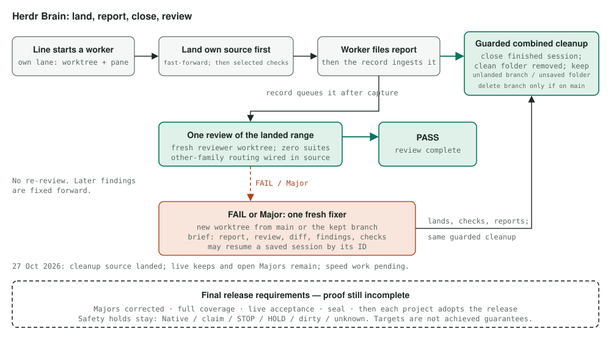

# How work moves through Herdr Brain: land, report, close, review

Status: landing snapshot, 27 October 2026, 20:1x CDT. This page describes the adopted lifecycle and the limits of the available live evidence. Source on main is not a stable release or proof that every finished lane closes promptly. See [Status and evidence](#status-and-evidence).

## The adopted rule

> When a worker report is in, close its session and remove its worktree folder in the same step; delete its branch only if it is already on main, otherwise keep the branch so a fix can continue from it, and keep the folder only if it has unsaved changes. Reviews and fixes start fresh from the record and may resume a saved session by its ID; nothing stays open waiting.

This is the intended ordinary flow, subject to the safety checks below. “In the same step” means one guarded closeout operation. It does not promise immediate report ingestion, a successful close in every line pass, or removal despite an unknown native outcome.

## Step by step

1. **The line starts a worker in its own lane.** A lane combines a Git worktree with a Herdr allocation. One writer owns it. Dispatch validates the required brief and the actual project, native session and run claim before delivering work. A display name alone grants no authority.
2. **The worker lands its own finished source first.** Under the current operator waiver, the worker commits clean work, rebases onto moved main in its lane, captures the full resulting head, and calls `lane promote TOPIC --expected-head FULL_SHA`. Promotion checks current ownership, source, clean Git state and main's expected value before a local fast-forward. It preserves STOP/HOLD and recovery safeguards. **Selected affected checks follow landing, before the report**; they are not a pre-main readiness gate. Failed and unrun controls remain explicit. This is no permission to push or release.
3. **The record receives the report.** Writing a report file and ingesting it are separate events. The direct cleanup path covers ingested `done`, `blocked`, `needs_human` and `failed` reports, including already-ingested backlog without a cleanup cutoff. Explicit abandonment is a separate event and recovery path, not a report outcome. An exit or an idle pane alone is not an ingested report or completion proof.
4. **The closer attempts session and folder cleanup together.** It checks the bound allocation is finished and has no competing active run. It preserves the ask, report, immutable source range and diff, check evidence, failed/unrun artifact locations and native/profile context before removing the folder. A successful operation closes the session and removes the clean folder. It deletes a main-ancestor branch; otherwise it retains that exact branch so a fresh fixer can continue from it. Unsaved or untracked work keeps its folder, with a recorded reason; a finished session may still close. Changed ownership, native identity, protected slots, live references, STOP/HOLD, missing preservation proof and uncertain or refused effects can keep the operation pending. The record says what closed or stayed and why. Old saved requests retain their compatibility rules.
5. **The existing record queue creates one asynchronous review.** The line captures the landed range and producer evidence and dispatches an ordinary reviewer item. Report/landing discovery feeds this path; a Git commit does not directly launch a reviewer. The reviewer starts fresh **in its own worktree**, reads the immutable diff and evidence, and runs zero test, build, install, prepare or probe suites. New queue reviews currently request the other model family using the producer's declared route/profile. The implementation applies this to all new queue reviews, broader than the adopted emphasis on judgment-heavy work. An existing or uncertain attempt is retained, never replaced by a parallel review. The cap is one; the roughly 30-minute target is advisory.
6. **Findings get one formal correction.** A passing verdict completes that review obligation; it is not test or release proof. Linked findings can create a fresh correction item. Its brief includes the author and review reports, immutable diff, findings, failed/unrun evidence and each Major's specific correction check. A fresh fixer uses the exact kept unlanded branch when present, otherwise current main; dirty saved author work must be resolved rather than silently bypassed. Explicit saved-session resume by ID uses the configured `ai` wrapper and a fresh guarded allocation. It does not mean keeping a live author pane open. The fixer lands, checks and reports in the same order. There is one formal correction, no automatic re-review chain; later findings fix forward. Majors need actual correction evidence before release.
7. **The release coordinator qualifies the final release.** Full final-source coverage, actual live acceptance and corrected Majors precede sealing and project activation. Earlier selected checks are not this full obligation. Each project's adoption has its own authority and native checks. Phase 2's automatic main-health revert is future work; current failures are fixed forward.

## Safety boundaries

The closer checks Herdr's native state and process/allocation evidence: a working agent is kept. Idle or done means ready for input, so it still needs the report and ownership checks. Unlanded commits retain their exact branch and recoverable archive; unsaved bytes retain their folder. Native identity, claim generation, real Git common directory and worktree, expected head, source ownership and single-effect ownership remain checked at mutations.

An unknown attempt blocks its own subject, not unrelated work. Elapsed time proves neither absence nor completion. A native refusal stops that effect; it is not permission to retry through another executor or identity. The adopted rule removes retention merely for a possible future fix, but does not erase these boundaries. Outcomes and preservation evidence live in the append-only record, rather than depending on an open conversation.

## Why change the old flow?

These are retained producer observations, **not a new census or a controlled comparison of the new implementation**:

| Dated observation | Reported result and limit |
|---|---|
| Closeout mechanics comparison, 27 Oct 2026, 17:1x CDT; source pinned at `c9845bd8`; Claude's 56 removed lanes | Report-to-removal median 39 minutes, p90 188 minutes. The old path split session retirement and folder removal across passes. This is a historical sample, not a current latency guarantee. |
| Review-cycle comparison, 27 Oct 2026, 17:3x CDT; Claude's 17:26 pane snapshot | Of 47 finished lane panes, 20 were held for possible reuse. Reused fix rounds reported done in 2 of 7 cases, fresh rounds in 38 of 56. Small, differently selected tasks do not establish causation or independent quality. |
| Same review-cycle comparison; separate retained analyses | Codex counted 55 PASS / 27 FAIL; Claude counted 53 of 82 reviews without findings. Their definitions differ; neither is a present-day pass rate. |

We track landing-to-review, review-to-verdict, findings, correction delay and tokens per useful landed change without inventing replacement numbers.

The live retention targets remain **fewer than five finished sessions older than two hours, sustained for two hours without hand-closing**, and **zero clean landed worktrees left after two passes**. They are targets, not achieved results.

## Status and evidence

As this documentation lands on 27 October 2026:

- **Direct cleanup source is landed.** Producer R-1009 records range `51d2171bc5d7931e7f9a6dc158b5c33965026c60..4d9d2adf3213fb3a8de7649670ef9e948ea3de3a`, accepted in the record at 19:11 CDT. Its retained focused results are 7 passing controls on the initial source, one failing fallback control, then 3 passing affected correction controls on the final head. These are different source-bound selections, not a full suite on the final head.
- **A source service was loaded, with limited live evidence.** The designated supervisor's restart/readback records a running source service at 19:16 CDT. It does not prove the first complete pass or the retention target. The 19:42 CDT passive clock packet records completed and held cleanup operations, including native-refusal, callback, dirty-work and unknown-identity keeps. There is no unconditional “nothing waits” result.
- **Other-family routing is wired in source.** R-1009 and the committed project configuration establish the new policy. The designated BCH owner supplied a positive for its original worker/claim on checked source, accepted at 18:40 CDT. That bounded consumer result is not proof of general BCH adoption, cleanup, stable activation or live release acceptance. Each project's configured routes and activation remain distinct facts.
- **Speed work is pending.** ENG-703 is active to reuse a record observation and close independent lanes concurrently while retaining fresh effect guards. The 19:42 CDT packet contains individual successful physical operations around 58–76 seconds. These are wall clocks including safety work, not a CPU diagnosis or an after-fix benchmark. No speed improvement is claimed here.
- **Release qualification is incomplete.** The coordinator's early full run over a captured 267-file inventory has real failures and unrun residual coverage. The latest supplied independent direct-cleanup review, REV-65/R-1022 at 20:02 CDT, reports Majors, including review-rerun source binding and repeated abandoned-run recovery. Those findings need owned correction evidence. No complete full-test, stable-release, retention-target or project-activation claim follows from this page.
- **Event-driven cleanup is a next-stage design.** A message-bus consumer acting on reports and exits is intended future work, not evidence that polling has already disappeared. Automatic main-health revert likewise remains Phase 2 work.

The dated producer facts above are accepted once within their stated scope; this documentation does not rerun their tests or audit their native bindings. The accompanying report retains their exact evidence locators. This public-facing page supplies the relevant observations in full enough form to stand alone, without requiring a private record or personal filesystem link.

## Committed implementation references

- [Worker policy](../AGENTS.md), [lane promotion and checks](../lanes/lane.mjs), and [promotion ownership guard](../promote/guard.mjs).
- [Direct report closeout contract](contracts/CLOSEOUT.md), [target derivation](../lib/closeout.mjs), [guarded executor](../lib/closeout-executor.mjs), and [retirement policy](../lib/retire.mjs).
- [Preserved author packet and correction source](../lib/report-closeout.mjs), [recovery triggers](../lib/closeout-recovery.mjs), and [line report/review/dispatch integration](../line-service/line-service.mjs).
- [Record review queue and routing](../line-service/review-queue.mjs), [finding intake](../line-service/review-findings.mjs), [project route configuration](../.lane.json), and [one-review policy](../settle/README.md).
- [Release procedure](../herdr/README.md) and [Phase 1/Phase 2 boundary](../line-service/README.md).

These relative references describe the committed implementation; the dated observations above describe the narrower available live proof. This documentation grants no publishing, release or adoption authority.
